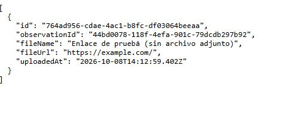
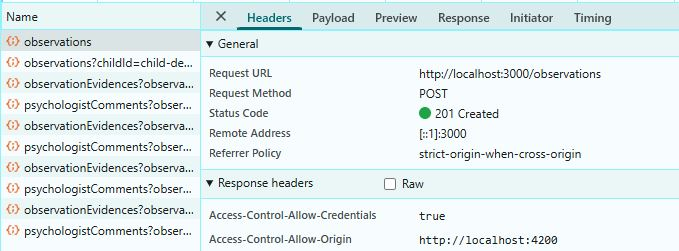
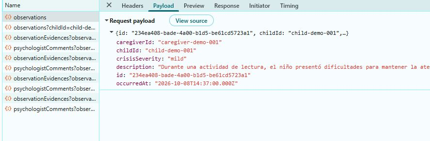

## Capítulo V: Product Implementation, Validation & Deployment

Las figuras del Sprint 1 y las capturas de Firebase se conservan en el [informe compartido](https://docs.google.com/document/d/1qst6_CSdXPCVaFQmo39zyPHU77tthbANZJvN1qQV5Ag/edit).
### 5.1. Software Configuration Management

En esta sección se describen las herramientas, convenciones y procedimientos utilizados por el equipo de NeuroSync para gestionar el desarrollo e implementación de Kinemo. Se documentan los entornos de trabajo empleados para diseño, desarrollo, control de versiones, documentación y despliegue, buscando mantener una forma de trabajo uniforme entre todos los integrantes del equipo.

Asimismo, se establecen las convenciones para la gestión del código fuente, los estándares de desarrollo y la configuración prevista para el despliegue de los diferentes productos que conforman la solución: Landing Page, Web Application y RESTful Web Services.

#### 5.1.1. Software Development Environment Configuration

Project Management

Para la gestión y organización de las actividades del proyecto se emplea GitHub como plataforma principal de colaboración. Mediante los repositorios de la organización del equipo se realiza el seguimiento de los cambios efectuados en los productos de software y se mantiene la trazabilidad de las contribuciones realizadas por cada integrante durante los sprints.

Adicionalmente, las tareas del Sprint son organizadas mediante un tablero de trabajo que permite identificar las actividades pendientes, en progreso y completadas.

Software Development

Para el desarrollo de la Landing Page de Kinemo se utilizan HTML5, CSS3 y JavaScript, tecnologías adecuadas para implementar un sitio web estático, responsive y accesible.

La Web Application se plantea como una Single-Page Application desarrollada utilizando Angular y TypeScript, mientras que los RESTful Web Services serán implementados posteriormente mediante Spring Boot y Java.

Software Documentation

Para la documentación de los RESTful Web Services se utilizará OpenAPI/Swagger, permitiendo documentar y probar de manera interactiva los endpoints desarrollados durante los siguientes sprints.

Para los diagramas de arquitectura se utilizan herramientas como Structurizr y Miro, mientras que los diagramas de flujo y determinados artefactos visuales se desarrollan mediante Lucidchart.

Software Deployment

Para el despliegue inicial de la Landing Page se utilizará GitHub Pages, debido a que permite publicar directamente sitios web estáticos almacenados en repositorios GitHub.

El despliegue de la Web Application y de los RESTful Web Services será definido e implementado durante los siguientes sprints, conforme avance el desarrollo funcional de la plataforma.

Version Control

Para el almacenamiento y control de versiones del código fuente se utiliza Git, gestionado mediante GitHub, dentro de la organización del equipo:

Organización GitHub:

[https://github.com/orgs/Open-SourceHelper/repositories](https://github.com/orgs/Open-SourceHelper/repositories)

El equipo utilizará un flujo de trabajo basado en ramas para separar el código estable de las funcionalidades que se encuentren en desarrollo. Asimismo, los mensajes de commit seguirán el estándar Conventional Commits, buscando mantener una trazabilidad clara sobre la naturaleza de cada modificación.

#### 5.1.2. Source Code Management

El equipo NeuroSync utiliza GitHub como plataforma principal para el control de versiones y colaboración durante el desarrollo de Kinemo. Los distintos productos que conforman la solución se administran mediante repositorios pertenecientes a la organización:

GitHub Organization:

[https://github.com/orgs/Open-SourceHelper/repositories](https://github.com/orgs/Open-SourceHelper/repositories)

| Producto | Repositorio |
| --- | --- |
| Startup / Project Report | [Report](https://github.com/Open-SourceHelper/Report) |
| Landing Page | [Landing-Page](https://github.com/Open-SourceHelper/Landing-Page) |
| Frontend Web Application | [Frontend-Application](https://github.com/Open-SourceHelper/Frontend-Application) |
| RESTful Web Services | [Backend-Application](https://github.com/Open-SourceHelper/Backend-Application) |

Para la gestión del código fuente se adopta un flujo de trabajo basado en GitFlow, separando las diferentes etapas de desarrollo mediante ramas específicas:

main: rama estable destinada al código preparado para producción y despliegue.

develop: rama de integración en la cual se consolidan las funcionalidades terminadas antes de incorporarlas a producción.

feature/: ramas utilizadas para desarrollar funcionalidades específicas relacionadas con User Stories o tareas del Sprint.

Las ramas feature parten de develop y, una vez completado el trabajo, se integran nuevamente mediante Pull Requests.

Conventional Commits

Los mensajes de commit seguirán el estándar Conventional Commits utilizando principalmente los siguientes prefijos:

| Prefijo | Uso |
| --- | --- |
| feat: | Nueva funcionalidad |
| fix: | Corrección de error |
| docs: | Cambios de documentación |
| style: | Cambios visuales o de formato |
| refactor: | Reestructuración sin cambiar comportamiento |
| test: | Pruebas |
| chore: | Configuración y mantenimiento |

La captura evidencia la estructura de ramas utilizada durante el desarrollo, permitiendo distinguir el código estable y las ramas empleadas por los integrantes para implementar las funcionalidades asignadas.

#### 5.1.3. Source Code Style Guide & Conventions

Esta sección establece los estándares de codificación que serán utilizados durante el desarrollo de Kinemo con el objetivo de mantener consistencia, legibilidad y mantenibilidad en todo el proyecto. Las convenciones se aplicarán de acuerdo con las tecnologías empleadas en la Landing Page, Web Application y RESTful Web Services.

Principios generales

Todo el código y los identificadores se escribirán en inglés.

Se utilizarán nombres descriptivos.

Se evitará duplicar código.

Cada función y componente deberá mantener una responsabilidad claramente definida.

Se mantendrá una estructura uniforme entre archivos del mismo tipo.

La indentación será consistente en todo el proyecto.

Nomenclatura

| Elemento | Convención | Ejemplo |
| --- | --- | --- |
| Variables | camelCase | childProfile |
| Funciones | camelCase | getDailyRoutine() |
| Clases | PascalCase | ChildProfile |
| Interfaces | PascalCase | CareNetwork |
| Constantes | UPPER_SNAKE_CASE | API_URL |
| Archivos web | kebab-case | child-profile.component.ts |
| Clases CSS | kebab-case | routine-card |

HTML

Se utilizarán etiquetas semánticas de HTML5 como header, nav, main, section, article y footer. Las etiquetas se escribirán en minúsculas y se utilizará una indentación uniforme.

CSS

Las clases CSS utilizarán nombres descriptivos escritos en kebab-case. Se priorizará la reutilización de estilos y el uso de variables CSS para elementos recurrentes como colores, tipografías y espaciados.

JavaScript

Se utilizarán const y let, evitando var. Las funciones deberán mantener una responsabilidad concreta y utilizar nombres descriptivos relacionados con la acción realizada.

TypeScript / Angular

TypeScript utilizará tipado explícito siempre que sea posible, evitando el uso innecesario de any. En Angular se utilizarán componentes reutilizables, servicios para la lógica compartida y separación de responsabilidades por funcionalidades.

Java / Spring Boot

Para el backend, las clases utilizarán PascalCase y los métodos camelCase. La solución seguirá una estructura organizada en Controller, Application/Service, Domain y Repository, coherente con los Bounded Contexts definidos para Kinemo.

#### 5.1.4. Software Deployment Configuration

Esta sección describe la configuración utilizada para publicar los productos digitales de Kinemo. Para el primer Sprint, el despliegue se concentra en la Landing Page, desarrollada mediante HTML5, CSS3 y JavaScript.

Landing Page

| Elemento | Tecnología |
| --- | --- |
| Estructura | HTML5 |
| Estilos | CSS3 |
| Interactividad | JavaScript |
| Version Control | Git / GitHub |
| Hosting | GitHub Pages |

**Configuración de la versión actual.** La landing de HTML, CSS y JavaScript se publica mediante GitHub Pages desde la rama main y la raíz del repositorio. URL: https://open-sourcehelper.github.io/Landing-Page/. La landing enlaza a la demo Angular en https://frontend-application-1.onrender.com. El despliegue previo de Firebase se conserva como evidencia histórica del Sprint 2. El backend Spring Boot usa Java 21 y Maven; su perfil local usa H2 en memoria y expone OpenAPI en /v3/api-docs y Swagger UI en /swagger-ui/index.html. El README indica que los perfiles dev y prod requieren configuración de base de datos. La URL de la demo Angular no acredita un despliegue público del backend integrado.

### 5.2. Landing Page, Services & Applications Implementation

En esta sección se documenta el proceso de implementación de los productos digitales que conforman Kinemo. Para el primer avance del proyecto se registra el trabajo correspondiente al Sprint 1, concentrado principalmente en la implementación y despliegue de la Landing Page y en el establecimiento de las bases necesarias para el desarrollo de los productos posteriores.

#### 5.2.1 Sprint 1 (AV1)

El Sprint 1 constituye la primera iteración de implementación de Kinemo. Durante este periodo, el equipo transforma los primeros requerimientos y diseños del producto en una versión funcional de la Landing Page.

El alcance prioriza las funcionalidades públicas necesarias para comunicar la propuesta de valor de NeuroSync, explicar los beneficios de Kinemo a sus diferentes segmentos de usuario, presentar los planes disponibles y facilitar la transición desde la página pública hacia la futura Web Application.

##### 5.2.1.1. Sprint Planning 1

| Campo | Información |
| --- | --- |
| Sprint # | Sprint 1 |
| upDate | [fecha real de su reunión] |
| Time | [hora] |
| Location | Reunión virtual |
| Prepared By | [integrante responsable] |
| Attendees | Felipe Huamanchumo, Gabriel Vilchez, Fabricio Flores, Matthew Shinko Okuhama Diaz, Cristian Trigoso |

Sprint 0 Review Summary

Al tratarse del primer Sprint del proyecto, no existe una iteración de implementación anterior que deba ser revisada. El equipo parte de los requerimientos, User Stories, Product Backlog y artefactos de diseño desarrollados durante las etapas iniciales de análisis y diseño del producto.

Sprint 0 Retrospective Summary

Al no existir un Sprint anterior, no corresponde realizar una retrospectiva formal. Sin embargo, el equipo llevó a cabo coordinaciones iniciales para definir herramientas de colaboración, distribución de responsabilidades, organización del código fuente y criterios de desarrollo.

Sprint Goal

Implementar y desplegar la primera versión funcional y responsive de la Landing Page de Kinemo, permitiendo comunicar la propuesta de valor, los beneficios para cada segmento objetivo, las preguntas frecuentes, los planes de suscripción y el acceso hacia la Web Application.

| Campo | Valor |
| --- | --- |
| Sprint 1 Velocity | 13 Story Points |
| Sum of Story Points | 13 Story Points |

##### 5.2.1.2. Aspect Leaders and Collaborators

En esta sección se presenta la matriz de liderazgo y colaboración correspondiente al Sprint 1. Su propósito es identificar a los integrantes responsables de liderar cada aspecto del desarrollo y a aquellos que participaron como colaboradores.

Para este Sprint se consideran tres aspectos principales: Landing Page, UX/UI & Responsive Design y Git

| Team Member | GitHub Username | Landing Page | UX/UI & Responsive | GitHub & Deployment |
| --- | --- | --- | --- | --- |
| Huamanchumo Chicchon, Felipe Marcelo | Ferdwar | L/C | L/C | L/C |
| Vilchez Vite, Gabriel Alejandro | GZ-99 | L/C | L/C | L/C |
| Flores Chavez, Fabricio | Elmiau2341 | L/C | L/C | L/C |
| Shinko Okuhama Diaz, Matthew | okudiaz124 | L/C | L/C | L/C |
| Trigoso Garrido, Cristian Joseph | Crzzz30<br>] | L/C | L/C | L/C |

Hub & Deployment.

##### 5.2.1.3. Sprint Backlog 1

El Sprint Backlog 1 reúne las tareas necesarias para implementar las User Stories priorizadas para la primera versión de la Landing Page de Kinemo. El trabajo se concentra en presentar la propuesta de valor, los beneficios según el tipo de usuario, preguntas frecuentes, acceso hacia la aplicación web y los planes disponibles.

US01 – Visualización de propuesta de valor

| Task ID | Title | Description | Estimation | Assigned To | Status |
| --- | --- | --- | --- | --- | --- |
| T001 | Estructura base HTML | Crear la estructura semántica principal de la Landing Page. | 3h | [Asignado] | Done |
| T002 | Hero Section | Implementar el título, descripción y CTA principal de Kinemo. | 3h | [Asignado] | Done |
| T003 | Estilos del Hero | Aplicar tipografía, colores y distribución responsive. | 3h | [Asignado] | Done |

US02 – Beneficios por segmento

| Task ID | Title | Description | Estimation | Assigned To | Status |
| --- | --- | --- | --- | --- | --- |
| T004 | Cards de segmentos | Crear tarjetas para Padre/Tutor, Cuidador y Psicólogo. | 4h | [Asignado] | Done |
| T005 | Contenido por rol | Incorporar los beneficios específicos de cada segmento. | 3h | [Asignado] | Done |
| T006 | Diseño responsive | Adaptar las tarjetas para móvil, tablet y desktop. | 3h | [Asignado] | Done |

US03 – Preguntas frecuentes

| Task ID | Title | Description | Estimation | Assigned To | Status |
| --- | --- | --- | --- | --- | --- |
| T007 | Estructura FAQ | Crear el listado de preguntas y respuestas frecuentes. | 3h | [Asignado] | Done |
| T008 | Interacción del FAQ | Implementar expansión y colapso de las respuestas mediante JavaScript. | 3h | [Asignado] | Done |

US04 – Redirección a la aplicación web

| Task ID | Title | Description | Estimation | Assigned To | Status |
| --- | --- | --- | --- | --- | --- |
| T009 | CTA de acceso | Implementar botones para acceder o registrarse en Kinemo. | 2h | [Asignado] | Done |
| T010 | Configuración de enlaces | Configurar la redirección hacia la futura Web Application. | 2h | [Asignado] | Done |

US37 – Visualización de planes

| Task ID | Title | Description | Estimation | Assigned To | Status |
| --- | --- | --- | --- | --- | --- |
| T011 | Sección de planes | Implementar las tarjetas correspondientes a los planes Familiar y Profesional. | 4h | [Asignado] | Done |
| T012 | Estilos de planes | Aplicar la identidad visual de Kinemo a las tarjetas de precios. | 3h | [Asignado] | Done |
| T013 | Responsive de planes | Adaptar la sección de planes a diferentes tamaños de pantalla. | 2h | [Asignado] | Done |

Las historias seleccionadas para este Sprint corresponden a funcionalidades públicas de la Landing Page, incluyendo la propuesta de valor, los beneficios por segmento, FAQ, redirección hacia la aplicación y visualización de planes.

##### 5.2.1.4. Development Evidence for Sprint Review

Durante el Sprint 1, el equipo NeuroSync avanzó en la implementación de la primera versión funcional de la Landing Page de Kinemo, desarrollada mediante HTML5, CSS3 y JavaScript.

Los principales avances estuvieron relacionados con la implementación de la estructura principal de la página, la presentación de la propuesta de valor, los beneficios para los distintos segmentos objetivo, la sección de preguntas frecuentes, los planes de suscripción y la adaptación responsive para diferentes dispositivos.

Para mantener la trazabilidad del desarrollo, los cambios realizados fueron registrados mediante commits dentro del repositorio correspondiente.

| Repository | Branch | Commit ID | Commit Message | Committed On |
| --- | --- | --- | --- | --- |
| [Repositorio] | [Branch] | [SHA] | [Commit real] | [Fecha] |
| [Repositorio] | [Branch] | [SHA] | [Commit real] | [Fecha] |
| [Repositorio] | [Branch] | [SHA] | [Commit real] | [Fecha] |
| [Repositorio] | [Branch] | [SHA] | [Commit real] | [Fecha] |

Aquí se deben colocar los commits reales obtenidos desde GitHub, indicando repositorio, rama, identificador del commit, mensaje y fecha.

##### 5.2.1.5. Execution Evidence for Sprint Review

Las capturas de ejecución del Sprint 1 se conservan en la versión compartida del informe. Véanse las figuras de propuesta de valor, beneficios, preguntas frecuentes, planes y vista móvil bajo el mismo apartado.

Durante el Sprint 1 se implementó la primera versión navegable y responsive de la Landing Page de Kinemo.

La interfaz permite al visitante conocer la propuesta de valor del producto, identificar los beneficios disponibles para padres, cuidadores y psicólogos, comprender el funcionamiento general de la solución, consultar preguntas frecuentes y revisar las alternativas de suscripción disponibles.

La navegación se organiza mediante diferentes secciones dentro de una misma página, permitiendo al usuario desplazarse fácilmente hacia el contenido de interés. Asimismo, la interfaz fue adaptada para mantener una correcta visualización en dispositivos desktop, tablet y móvil.

A continuación se presentan las principales evidencias de ejecución de la Landing Page:

Evidencia 1: Hero Section
 La sección principal presenta la propuesta de valor de Kinemo y una llamada a la acción que permite al visitante conocer cómo funciona la solución.

Evidencia 2: Beneficios de la solución
 Esta sección muestra las principales herramientas que Kinemo ofrece para facilitar la continuidad del cuidado del niño.

Evidencia 3: Segmentos objetivo
 Esta sección presenta los beneficios de Kinemo para padres, familiares, cuidadores y psicólogos.

Evidencia 4: Funcionamiento de Kinemo
 La interfaz explica de forma sencilla cómo los usuarios pueden organizar y compartir información relacionada con el cuidado del niño.

Evidencia 5: Planes de suscripción
 La sección permite visualizar las alternativas de suscripción disponibles para los usuarios de Kinemo.

Evidencia 6: Preguntas frecuentes
 Esta sección permite resolver las dudas principales que puede tener un visitante antes de utilizar la plataforma.

Evidencia 7: Vista responsive móvil
 La Landing Page adapta su distribución y navegación a dispositivos móviles para garantizar una experiencia adecuada en diferentes tamaños de pantalla.

La navegación definida para la Landing Page contempla secciones como la solución, público objetivo, funcionamiento y preguntas frecuentes.

##### 5.2.1.6. Services Documentation Evidence for Sprint Review

Durante el Sprint 1, el alcance de implementación estuvo enfocado principalmente en el desarrollo y despliegue de la primera versión de la Landing Page de Kinemo.

En consecuencia, durante esta iteración todavía no se realizó la implementación de los RESTful Web Services ni de los endpoints correspondientes al backend de la solución.

Por este motivo, no existe documentación mediante OpenAPI/Swagger que deba ser presentada como evidencia en este Sprint.

La documentación de los servicios será incorporada durante los siguientes Sprints, cuando se inicie la implementación de la RESTful API utilizando Spring Boot y Java.

La arquitectura planteada para Kinemo considera una RESTful API desarrollada con Spring Boot y Java, la cual posteriormente expondrá las capacidades de los diferentes Bounded Contexts.

##### 5.2.1.7. Software Deployment Evidence for Sprint Review

Durante el Sprint 1, el equipo NeuroSync realizó el despliegue de la primera versión pública de la Landing Page de Kinemo utilizando GitHub Pages.

GitHub Pages permite publicar aplicaciones web estáticas directamente desde un repositorio GitHub, por lo que resulta adecuado para la Landing Page desarrollada con HTML5, CSS3 y JavaScript.

Plataforma de despliegue: GitHub Pages
 Repositorio:
 Branch: main
 URL de la Landing Page:

Para realizar el despliegue se siguió el siguiente procedimiento:

Se integró la versión estable de la Landing Page en la rama main.

Se ingresó a la sección Settings del repositorio.

Se seleccionó la opción Pages.

Se configuró la rama main como fuente del despliegue.

Se seleccionó la carpeta correspondiente a los archivos de la Landing Page.

GitHub Pages procesó los archivos y generó una URL pública.

Se verificó que la Landing Page pudiera visualizarse correctamente desde el navegador.

Evidencia del despliegue

La captura anterior muestra la configuración utilizada para publicar la Landing Page mediante GitHub Pages.

Evidencia de la aplicación desplegada

La captura muestra la versión pública de Kinemo funcionando correctamente desde la URL generada por GitHub Pages.

##### 5.2.1.8. Team Collaboration Insights during Sprint

Durante el Sprint 1, el equipo NeuroSync utilizó GitHub como plataforma central para la colaboración y el control de versiones durante la implementación de Kinemo.

Cada integrante realizó sus contribuciones mediante commits y ramas de trabajo, permitiendo mantener separadas las funcionalidades en desarrollo del código estable del producto.

La utilización de Git permitió mantener un historial de modificaciones e identificar qué cambios fueron realizados durante el Sprint. Asimismo, se establecieron convenciones de nombres para las ramas y mensajes de commits con el objetivo de mejorar la organización y trazabilidad del proyecto.

El flujo de colaboración utilizado contempla que las nuevas funcionalidades sean desarrolladas en ramas independientes y posteriormente integradas al código principal mediante revisión de los cambios.

Para los mensajes de commit se utilizan convenciones como:

feat: para nuevas funcionalidades.

fix: para correcciones.

docs: para documentación.

style: para modificaciones visuales o de formato.

refactor: para reorganización interna del código.

chore: para tareas de configuración o mantenimiento.

A continuación se presentan evidencias de la colaboración realizada durante el Sprint.

Organización GitHub

[https://github.com/orgs/Open-SourceHelper/repositories](https://github.com/orgs/Open-SourceHelper/repositories)

La captura muestra los repositorios utilizados por el equipo NeuroSync para administrar los diferentes componentes del proyecto.

Contributors

Esta evidencia permite identificar la participación de los integrantes mediante las contribuciones realizadas al repositorio.

Network Graph

El Network Graph permite visualizar las diferentes ramas utilizadas durante el desarrollo y la forma en que los cambios fueron integrados al proyecto.

Pull Requests

Los Pull Requests permiten revisar los cambios desarrollados antes de integrarlos a las ramas principales del proyecto, favoreciendo la colaboración y el control de calidad del código.

El trabajo de referencia también documenta esta sección mediante ramas independientes, Pull Requests y Conventional Commits para mantener la trazabilidad del trabajo realizado por el equipo.

#### 5.2.2 Sprint 2 (TB1)

##### 5.2.2.1 Sprint Planning 2

Durante el Sprint 2, el equipo NeuroSync continuó el desarrollo de Kinemo, una plataforma destinada a facilitar la continuidad del cuidado de niños con condiciones del neurodesarrollo.

El trabajo se concentró en la implementación de la aplicación web mediante Angular y TypeScript, el desarrollo de los ocho Bounded Contexts definidos en la arquitectura del producto y la integración progresiva de sus funcionalidades en el repositorio compartido.

Se empleó una arquitectura organizada en capas de dominio, aplicación, infraestructura y presentación. Para las pruebas iniciales de comunicación HTTP se utilizó una API REST simulada mediante JSON Server, permitiendo validar operaciones de consulta y registro de información antes de la integración con un backend definitivo.

Los avances se gestionaron mediante ramas de funcionalidades (feature branches), commits y procesos de integración en la rama develop.

| Sprint # | Sprint 2 |
| --- | --- |
| Sprint Planning Background | — |
| Date | Por confirmar: fecha real de la reunión del Sprint 2. |
| Time | Por confirmar: hora real de la reunión. |
| Location | Reunión virtual. |
| Prepared By | Por confirmar: integrante responsable de elaborar el Sprint Planning 2. |
| Attendees (to planning meeting) | Felipe Huamanchumo / Gabriel Vilchez / Fabricio Flores / Matthew Shinko Okuhama Diaz / Cristian Trigoso. |
| Sprint 1 Review Summary | Durante el Sprint 1, el equipo NeuroSync desarrolló la primera versión funcional de la Landing Page de Kinemo utilizando HTML, CSS y JavaScript. Se implementaron secciones orientadas a presentar la propuesta de valor, los beneficios para los segmentos objetivo, los planes de suscripción y las preguntas frecuentes. Asimismo, se establecieron las bases de organización del proyecto y el control de versiones mediante GitHub. |
| Sprint 1 Retrospective Summary | Como resultado del primer Sprint, se identificaron oportunidades de mejora relacionadas con la coordinación entre integrantes, la distribución de responsabilidades y la integración del trabajo en el repositorio. Para el Sprint 2, se propuso fortalecer la comunicación del equipo, mantener convenciones de desarrollo y organizar la implementación mediante ramas independientes por funcionalidad. |
| Sprint Goal & User Stories | — |
| Sprint 2 Goal | Implementar las funcionalidades principales del frontend de Kinemo mediante Angular y TypeScript, organizando el desarrollo en los ocho Bounded Contexts definidos para el producto. Se busca integrar progresivamente los módulos en la rama develop, mantener una arquitectura por capas y comprobar las operaciones principales mediante una API REST simulada con JSON Server. Como criterio de cumplimiento, se considerará la implementación e integración de las funcionalidades priorizadas en el Sprint Backlog 2. |
| Sprint 2 Velocity | Por definir según la suma de Story Points de las User Stories comprometidas en el Sprint Backlog 2. |

Objetivo del Sprint

Implementar e integrar una primera versión funcional de los principales módulos de la aplicación web Kinemo, estableciendo las bases para la interacción de padres, cuidadores y psicólogos mediante los Bounded Contexts definidos en el diseño del sistema.

Alcance del Sprint

El alcance de trabajo se organizó alrededor de los siguientes Bounded Contexts:

| Bounded Context | Responsabilidad funcional |
| --- | --- |
| BC01 — Identity & Access Management | Registro de usuarios, inicio de sesión y gestión de perfiles. |
| BC02 — Child Profile Management | Registro y administración de perfiles de niños e información clínica. |
| BC03 — Care Network Management | Gestión de redes de cuidado, miembros e invitaciones. |
| BC04 — Routine & Activity Management | Organización de rutinas y actividades. |
| BC05 — Clinical Guidance Management | Administración de pautas clínicas y orientaciones profesionales. |

Estrategia de desarrollo

Para distribuir el trabajo, los módulos fueron implementados en ramas independientes. Esta organización permitió avanzar en distintos componentes de manera paralela, reduciendo las modificaciones simultáneas sobre el código compartido.

Cada módulo utilizó las convenciones de Angular y TypeScript, incorporando componentes de presentación, entidades de dominio y servicios de infraestructura según las necesidades de sus funcionalidades.

La integración del código se realizó progresivamente hacia develop, donde se resolvieron conflictos de archivos compartidos y se consolidaron las rutas de navegación.

Criterios de verificación del Sprint

Se consideraron como criterios técnicos de revisión:

Incorporación del código correspondiente a los Bounded Contexts desarrollados.

Registro de las rutas necesarias para acceder a las funcionalidades implementadas.

Integración de servicios y componentes de la aplicación web.

Verificación de la compilación del proyecto Angular.

Realización de pruebas funcionales y HTTP de las funcionalidades disponibles.

Registro de evidencia técnica y de colaboración en GitHub.

Información de planificación por completar: fecha formal de inicio y cierre del Sprint, duración acordada, capacidad de trabajo del equipo y registro de la reunión de Sprint Planning.

##### 5.2.2.2 Aspect Leaders and Collaborators

La implementación de Kinemo durante el Sprint 2 requirió coordinación entre los integrantes de NeuroSync, especialmente para desarrollar módulos independientes y posteriormente consolidarlos en una aplicación compartida.

Las responsabilidades técnicas incluyeron el desarrollo de componentes Angular, implementación de modelos de dominio, configuración de servicios, mantenimiento del repositorio e integración de funcionalidades.

Participación verificable en GitHub

| Integrante | Evidencia de participación |
| --- | --- |
| Felipe Huamanchumo | Commits relacionados con Dashboard & Reporting, integración de rutas y módulos en develop. |
| Fabricio Flores | Commits relacionados con Routine & Activity Management, Subscription & Payment Management y configuración de servicios. |
| Matthew Shinko Okuhama Diaz | Implementación e integración de Observation & Crisis Management (BC06). |
| Gabriel Vilchez | Participación en el repositorio compartido, con cambios registrados bajo el usuario GZ-99. La asignación específica de su trabajo en el Sprint 2 debe confirmarse. |
| Cristian Trigoso | Participación en la implementación e integración registrada con el usuario Crzzz30. La distribución formal de responsabilidades debe confirmarse. |

Colaboración durante el Sprint

La estrategia de integración permitió conservar los avances de diferentes desarrolladores. Los conflictos surgidos sobre archivos compartidos, como app.routes.ts, layout.ts y db.json, requirieron combinar las implementaciones para mantener las rutas, componentes y datos de los módulos involucrados.

De esta manera, el equipo avanzó desde implementaciones separadas hacia una aplicación con múltiples Bounded Contexts incorporados.

Pendiente de validación: confirmar con el equipo la designación formal de Aspect Leaders, así como los responsables de cada aspecto de desarrollo. Los commits permiten identificar contribuciones técnicas, pero no sustituyen las asignaciones acordadas durante la planificación.

##### 5.2.2.3 Sprint Backlog 2

El Sprint Backlog 2 reúne los trabajos identificables en los repositorios de la aplicación web, organizados según los módulos implementados y las actividades de integración realizadas.

| ID | Actividad | Evidencia técnica | Estado |
| --- | --- | --- | --- |
| SB2-01 | Implementación de Identity & Access Management | Código del módulo identity-access y rutas de autenticación. | Integrado en código |
| SB2-02 | Implementación de Child Profile Management | Módulo child-profile y sus componentes de presentación. | Integrado en código |
| SB2-03 | Implementación de Care Network Management | Módulo care-network-management y rutas de redes de cuidado. | Integrado en código |
| SB2-04 | Implementación de Routine & Activity Management | Módulo routine-activity y configuración de rutas. | Integrado en código |
| SB2-05 | Implementación de Clinical Guidance Management | Módulo clinical-guidance. | Integrado en código |
| SB2-06 | Implementación de Observation & Crisis Management | Módulo observation-crisis, servicios y componentes. | Integrado y probado localmente |
| SB2-07 | Implementación de Dashboard & Reporting | Módulo dashboard-reporting y rutas correspondientes. | Integrado en código |
| SB2-08 | Implementación de Subscription & Payment Management | Módulo subscription-payment, componentes y rutas. | Integrado en código |
| SB2-09 | Integración de funcionalidades en develop | Commits de integración de Bounded Contexts. | Realizado |
| SB2-10 | Configuración de comunicación con servicios | Servicios HTTP, variables de entorno y JSON Server. | Configuración implementada |
| SB2-11 | Verificación de compilación | Comando npm run build. | Verificado para la integración BC02–BC06 |
| SB2-12 | Documentación de evidencias del Sprint | Capturas, descripciones y registros en el repositorio Report. | En elaboración |

Los estados indicados representan avances comprobados en el código y no implican que todos los criterios de aceptación de las User Stories hayan superado pruebas funcionales completas.

El backlog deberá complementarse con los identificadores originales de las User Stories, sus estimaciones y responsables, según lo acordado por el equipo.

##### 5.2.2.4 Development Evidence for Sprint Review

Durante el Sprint 2 se implementaron diferentes módulos de la aplicación web, siguiendo una organización modular que separa las responsabilidades funcionales de cada Bounded Context.

La estructura del repositorio evidencia la implementación de los siguientes directorios principales:

src/app/

├── identity-access/

├── child-profile/

├── care-network-management/

├── routine-activity/

├── clinical-guidance/

├── observation-crisis/

├── dashboard-reporting/

├── subscription-payment/

└── shared/

Evidencia 1. Organización del código fuente

La estructura de carpetas demuestra la separación de responsabilidades entre los ocho Bounded Contexts de Kinemo. Esta organización facilita el desarrollo, mantenimiento e integración progresiva del sistema.

Figura pendiente de incorporación: estructura de carpetas de la aplicación Angular.

Evidencia 2. Arquitectura y componentes implementados

Los módulos contienen modelos de dominio y, según su alcance, servicios, stores, recursos y componentes de presentación. Esta organización permite separar la interfaz de usuario de las responsabilidades de aplicación e infraestructura.

Figura pendiente de incorporación: ejemplo de la estructura interna de un Bounded Context.

Evidencia 3. Integración de rutas de la aplicación

El archivo src/app/app.routes.ts registra rutas correspondientes a los diferentes Bounded Contexts, incluyendo autenticación, perfiles de niños, redes de cuidado, rutinas, pautas clínicas, observaciones, dashboard y suscripciones.

Figura pendiente de incorporación: configuración de rutas de Kinemo.

Evidencia 4. Integración de ramas de desarrollo

El historial de commits muestra los procesos de incorporación de funcionalidades en develop, incluyendo las integraciones de Observation & Crisis Management, Routine & Activity Management, Clinical Guidance Management y otros módulos.

Figura pendiente de incorporación: historial de commits de develop.

Repositorio de referencia:
[https://github.com/Open-SourceHelper/Frontend-Application/tree/develop](https://github.com/Open-SourceHelper/Frontend-Application/tree/develop)

##### 5.2.2.5 Execution Evidence for Sprint Review

Las evidencias de ejecución tienen como objetivo demostrar el comportamiento de las funcionalidades implementadas desde la interfaz de usuario y los servicios utilizados.

Durante el Sprint 2 se realizaron verificaciones locales sobre la aplicación Angular, comprobando su ejecución y el acceso a diferentes módulos desde la navegación compartida.

Evidencia 1. Ejecución de la aplicación Kinemo

La aplicación web se ejecuta mediante el servidor de desarrollo de Angular. La interfaz permite acceder a las funcionalidades registradas en el sistema de rutas.

Figura pendiente de incorporación: pantalla principal de Kinemo ejecutándose localmente.

Evidencia 2. Gestión de perfiles de niños

El módulo Child Profile Management contempla la consulta y gestión de información relacionada con el perfil del niño y sus datos clínicos.

Figura pendiente de incorporación: ejecución del módulo Child Profile Management.

Evidencia 3. Gestión de observaciones y crisis

El módulo Observation & Crisis Management permite consultar el historial de observaciones, registrar nuevos eventos y clasificar episodios de crisis de acuerdo con su intensidad.

Figura pendiente de incorporación: historial de observaciones y crisis.

Evidencia 4. Registro de observaciones

La interfaz de registro permite ingresar una descripción, fecha de ocurrencia y nivel de crisis. Los datos son procesados por los servicios de aplicación y enviados a la API REST simulada.

Figura pendiente de incorporación: formulario de registro de observaciones.

Evidencia 5. Ejecución de otros módulos

La revisión del Sprint debe incluir capturas de las funcionalidades disponibles correspondientes a Care Network Management, Routine & Activity Management, Clinical Guidance Management, Dashboard & Reporting y Subscription & Payment Management.

Estas capturas deberán ser obtenidas mediante la ejecución de cada módulo, verificando que la interfaz funcione según las User Stories correspondientes.

Resultado de la ejecución

Se comprobó previamente la compilación de la aplicación Angular durante la integración de Observation & Crisis Management con Child Profile Management. Asimismo, se verificó la visualización de los módulos desde el menú de navegación.

La presencia de un módulo en el repositorio o en el menú no demuestra por sí sola que todas sus operaciones hayan sido probadas exitosamente. Por ello, se recomienda que el equipo complete las evidencias funcionales de cada Bounded Context.

##### 5.2.2.6 Services Documentation Evidence for Sprint Review

En el Sprint 2, el BC06 — Observation & Crisis Management consumió una API REST simulada con JSON Server. La URL local era http://localhost:3000. Angular utilizó datos ficticios y las colecciones se almacenaron en db.json. Esta evidencia corresponde al prototipo del Sprint 2.

- GET /observations: consulta el historial de observaciones. Respuesta esperada: 200 y arreglo JSON.
- POST /observations: registra una observación con childId, caregiverId, description, occurredAt y crisisSeverity. Respuesta esperada: 201 y objeto creado.
- GET /psychologistComments: consulta comentarios. GET /observationEvidences: consulta registros que referencian enlaces de evidencia. Ambas colecciones relacionan sus elementos con la observación mediante observationId.

Ejemplo de un elemento de GET /observations, tomado de los datos de demostración:
```json
{"id":"obs-001","childId":"child-demo-001","caregiverId":"caregiver-demo-001","description":"Completó su rutina de la mañana con apoyo visual.","occurredAt":"2026-10-08T08:00:00-05:00","crisisSeverity":null}
```

Datos de demostración: https://github.com/Open-SourceHelper/Frontend-Application/blob/f0d7f11/db.json
Evidencias archivadas por el equipo:

1. Consulta de evidencias de observación (GET).



2. Registro de observación (POST).



3. Cuerpo de la solicitud.



##### 5.2.2.7 Software Deployment Evidence for Sprint Review

Las dos capturas originales de publicación en Firebase se conservan bajo este apartado en el informe compartido.

Durante el Sprint 2, el equipo NeuroSync realizó el despliegue de la aplicación web Kinemo utilizando Firebase Hosting, un servicio de alojamiento de aplicaciones web proporcionado por Google Firebase.

La aplicación fue desarrollada mediante Angular y TypeScript. Para su publicación, se utilizó la versión compilada del frontend, ubicada en el directorio dist/frontend-application-OP/browser.

El proceso de despliegue permitió transferir los archivos generados hacia Firebase Hosting y publicar una nueva versión de la aplicación.

Información del despliegue:

Plataforma: Firebase Hosting.

Proyecto: kinemo-neurosync.

Repositorio: [https://github.com/Open-SourceHelper/Frontend-Application](https://github.com/Open-SourceHelper/Frontend-Application)

Directorio de distribución: dist/frontend-application-OP/browser

Archivos procesados: 44.

URL pública: [https://kinemo-neurosync.web.app/](https://kinemo-neurosync.web.app/)

Evidencia 1. Proceso de despliegue en Firebase Hosting

Figura del documento compartido. Proceso de despliegue de la aplicación Angular de Kinemo en Firebase Hosting.

La captura evidencia las etapas de publicación, incluyendo la detección de 44 archivos, la transferencia de archivos, la finalización de la versión y su liberación mediante Firebase Hosting. El mensaje release complete confirma que la plataforma completó el proceso de publicación.

Evidencia 2. Confirmación del despliegue

Figura del documento compartido. Confirmación del despliegue exitoso de Kinemo.

La segunda captura muestra el mensaje Deploy complete!, junto con la dirección pública de la aplicación. Esto confirma que Firebase Hosting completó el despliegue y proporcionó una URL para acceder a la versión publicada.

Resultado del despliegue

El despliegue representa un avance importante del Sprint 2, al permitir que la aplicación Angular se encuentre alojada en una plataforma de hosting, sin depender exclusivamente de un servidor de desarrollo local.

Sin embargo, la confirmación del despliegue no demuestra por sí sola que todas las funcionalidades y servicios REST estén operativos en producción. Por ello, corresponde complementar estas evidencias con pruebas de navegación y funcionamiento desde la URL pública.

##### 5.2.2.8 Team Collaboration Insights during Sprint

La colaboración del equipo NeuroSync durante el Sprint 2 se desarrolló principalmente mediante GitHub, utilizando ramas independientes para implementar funcionalidades y una rama compartida para consolidar los avances.

Organización del repositorio

El repositorio Frontend-Application contiene ramas asociadas a los distintos Bounded Contexts del sistema.

Entre ellas se identifican:

feature/identity-access-management

feature/Child-Profile-Management

feature/bc03-Care-Network

feature/bc04-routine-activity-management

feature/clinical-guidance-management

feature/observation-crisis-management

feature/bc07-dashboard-reporting

feature/bc08-subscription-payment-management

Proceso de integración

El historial de GitHub evidencia integraciones realizadas sobre develop.

Entre los registros identificables se encuentran:

| Commit | Descripción |
| --- | --- |
| 3e3ac3e | Integración de Observation & Crisis Management en develop. |
| 899fdf44 | Integración de Routine & Activity Management. |
| 0171212d | Integración de Subscription & Payment Management. |
| 1878d899 | Integración de Identity & Access Management. |
| 957515c9 | Integración de Clinical Guidance Management. |
| f56afa6a | Integración de Care Network Management. |
| dbb9e012 | Integración de Dashboard & Reporting. |

También se registraron commits posteriores destinados a corregir y ajustar la configuración compartida de la aplicación.

Gestión de conflictos

Durante el proceso de integración se identificaron conflictos derivados de modificaciones simultáneas en archivos compartidos.

Los archivos que requirieron especial atención en la integración del BC06 fueron:

db.json, por la incorporación de colecciones de distintos Bounded Contexts.

src/app/app.routes.ts, por el registro de rutas de navegación.

src/app/shared/presentation/components/layout/layout.ts, por las opciones del menú lateral.

Estos conflictos fueron resueltos conservando las funcionalidades involucradas, y el resultado se incorporó a develop.

Evidencias de colaboración

Figura pendiente de incorporación: historial de commits de los colaboradores.

Figura pendiente de incorporación: ramas utilizadas durante el Sprint 2.

Análisis de colaboración

El uso de ramas de funcionalidades facilitó la distribución de tareas y permitió desarrollar diferentes componentes de Kinemo en paralelo.

La integración progresiva también evidenció la necesidad de coordinar los cambios sobre archivos compartidos, especialmente aquellos relacionados con navegación, configuración global y datos de demostración.

Como oportunidad de mejora, se identifica la conveniencia de establecer convenciones comunes para integrar rutas, mantener datos de prueba y ejecutar verificaciones automáticas antes de consolidar los cambios en develop.

La evaluación cuantitativa de las contribuciones, como número de commits por integrante o distribución de cambios, deberá complementarse con las capturas de GitHub Insights correspondientes.

#### 5.2.3 Sprint 3 (AV2)

##### 5.2.3.1 Sprint Planning 3

El objetivo técnico documentado para este avance es conectar la aplicación Angular con los servicios Java y presentar una demostración pública con datos ficticios. El registro de la reunión, la capacidad y las estimaciones requieren contraste con el tablero o acta del equipo.

##### 5.2.3.2 Aspect Leaders and Collaborators

Se distinguen cuatro aspectos: integración de servicios REST, interfaz y entrada a la demo, actualización de la landing, y despliegue y documentación. Los historiales de cada repositorio identifican las contribuciones técnicas. Confirmar la asignación formal de líderes y colaboradores con el equipo.

##### 5.2.3.3 Sprint Backlog 3

- Integrar perfiles infantiles y red de cuidado, alertas de crisis, orientaciones clínicas y rutinas e historial de episodios. Evidencia: [backend integrado](https://github.com/Open-SourceHelper/Backend-Application/commit/c261f4032f4c724c9667ae04cbbf2eba87137e5c).
- Incorporar acceso a la demo Angular y episodios ficticios. Evidencia: [acceso a demo](https://github.com/Open-SourceHelper/Frontend-Application/commit/6967e209f5565f569291507611f8d20f9f023d43) e [historial de demostración](https://github.com/Open-SourceHelper/Frontend-Application/commit/8b43494afa9cef11595dcc62e852f5549e41053d).
- Actualizar la landing con accesos a la demo según el segmento. Evidencia: [rediseño](https://github.com/Open-SourceHelper/Landing-Page/commit/06d049f995bdbab3de294a570cab5a6d92e0ce14).
- Publicar la nueva landing. Evidencia: [ejecución de GitHub Pages](https://github.com/Open-SourceHelper/Landing-Page/actions/runs/43684776984).

Los puntos describen entregables rastreables por código; la identificación de User Stories y sus estimaciones se completa con el backlog original del equipo.

##### 5.2.3.4 Development Evidence for Sprint Review

La landing actualiza la portada y el mensaje de coordinación del cuidado. Incluye una vista previa del historial de episodios con datos ficticios y enlaces para familias, cuidadores y profesionales. Los cambios abarcan index.html, styles.css, translations.js y la imagen historial-kinemo.png. [Ver cambios](https://github.com/Open-SourceHelper/Landing-Page/commit/06d049f995bdbab3de294a570cab5a6d92e0ce14).

En Angular se incorporó acceso a la demo pública y una vista con episodios ficticios; también se documenta el selector persistente ES/EN en el [commit de navegación](https://github.com/Open-SourceHelper/Frontend-Application/commit/be1b86f40072d85322279b5260b2ebc71bbeac4c). En Java, la versión integrada contiene controladores para perfiles y red de cuidado, alertas, rutinas, pautas clínicas e historial. [Código del backend](https://github.com/Open-SourceHelper/Backend-Application/commit/c261f4032f4c724c9667ae04cbbf2eba87137e5c).

##### 5.2.3.5 Execution Evidence for Sprint Review

[Vista previa del historial incluida en la landing](https://github.com/Open-SourceHelper/Landing-Page/blob/06d049f995bdbab3de294a570cab5a6d92e0ce14/historial-kinemo.png). Esta imagen muestra datos ficticios; es un recurso de la landing. La prueba de ejecución debe abrir la página publicada en escritorio y móvil, seguir «Probar Kinemo», entrar a la demo y comprobar el historial sin editar datos. Adjuntar las capturas de ese recorrido y el resultado de cada paso; el recurso visual no sustituye una prueba del sitio en vivo.

##### 5.2.3.6 Services Documentation Evidence for Sprint Review

La API Java documenta los servicios en [el README del backend](https://github.com/Open-SourceHelper/Backend-Application/blob/main/README.md). Con el perfil local levantado, el contrato OpenAPI se consulta en http://localhost:8080/v3/api-docs y Swagger UI en http://localhost:8080/swagger-ui/index.html.

- BC02: GET/POST /api/v1/children para consultar y registrar perfiles.
- BC03: GET/POST /api/v1/crisis-alerts para consultar y registrar alertas; las transiciones se gestionan con rutas de atención y cierre.
- BC04: /api/v1/routines, /api/v1/clinical-guidelines y /api/v1/practical-guides para rutinas, pautas y guías.
- BC05 en el backend: GET/POST /api/v1/children/{childId}/episodes para consultar y registrar episodios; POST /api/v1/children/{childId}/episodes/{id}/comments y PUT /api/v1/children/{childId}/episodes/{id}/review para comentarios y revisión. Es el contrato Java del historial y se distingue del BC06 simulado del Sprint 2.

El código incluye pruebas de historial y de permisos entre contextos. La ejecución local se reproduce con mvn clean verify; adjuntar el resultado real y una captura de Swagger cuando el equipo los genere.

##### 5.2.3.7 Software Deployment Evidence for Sprint Review

La última publicación comprobada de la landing corresponde a la [ejecución exitosa de GitHub Pages](https://github.com/Open-SourceHelper/Landing-Page/actions/runs/43684776984), asociada al [commit de actualización del enlace público](https://github.com/Open-SourceHelper/Landing-Page/commit/353bb86564ed599c46a2b69761b50586a800bb5e). Landing: https://open-sourcehelper.github.io/Landing-Page/. Destino de la demo: https://frontend-application-1.onrender.com. El resultado de GitHub Pages acredita la publicación de la landing; para la aplicación y la API se requiere evidencia independiente de disponibilidad y funcionalidad.

##### 5.2.3.8 Team Collaboration Insights during Sprint

La integración es rastreable en el [historial de Angular](https://github.com/Open-SourceHelper/Frontend-Application/commits), el [historial de Spring Boot](https://github.com/Open-SourceHelper/Backend-Application/commits) y el [historial de la landing](https://github.com/Open-SourceHelper/Landing-Page/commits/main/). Registrar los responsables acordados y adjuntar capturas de pull requests o de Insights si la entrega exige esa evidencia.

#### 5.2.4 Sprint 4 (TB2)

La versión compartida está identificada como AV2. Si el equipo presenta TB2, en esta sección deben registrarse la planificación, responsables, backlog, cambios, ejecución, servicios, despliegue y colaboración propios del Sprint 4. No se atribuyen al Sprint 4 cambios cuya asignación no se ha confirmado.

### 5.3 Validation Interviews

#### 5.3.1 Diseño de Entrevistas

Validación propuesta por segmento: una persona de familia, una cuidadora y una profesional. Pedir que abran la landing, identifiquen para quién es Kinemo, entren en la demo y localicen el historial ficticio. Luego asignar una tarea por rol: localizar el perfil del niño, identificar una rutina o interpretar el seguimiento de un episodio. Preguntar: ¿Qué esperaba encontrar?, ¿en qué paso dudó?, ¿qué cambiaría? Registrar éxito sin ayuda, con ayuda o no completado, y la razón. Usar únicamente datos ficticios.

#### 5.3.2 Registro de Entrevistas

Para cada sesión registrar código de participante, segmento, fecha, tareas realizadas, resultado, comentario relevante, enlace a la evidencia autorizada y acción de mejora. No se incorporan entrevistas como realizadas hasta contar con el registro o grabación del equipo.

#### 5.3.3 Evaluaciones según heurísticas

Pauta de revisión para la demo: comprobar la visibilidad del estado al cargar o fallar una consulta, la consistencia de nombres y botones entre landing y aplicación, la claridad de los mensajes de acceso y la recuperación al volver al menú. Para cada hallazgo documentar pantalla, paso para reproducirlo, heurística, severidad y recomendación. Los hallazgos y su severidad deben proceder de una revisión real.

### 5.4 Video About-the-Product

El video debe presentar el problema, los segmentos a los que ayuda Kinemo y el recorrido landing → demo → historial de episodios, utilizando datos ficticios. Mostrar también una rutina o el perfil infantil si la aplicación está disponible. Incorporar el enlace del video final con permisos de visualización comprobados. El enlace de la demo no reemplaza el del video.
