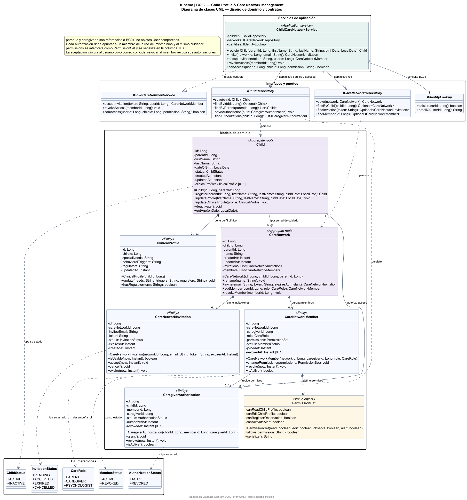
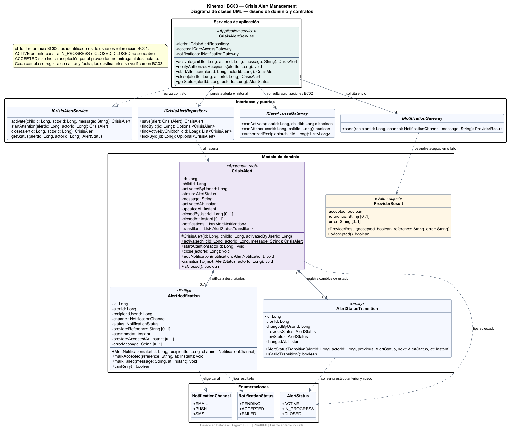

# Vista previa de los cinco diagramas de clases

## BC01 — Identity & Access Management

## BC02 — Child Profile & Care Network Management

## BC03 — Crisis Alert Management

## BC04 — Clinical Guidance & Routine Management

## BC05 — Observation & Crisis History Management

