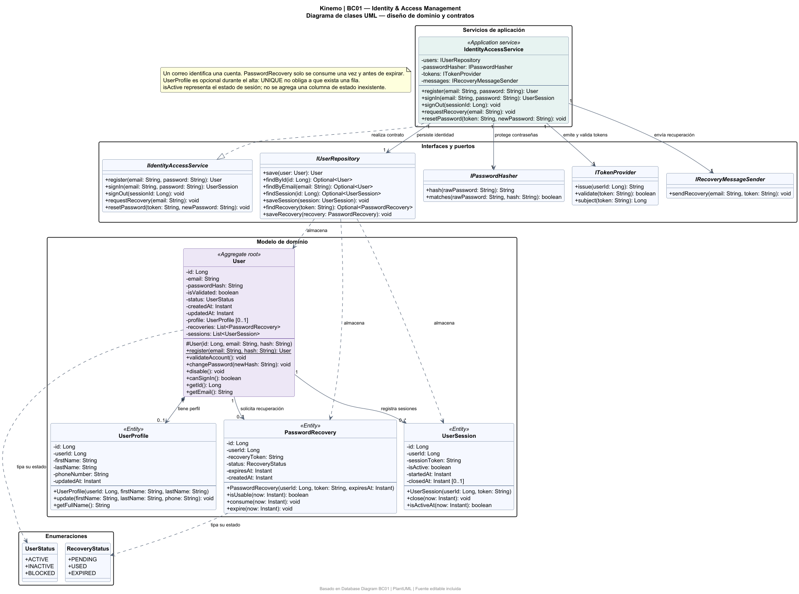
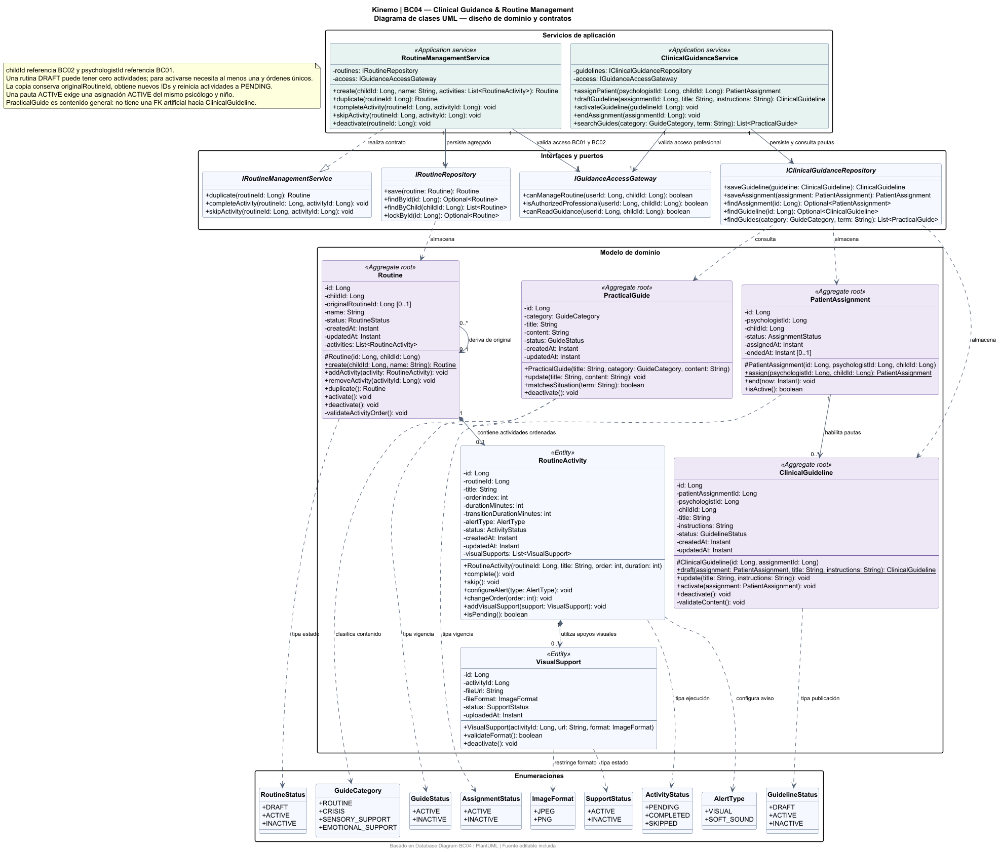
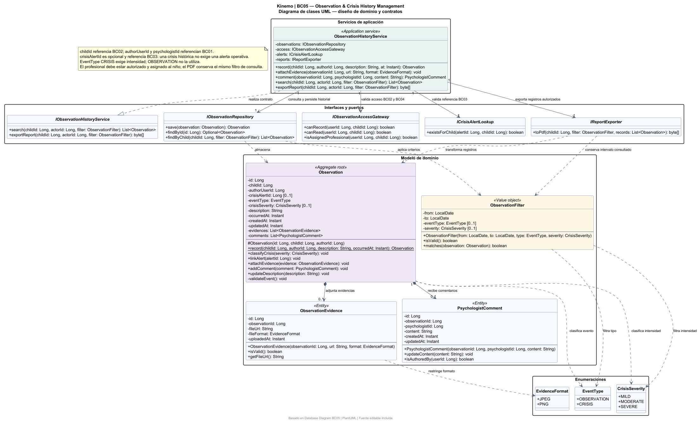

#### 4.7.1. Class Diagrams

Los diagramas de clases UML de Kinemo se organizan en cinco bounded contexts. Se elaboraron en PlantUML tomando como referencia los Database Diagrams y las historias de usuario. Cada diagrama presenta las clases del dominio, sus atributos y métodos, las interfaces, las enumeraciones y las relaciones correspondientes.

La visibilidad se indica con `-` para private, `+` para public y `#` para protected. Las asociaciones y composiciones incluyen nombre, dirección y multiplicidad. Los identificadores que apuntan a otros bounded contexts se conservan como referencias para respetar los límites de cada dominio. Los métodos e interfaces representan el diseño de responsabilidades y contratos, además de la estructura persistente de las tablas.

##### 4.7.1.1. BC01 — Identity & Access Management

El agregado `User` concentra la identidad y protege sus credenciales mediante `passwordHash`. Su perfil se representa mediante composición opcional 1 a 0..1: la restricción UNIQUE limita el máximo, pero no obliga a crear un perfil durante el alta. Las recuperaciones y sesiones pertenecen exactamente a un usuario, que puede registrar cero o muchas de ellas.

`PasswordRecovery` controla uso único y expiración; `UserSession` conserva la apertura y el cierre mediante `isActive`. `IdentityAccessService` realiza el contrato `IIdentityAccessService` y depende de interfaces de persistencia, hashing, tokens y mensajería. Así, el dominio no queda acoplado a una biblioteca criptográfica o un proveedor de correo concreto.

##### 4.7.1.2. BC02 — Child Profile & Care Network Management

`Child` representa al niño y compone un perfil clínico opcional. La relación con `CareNetwork` es 1 a 0..1, porque child_id es único en la red. `CareNetwork` se modela como otro agregado que contiene invitaciones y miembros, ambos con multiplicidad 0..*. Cada autorización identifica exactamente un niño y un miembro; cada uno puede acumular cero o muchas autorizaciones.

`PermissionSet` expresa como objeto de valor los permisos almacenados en la columna TEXT. Se separan la pertenencia a la red y la autorización efectiva sobre el niño. La aceptación comprueba el correo del invitado; la revocación de un miembro invalida sus autorizaciones. Las referencias parentId y caregiverId apuntan a BC01 mediante identificadores, y `IIdentityLookup` representa su consulta externa.

##### 4.7.1.3. BC03 — Crisis Alert Management

`CrisisAlert` es la raíz del agregado operativo de alertas. Compone cero o muchas notificaciones y transiciones de estado; cada componente pertenece a una sola alerta. `AlertStatusTransition` registra estado anterior, estado nuevo, actor y fecha, manteniendo la trazabilidad de la atención y del cierre.

`ICareAccessGateway` permite consultar en BC02 quién puede activar, atender o recibir una alerta. `INotificationGateway` devuelve un `ProviderResult` que distingue aceptación y fallo. El estado ACCEPTED representa únicamente aceptación por el proveedor: no equivale a entrega al dispositivo o a lectura por el destinatario. Las notificaciones pueden ser cero si no hay destinatarios o el procesamiento aún no empezó.

##### 4.7.1.4. BC04 — Clinical Guidance & Routine Management

`Routine` compone sus actividades y cada `RoutineActivity` compone sus apoyos visuales. Se conserva 0..* en la estructura para admitir borradores; la regla para activar exige al menos una actividad, órdenes únicos y duraciones positivas. La asociación reflexiva permite que una copia tenga cero o una rutina original, mientras una original puede generar muchas copias. Duplicar conserva trazabilidad, asigna identidades nuevas y reinicia las actividades pendientes.

`PatientAssignment` vincula al profesional y al niño, y habilita cero o muchas `ClinicalGuideline`. Cada pauta identifica una asignación; los identificadores redundantes de niño y profesional deben coincidir con ella. Activar una pauta exige asignación vigente. `PracticalGuide` permanece independiente porque el diagrama de base de datos no establece una relación entre guías generales y pautas individuales. Los servicios de rutinas y orientación clínica utilizan puertos de repositorio y acceso, sin compartir entidades de otros contextos.

##### 4.7.1.5. BC05 — Observation & Crisis History Management

`Observation` concentra el registro histórico y compone cero o muchas evidencias y comentarios profesionales; cada evidencia y comentario pertenece a una sola observación. La referencia opcional crisisAlertId vincula con BC03 sin obligar a que todo episodio histórico haya generado una alerta operativa.

`EventType` y `CrisisSeverity` diferencian observaciones generales y crisis clasificadas. `ObservationFilter` concentra el intervalo, tipo e intensidad de una consulta. `ObservationHistoryService` verifica autorizaciones mediante BC02/BC04 y, si existe vínculo de alerta, comprueba que corresponda al mismo niño. La exportación utiliza el mismo filtro y los mismos registros autorizados de la consulta mediante `IReportExporter`.

