# Informe de AV2 — NeuroSync

| Campo | Valor                                           |
|---|-------------------------------------------------|
| Universidad | Universidad Peruana de Ciencias Aplicadas (UPC) |
| Carrera | Ingeniería de Software                          |
| Ciclo | 2026-20                                         |
| Código y Nombre del Curso | 1ASI0729 - Desarrollo de Aplicaciones Open Source                     |
| NRC | 7793                                            |
| Profesor | Ivan Robles Fernández                   |
| Nombre del Startup | NeuroSync                               |
| Nombre del Producto | Kinemo                                          |
| año | 2026                                            |

**Integrantes**

| Código     | Apellidos y Nombres        |
|------------|----------------------------|
|  u20241b932 | Huamanchumo Chicchon, Felipe Marcelo |
|  u202416903 | Vilchez Vite, Gabriel Alejandro     |
| u202212327 | Flores Chavez, Fabricio     |
| u202419311 | Matthew Shinko Okuhama Diaz     |
| u202318865 | Trigoso Garrido, Cristian Joseph     |

## Registro de Versiones del Informe

| Versión | Fecha | Autor | Descripción de modificación |
|---|---|---|---|
| AV1 | 4/20/26 | Felipe Marcelo Huamanchumo Chicchon |  |

## Project Report Collaboration Insights

Repositorio del Project Report: 

> _Pendiente — a partir de TB1, agregar explicación del proceso de elaboración del informe y capturas de los analíticos de colaboración/commits de GitHub._

## Contenido

- [Capítulo I: Introducción](#capítulo-i-introducción)
    - [1.1. Startup Profile](#11-startup-profile)
        - [1.1.1. Descripción de la Startup](#111-descripción-de-la-startup)
        - [1.1.2. Perfiles de integrantes del equipo](#112-perfiles-de-integrantes-del-equipo)
    - [1.2. Solution Profile](#12-solution-profile)
        - [1.2.1 Antecedentes y problemática](#121-antecedentes-y-problemática)
        - [1.2.2 Lean UX Process](#122-lean-ux-process)
            - [1.2.2.1. Lean UX Problem Statements](#1221-lean-ux-problem-statements)
            - [1.2.2.2. Lean UX Assumptions](#1222-lean-ux-assumptions)
            - [1.2.2.3. Lean UX Hypothesis Statements](#1223-lean-ux-hypothesis-statements)
            - [1.2.2.4. Lean UX Canvas](#1224-lean-ux-canvas)
    - [1.3. Segmentos objetivo](#13-segmentos-objetivo)

- [Capítulo II: Requirements Elicitation & Analysis](#capítulo-ii-requirements-elicitation--analysis)
    - [2.1. Competidores](#21-competidores)
        - [2.1.1. Análisis competitivo](#211-análisis-competitivo)
        - [2.1.2. Estrategias y tácticas frente a competidores](#212-estrategias-y-tácticas-frente-a-competidores)
    - [2.2. Entrevistas](#22-entrevistas)
        - [2.2.1. Diseño de entrevistas](#221-diseño-de-entrevistas)
        - [2.2.2. Registro de entrevistas](#222-registro-de-entrevistas)
        - [2.2.3. Análisis de entrevistas](#223-análisis-de-entrevistas)
    - [2.3. Needfinding](#23-needfinding)
        - [2.3.1. User Personas](#231-user-personas)
        - [2.3.2. User Task Matrix](#232-user-task-matrix)
        - [2.3.3. User Journey Mapping](#233-user-journey-mapping)
        - [2.3.4. Empathy Mapping](#234-empathy-mapping)
    - [2.4. Big Picture Event Storming](#24-big-picture-event-storming)
    - [2.5 Ubiquitous Language](#25-ubiquitous-language)

- [Capítulo III: Requirements Specification](#capítulo-iii-requirements-specification)
    - [3.1. User Stories](#31-user-stories)
    - [3.2. Impact Mapping](#32-impact-mapping)
    - [3.3. Product Backlog](#33-product-backlog)

- [Capítulo IV: Product Design](#capítulo-iv-product-design)
    - [4.1. Style Guidelines](#41-style-guidelines)
        - [4.1.1. General Style Guidelines](#411-general-style-guidelines)
        - [4.1.2. Web Style Guidelines](#412-web-style-guidelines)
    - [4.2. Information Architecture](#42-information-architecture)
        - [4.2.1. Organization Systems](#421-organization-systems)
        - [4.2.2. Labeling Systems](#422-labeling-systems)
        - [4.2.3. SEO Tags and Meta Tags](#423-seo-tags-and-meta-tags)
        - [4.2.4. Searching Systems](#424-searching-systems)
        - [4.2.5. Navigation Systems](#425-navigation-systems)
    - [4.3. Landing Page UI Design](#43-landing-page-ui-design)
        - [4.3.1. Landing Page Wireframe](#431-landing-page-wireframe)
        - [4.3.2. Landing Page Mock-up](#432-landing-page-mock-up)
    - [4.4. Web Applications UX/UI Design](#44-web-applications-uxui-design)
        - [4.4.1. Web Applications Wireframes](#441-web-applications-wireframes)
        - [4.4.2. Web Applications Mock-ups](#442-web-applications-mock-ups)
        - [4.4.3. Web Applications User Flow Diagrams](#443-web-applications-user-flow-diagrams)
    - [4.5. Web Applications Prototyping](#45-web-applications-prototyping)
    - [4.6. Domain-Driven Software Architecture](#46-domain-driven-software-architecture)
        - [4.6.1. Design-Level Event Storming](#461-design-level-event-storming)
        - [4.6.2. Software Architecture Context Diagram](#462-software-architecture-context-diagram)
        - [4.6.3. Software Architecture Container Diagrams](#463-software-architecture-container-diagrams)
        - [4.6.4. Software Architecture Components Diagrams](#464-software-architecture-components-diagrams)
    - [4.7. Software Object-Oriented Design](#47-software-object-oriented-design)
        - [4.7.1. Class Diagrams](#471-class-diagrams)
    - [4.8. Database Design](#48-database-design)
        - [4.8.1. Database Diagrams](#481-database-diagrams)

- [Capítulo V: Product Implementation, Validation & Deployment](#capítulo-v-product-implementation-validation--deployment)
    - [5.1. Software Configuration Management](#51-software-configuration-management)
        - [5.1.1. Software Development Environment Configuration](#511-software-development-environment-configuration)
        - [5.1.2. Source Code Management](#512-source-code-management)
        - [5.1.3. Source Code Style Guide & Conventions](#513-source-code-style-guide--conventions)
    - [5.2. Landing Page, Services & Applications Implementation](#52-landing-page-services--applications-implementation)
        - [5.2.1. Sprint 1](#521-sprint-1)
            - [5.2.1.1. Sprint Planning 1](#5211-sprint-planning-1)
            - [5.2.1.2. Aspect Leaders and Collaborators](#5212-aspect-leaders-and-collaborators)
            - [5.2.1.3. Sprint Backlog 1](#5213-sprint-backlog-1)
            - [5.2.1.4. Development Evidence for Sprint Review](#5214-development-evidence-for-sprint-review)
            - [5.2.1.5. Execution Evidence for Sprint Review](#5215-execution-evidence-for-sprint-review)
            - [5.2.1.6. Services Documentation Evidence for Sprint Review](#5216-services-documentation-evidence-for-sprint-review)
            - [5.2.1.7. Software Deployment Evidence for Sprint Review](#5217-software-deployment-evidence-for-sprint-review)
            - [5.2.1.8. Team Collaboration Insights during Sprint](#5218-team-collaboration-insights-during-sprint)
        - [5.2.2. Sprint 2](#522-sprint-2)
            - [5.2.2.1. Sprint Planning 2](#5221-sprint-planning-2)
            - [5.2.2.2. Aspect Leaders and Collaborators](#5222-aspect-leaders-and-collaborators)
            - [5.2.2.3. Sprint Backlog 2](#5223-sprint-backlog-2)
            - [5.2.2.4. Development Evidence for Sprint Review](#5224-development-evidence-for-sprint-review)
            - [5.2.2.5. Execution Evidence for Sprint Review](#5225-execution-evidence-for-sprint-review)
            - [5.2.2.6. Services Documentation Evidence for Sprint Review](#5226-services-documentation-evidence-for-sprint-review)
            - [5.2.2.7. Software Deployment Evidence for Sprint Review](#5227-software-deployment-evidence-for-sprint-review)
            - [5.2.2.8. Team Collaboration Insights during Sprint](#5228-team-collaboration-insights-during-sprint)

- [Conclusiones](#conclusiones)
- [Bibliografía](#bibliografía)
- [Anexos](#anexos)

## Student Outcome

**ABET – EAC - Student Outcome 5**

**Capacidad de comunicarse efectivamente con un rango de audiencias.**

En el siguiente cuadro se describen las acciones realizadas y las conclusiones obtenidas durante el desarrollo del proyecto NeuroSync – Kinemo, las cuales permiten evidenciar el cumplimiento del Student Outcome 5.

| Criterio específico | Acciones realizadas | Conclusiones |
|---|---|---|
| **Comunica oralmente con efectividad a diferentes rangos de audiencia.** | **Huamanchumo Chicchon, Felipe Marcelo**  **AV1:** Participé en la comunicación y coordinación con los integrantes del equipo durante el desarrollo del Capítulo I y las secciones de entrevistas del Capítulo II. Compartí información sobre la problemática, los segmentos objetivo y los resultados de las entrevistas para contribuir a una comprensión común de las necesidades de los usuarios de Kinemo.  **TB1:** Participé en la coordinación de las actividades relacionadas con la implementación frontend de los Bounded Contexts 3 (Care Network) y 7, comunicando los avances y las correcciones realizadas en las funcionalidades y en el reporte del proyecto. | **AV1:** Fortalecí mis habilidades de comunicación oral al compartir ideas y resultados de investigación con los integrantes del equipo, facilitando la coordinación y comprensión de los objetivos del proyecto.  **TB1:** Mejoré mi capacidad para comunicar avances técnicos y explicar las funcionalidades desarrolladas, contribuyendo a una mejor organización y coordinación del trabajo en equipo. |
| **Comunica por escrito con efectividad a diferentes rangos de audiencia.** | **Huamanchumo Chicchon, Felipe Marcelo**  **AV1:** Desarrollé el Capítulo I del informe, incluyendo la descripción de la startup, los perfiles del equipo, los antecedentes y la problemática, el proceso Lean UX y los segmentos objetivo. Asimismo, elaboré las secciones correspondientes al diseño, registro y análisis de entrevistas del Capítulo II. También participé en la elaboración del diagrama de base de datos, representando las entidades y relaciones necesarias para la solución propuesta.  **TB1:** Desarrollé funcionalidades frontend de los Bounded Contexts 3 (Care Network) y 7, siguiendo la estructura y arquitectura establecida para el proyecto. Además, realicé correcciones y actualizaciones en el reporte, incorporando y organizando información en formato Markdown, mejorando la redacción y manteniendo la coherencia de la documentación con el desarrollo de la aplicación. | **AV1:** Fortalecí mis habilidades de comunicación escrita mediante la elaboración de documentación técnica y de investigación, organizando de manera clara la información de la startup, la problemática, las entrevistas y el diseño de la base de datos.  **TB1:** Mejoré mi capacidad para estructurar y documentar información técnica, relacionando las funcionalidades implementadas con la arquitectura del sistema. Asimismo, las correcciones del reporte me permitieron desarrollar mayor precisión y claridad en la presentación escrita de los avances del proyecto. |

## Capítulo I: Introducción

### 1.1 Startup Profile

#### 1.1.1. Descripción de la Startup

NeuroSync es una startup tecnológica orientada al desarrollo de soluciones digitales que faciliten la comunicación y coordinación entre familiares, cuidadores y profesionales que acompañan a niños con condiciones del neurodesarrollo, como el Trastorno del Espectro Autista (TEA), el Trastorno por Déficit de Atención e Hiperactividad (TDAH) y el síndrome de Down.
La startup busca atender las dificultades que enfrentan las redes de cuidado para compartir información relevante, acceder a pautas de actuación individualizadas y responder de manera coordinada durante episodios de desregulación emocional, conductual o sensorial.
Su propuesta contempla el desarrollo de Kinemo, una plataforma web que permitirá gestionar perfiles infantiles, organizar redes de cuidadores autorizados, comunicar alertas, consultar recomendaciones profesionales y registrar observaciones sobre los episodios.

Misión: Facilitar la comunicación y coordinación entre familias, cuidadores y profesionales mediante soluciones digitales accesibles que contribuyan a un acompañamiento informado, organizado y continuo de niños con condiciones del neurodesarrollo.

#### 1.1.2. Perfiles de integrantes del equipo

| Ingeniería de Software | Fabricio Flores Chavez   U202212327 |
|---|---|
| **Descripción:** Me gusta mucho seguir aprendiendo cosas nuevas y poder ser un gran profesional, y siempre poder ayudar a los demás en lo que necesiten. |  |

| Ingeniería de Software | Felipe Marcelo Huamanchumo Chicchon   U20241B932 |
|---|---|
| **Descripción:** Soy una persona que le busca la vuelta a los problemas, con ganas de salir adelante y de seguir aprendiendo cosas nuevas, siempre dando lo mejor de mí para alcanzar mis metas. |  |

| Ingeniería de Software | Gabriel Alejandro Vilchez Vite   U202416903 |
|---|---|
| **Descripción:** Actualmente estudio la carrera de ingeniería de software y me considero una persona que no deja todos sus trabajos pendientes a última hora y que siempre trata de terminar todos sus trabajos a tiempo. Actualmente tengo conocimientos en matemáticas y en algunos lenguajes de programación como C++ y Matlab. Actualmente estoy estudiando Java. |  |

| Ingeniería de Software | Matthew Shinko Okuhama Diaz   U202419311 |
|---|---|
| **Descripción:** Soy estudiante de ingeniería de software y me considero una persona estudiosa y trabajadora muy enfocado en sus estudios. Tengo conocimientos en programación (C++ y HTML). |  |

| Ingeniería de Software | Cristian Joseph Trigoso Garrido   U202318865 |
|---|---|
| **Descripción:** Me gusta la superación personal y el aprendizaje continuo en el ámbito del desarrollo de software. Me motiva explorar y dominar nuevas herramientas tecnológicas para aportar soluciones creativas y de impacto en proyectos colaborativos. |  |

### 1.2 Solution Profile

#### 1.2.1. Antecedentes y problemática

**Antecedentes**

El acompañamiento cotidiano de niños con condiciones del neurodesarrollo, como TEA, TDAH y síndrome de Down, puede involucrar a diferentes familiares, cuidadores y profesionales. Cada niño presenta necesidades particulares, por lo que resulta importante que las personas responsables de su cuidado conozcan las recomendaciones y pautas de actuación correspondientes.

Durante los episodios de desregulación emocional, conductual o sensorial, la comunicación entre los integrantes de la red de cuidado adquiere especial importancia. Sin embargo, cuando las indicaciones se transmiten únicamente mediante conversaciones, mensajes dispersos o anotaciones personales, pueden presentarse dificultades para acceder oportunamente a información relevante y coordinar las acciones de los cuidadores.

Asimismo, la ausencia de un registro compartido de observaciones puede dificultar que familiares y profesionales conozcan lo ocurrido durante estos episodios y mantengan un seguimiento organizado.

**Análisis de la problemática (5W + 2H)**

- **Who:** Padres, familiares, cuidadores autorizados y profesionales que participan en el acompañamiento de niños con condiciones del neurodesarrollo.

- **What:** Dificultades para comunicar episodios de desregulación, coordinar la respuesta de los cuidadores, consultar pautas individualizadas y compartir información para el seguimiento.

- **Where:** Hogares, espacios familiares y otros entornos cotidianos en los que diferentes personas asumen el cuidado del niño.

- **When:** Principalmente durante episodios de desregulación y en los momentos posteriores que requieren comunicación y seguimiento.

- **Why:** La información relevante puede encontrarse dispersa entre distintos medios, dificultando su disponibilidad y consulta por parte de toda la red de cuidado autorizada.

- **How:** Los cuidadores recurren a llamadas, mensajes o indicaciones previas para comunicar lo ocurrido y decidir cómo actuar, lo que puede generar demoras o información incompleta.

- **How Much:** La frecuencia e impacto de estas dificultades pueden variar según las necesidades del niño, la cantidad de cuidadores involucrados y los mecanismos de comunicación utilizados. Su magnitud deberá evaluarse mediante entrevistas a los segmentos objetivo.

**Puntos que debe resolver la solución:**

- Facilitar la comunicación de alertas sobre episodios de desregulación a los cuidadores autorizados.
- Permitir la gestión de perfiles infantiles y redes de cuidado con permisos diferenciados.
- Facilitar el acceso a pautas individualizadas previamente proporcionadas o validadas por profesionales.
- Permitir el registro de observaciones y el seguimiento de los episodios.
- Apoyar la continuidad de las rutinas acordadas entre familiares, cuidadores y profesionales.

**Objetivo General:** Desarrollar Kinemo, una plataforma web que facilite la comunicación, coordinación y seguimiento entre familiares, cuidadores autorizados y profesionales durante episodios de desregulación en niños con condiciones del neurodesarrollo, mediante alertas digitales, acceso a pautas individualizadas, gestión de rutinas y registro de observaciones.

#### 1.2.2 Lean UX Process

En esta sección se aplica el proceso Lean UX para identificar las necesidades de los segmentos objetivo, establecer los problemas que NeuroSync busca resolver y definir los supuestos que orientan el desarrollo de Kinemo.

Debido a que se trata de una nueva iniciativa, se utiliza el enfoque Brand New Initiative para formular el Lean UX Problem Statement. Posteriormente, se establecen los Assumptions y Hypothesis Statements, que permitirán evaluar las principales decisiones relacionadas con la solución propuesta. Finalmente, estos elementos se integran en el Lean UX Canvas.

##### 1.2.2.1 Lean UX Problem Statements

Actualmente, el acompañamiento de niños con condiciones del neurodesarrollo, como TEA, TDAH y síndrome de Down, puede involucrar a padres, familiares, cuidadores y profesionales que necesitan compartir información y coordinar acciones durante situaciones de desregulación emocional, conductual o sensorial. Esta coordinación suele apoyarse en llamadas telefónicas, mensajes y recomendaciones compartidas por diferentes medios, lo que puede dificultar el acceso oportuno a información relevante.

Las herramientas de comunicación y organización utilizadas habitualmente no siempre permiten integrar en un mismo entorno la gestión de cuidadores autorizados, la comunicación de alertas, el acceso a pautas individualizadas y el seguimiento de episodios de desregulación. Esto representa una oportunidad para mejorar la coordinación y continuidad del acompañamiento entre los integrantes de la red de cuidado.

Kinemo buscará atender esta necesidad mediante una plataforma web que permita administrar perfiles infantiles, gestionar redes de cuidadores autorizados, comunicar alertas digitales, consultar pautas de actuación proporcionadas o validadas por profesionales y registrar observaciones para el seguimiento de los episodios. La plataforma también incorporará herramientas para organizar rutinas de apoyo.

La propuesta se enfocará inicialmente en familias y cuidadores de niños de 3 a 12 años con condiciones del neurodesarrollo, así como en los profesionales que participan en su acompañamiento, considerando a Lima Metropolitana como ámbito inicial de investigación y validación.

Se considerará que la propuesta está obteniendo resultados favorables cuando los cuidadores participantes puedan localizar oportunamente las pautas correspondientes, comunicar situaciones de desregulación a su red autorizada y registrar observaciones de manera satisfactoria. Asimismo, se evaluará si los profesionales participantes consideran útil la información compartida para dar continuidad al seguimiento de los niños.

##### 1.2.2.2 Lean UX Assumptions

#### Business Assumptions
- BA01: Creemos que existe una oportunidad para ofrecer una plataforma digital especializada en la coordinación de redes de cuidado de niños con condiciones del neurodesarrollo.

- BA02: Creemos que las familias y los profesionales pueden encontrar valor en una herramienta que centralice la comunicación, las pautas de actuación y el seguimiento de episodios.

- BA03: Creemos que Kinemo puede desarrollarse como una plataforma web SaaS que permita ampliar progresivamente su alcance y cantidad de usuarios.

#### Business Outcome Assumptions

- BOA01: Creemos que una experiencia sencilla para comunicar episodios de desregulación favorecerá la adopción inicial de Kinemo por parte de las familias.

- BOA02: Creemos que facilitar el acceso a información relevante contribuirá a aumentar el uso recurrente de la plataforma por parte de los cuidadores.

- BOA03: Creemos que la participación de profesionales en la gestión de pautas y observaciones contribuirá a mejorar la percepción de utilidad y la continuidad de uso de Kinemo.

#### User Assumptions

- UA01: Creemos que los padres y familiares responsables del cuidado necesitan mantener informados a los demás cuidadores autorizados.

- UA02: Creemos que los cuidadores secundarios necesitan consultar información clara sobre las necesidades del niño y las pautas de actuación correspondientes.

- UA03: Creemos que los profesionales requieren recibir observaciones sobre situaciones ocurridas fuera de las sesiones de atención.

#### User Outcome and Benefit Assumptions

- UOBA01: Creemos que los cuidadores desean comunicar oportunamente los episodios de desregulación y conocer las acciones recomendadas para cada niño.

- UOBA02: Creemos que las familias buscan mejorar la coordinación entre las personas que participan en el cuidado del niño.

- UOBA03: Creemos que los cuidadores necesitan acceder a pautas individualizadas para aplicar las recomendaciones profesionales de manera consistente.

- UOBA04: Creemos que las familias y los profesionales desean mantener un historial organizado de observaciones que facilite el seguimiento de los episodios.

#### Feature Assumptions

- FA01: Creemos que una funcionalidad de alertas digitales permitirá a los cuidadores comunicar episodios de desregulación a los integrantes autorizados de la red de cuidado.

- FA02: Creemos que la gestión de perfiles infantiles y redes de cuidado permitirá organizar la información del niño y controlar quiénes pueden acceder a ella.

- FA03: Creemos que el acceso a pautas de actuación individualizadas y rutinas de apoyo facilitará la consulta de recomendaciones durante el cuidado cotidiano.

- FA04: Creemos que el registro de observaciones y el historial de episodios facilitarán el intercambio de información entre cuidadores y profesionales.

##### 1.2.2.3 Lean UX Hypothesis Statements

**Hypothesis Statement 1: Comunicación de alertas digitales**

Creemos que lograremos incrementar la adopción inicial de Kinemo por parte de las familias

si los padres y cuidadores autorizados

consiguen comunicar oportunamente un episodio de desregulación a los integrantes de su red de cuidado

mediante la funcionalidad de alertas digitales de Kinemo.

Criterio de validación: Al menos el 80 % de los cuidadores participantes completa correctamente un escenario simulado de activación y comunicación de una alerta durante las pruebas de usabilidad.

**Hypothesis Statement 2: Gestión de perfiles y redes de cuidado**

Creemos que lograremos incrementar el uso recurrente de Kinemo

si los padres y familiares responsables

consiguen organizar la información del niño y compartirla únicamente con las personas autorizadas para participar en su cuidado

mediante la gestión de perfiles infantiles y redes de cuidadores de Kinemo.

Criterio de validación: Al menos el 80 % de los padres participantes consigue agregar un cuidador autorizado y configurar sus permisos durante las pruebas de usabilidad.

**Hypothesis Statement 3: Acceso a pautas individualizadas y rutinas de apoyo**

Creemos que lograremos incrementar el uso recurrente de Kinemo por parte de los cuidadores

si los familiares y cuidadores autorizados

consiguen consultar las recomendaciones y rutinas correspondientes a las necesidades individuales del niño

mediante las funcionalidades de pautas de actuación y gestión de rutinas de Kinemo.

Criterio de validación: Al menos el 80 % de los cuidadores participantes consigue localizar la pauta correspondiente en un escenario de prueba y declara que la información resulta clara y útil.

**Hypothesis Statement 4: Registro de observaciones y seguimiento**

Creemos que lograremos mejorar la percepción de utilidad de Kinemo entre los profesionales y favorecer su continuidad de uso

si los profesionales que acompañan al niño

consiguen consultar observaciones registradas por los cuidadores y acceder a información organizada sobre episodios anteriores

mediante las funcionalidades de registro de observaciones e historial de episodios de Kinemo.

Criterio de validación: Al menos el 80 % de los profesionales participantes consigue consultar el historial de un niño y considera que la información presentada resulta útil para el seguimiento de las situaciones reportadas.

##### 1.2.2.4 Lean UX Canvas

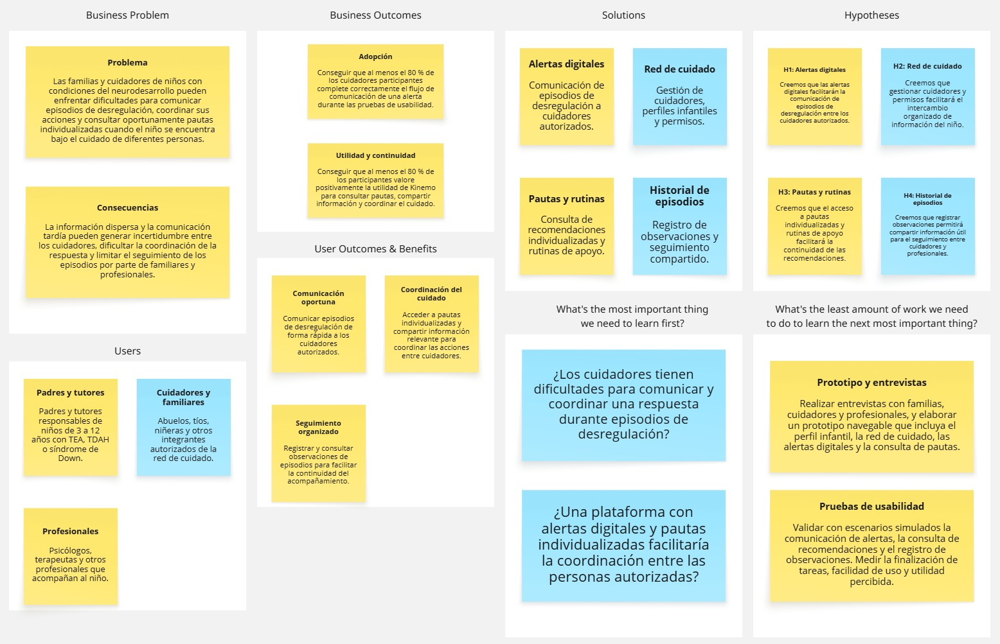

**Link:** https://miro.com/welcomeonboard/U1c5M2RpZDN6L211eTVJd2tCQXk4b2xDQk5LUVc2WmQ0c2ZkS1o4bHlNQ3FrTU4zQ052bkxkQTM4eFR2dDZJdzNOOFVpaC95UmwxTzkxRGdOeWNoWDF0RXpCbmQ0NHZBOWF3cWtMVmZhelRPam92WkV0Vm51cUJHL09seXBUMHF0R2lncW1vRmFBVnlLcVJzTmdFdlNRPT0hdjE=?share_link_id=680292650527

### 1.3. Segmentos objetivo

Para el desarrollo del proyecto se han identificado dos segmentos objetivos principales, los cuales interactúan de manera complementaria dentro de la solución web:

**Segmento 1: Familias y red de cuidado cercano (Padres y Cuidadores)**

**Descripción:** Padres, familiares y cuidadores responsables del acompañamiento cotidiano de niños de 3 a 12 años con condiciones del neurodesarrollo, como TEA, TDAH o síndrome de Down. Este segmento necesita compartir información relevante sobre las necesidades individuales del niño, coordinar las acciones de las personas autorizadas y disponer de pautas de actuación durante episodios de desregulación emocional, conductual o sensorial.

Entre sus principales necesidades se encuentran la comunicación oportuna de alertas, el acceso a recomendaciones individualizadas, la organización de rutinas de apoyo y el registro de observaciones que permitan mantener informados a los integrantes de la red de cuidado.

**Características demográficas:**

- **Edad:** 25 a 65 años.
- **Ubicación:** Lima Metropolitana.
- **Nivel educativo:** Secundaria completa, técnico o superior.
- **Uso tecnológico:** Nivel básico a intermedio; utilizan principalmente teléfonos (smartphones) y navegadores web para mensajería y consulta de información cotidiana.

**Sustento estadístico:**

Según el Instituto Nacional de Estadística e Informática (INEI), en el Perú existen más de 3.2 millones de personas con alguna dificultad o limitación permanente, de las cuales el 30.7% reside en hogares extendidos (familias nucleares acompañadas por abuelos u otros parientes a cargo del cuidado del hogar).

De acuerdo con el Registro Nacional de CONADIS, más del 82% de las personas registradas presentan limitaciones directas en el cuidado personal y un 61% en la conducta, lo que exige una constante coordinación entre múltiples miembros del hogar.

**Segmento 2: Profesionales de la Salud Mental y Terapeutas Infantiles**

**Descripción:** Psicólogos infantiles, terapeutas ocupacionales y otros profesionales especializados en el acompañamiento de niños con condiciones del neurodesarrollo. Este segmento participa en la orientación de las familias y puede proporcionar pautas individualizadas para el cuidado cotidiano y el manejo de episodios de desregulación.

Los profesionales necesitan contar con información organizada sobre las situaciones observadas por los cuidadores fuera de las sesiones de atención, con el propósito de facilitar la comunicación con las familias y dar continuidad al acompañamiento del niño.

Kinemo busca facilitar la consulta de observaciones e historiales de episodios y la disponibilidad de recomendaciones profesionales para los integrantes autorizados de la red de cuidado, sin sustituir la evaluación ni la intervención clínica.

**Características demográficas:**

- **Edad:** 26 a 55 años.
- **Ubicación:** Principales centros urbanos del país.
- **Nivel educativo:** Licenciatura universitaria en Psicología o Terapia Ocupacional, con colegiatura vigente y especializaciones en neurodiversidad.
- **Uso tecnológico:** Nivel intermedio; acostumbran gestionar agendas, historiales clínicos y comunicación con pacientes a través de computadoras portátiles y aplicaciones web.

**Sustento estadístico:**

Según el Colegio de Psicólogos del Perú (CPsP) y datos del Ministerio de Salud (MINSA), la demanda de consultas psicológicas infantiles y neurodesarrollo se ha incrementado en más de un 40% en los últimos años.

Cerca del 70% de especialistas independientes indican que sus mayores obstáculos son la falta de continuidad de las pautas terapéuticas en casa y la dificultad de que cuidadores secundarios (distintos a los padres) repliquen correctamente las técnicas de regulación.

## Capítulo II: Requirements Elicitation & Analysis

### 2.1 Competidores

En esta sección, se analizan y explican los principales competidores que están relacionados con la solución que se ha planteado, de este modo se van a considerar fundamentalmente competidores que son directos, siendo aquéllos que ofrecen productos digitales centrados en el seguimiento, la organización y el soporte del cuidado de los niños con condiciones del neurodesarrollo, pero también se van a considerar aquellos competidores que son indirectos, quienes aunque no ofrecen las mismas funcionalidades cubren parcialmente las necesidades de la gestión de las rutinas, el seguimiento de los tratamientos, la comunicación entre familias y especialistas y el soporte a los cuidadores. A través del análisis se podrá realizar una comparación sobre las principales características y modelos de negocio con los que trabajan los competidores, así como poder detectar oportunidades de diferenciación para la aplicación propuesta.

**Tiimo:** Es una aplicación móvil que está dirigida para las personas con TDAH y autismo. Dentro de la aplicación, los usuarios pueden crear horarios visuales, establecer rutinas, usar temporizadores o recibir avisos para la finalización de las tareas a realizar. La aplicación cuenta con una versión gratuita y una versión premium que otorga la posibilidad de usar algunas funcionalidades adicionales.

**Brili:** Es una aplicación móvil que se centra en establecer y hacer seguimiento de rutinas estructuradas, principalmente relacionada con actividades para niños o personas precisan ayuda para poder gestionar sus rutinas diarias. Permite crear rutinas a medida, temporizadores para el control del tiempo, notificaciones o visión de las actividades paso a paso. Esta aplicación es gratuita y, al mismo tiempo, cuenta con modalidades de pago con función extra.

**AutismDock:** Es una aplicación móvil centrada en ofrecer apoyo a los menores con autismo y a las personas responsables de cuidarles. La app permite crear rutinas visuales personalizadas, organizar horarios, usar temporizadores y programar recompensas para ayudar a conseguir realizar la actividad; y está orientada a padres, cuidadores, profesores y terapeutas, y por ello el contenido presenta aspectos similares a lo que se propone en este proyecto. La aplicación tiene una versión demo y también tiene funciones adicionales a través de su modelo de servicio.

#### 2.1.1 Análisis competitivo

En esta sección se ejecuta un análisis de los competidores más relevantes identificados, con la intención de conocer mejor sus características, funcionalidades y propuestas de valor, con el cual se busca realizar una comparación entre la percepción inicial que se tenía de estas soluciones con sus verdaderas características, así como identificar el potencial de mejora, las características que refuercen nuestra propuesta y también los elementos diferenciadores de nuestra propuesta.

|                     |                                                       | Kinemo                                                                                                                                                                                                                                                                                                  | Tiimo                                                                                                                                                                          | Brili 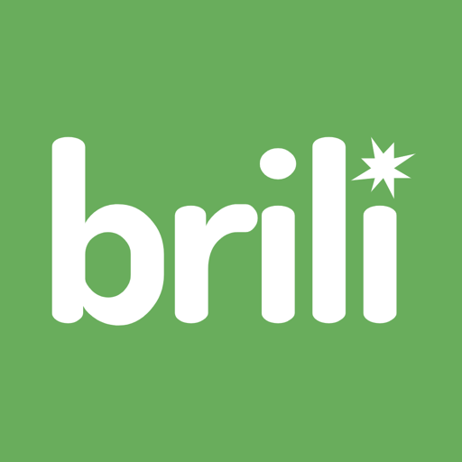                                                                                                                                                      | AutismDock 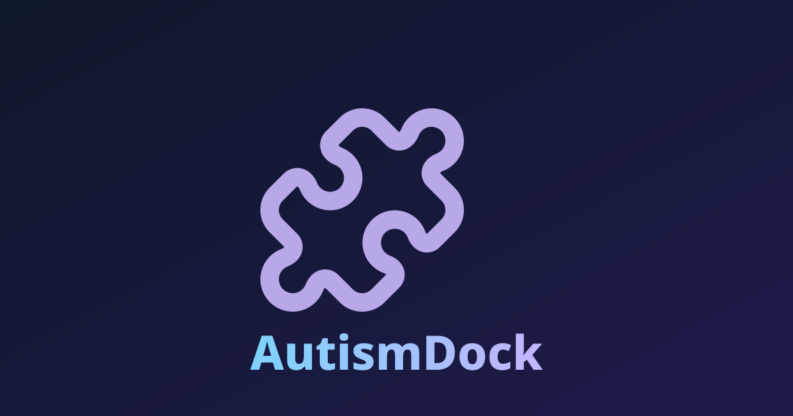                                                                                                                                                     |
|---------------------|-------------------------------------------------------|-------------------------------------------------------------------------------------------------------------------------------------------------------------------------------------------------------------------------------------------------------------------------------------------------------|--------------------------------------------------------------------------------------------------------------------------------------------------------------------------------|------------------------------------------------------------------------------------------------------------------------------------------------------------|-----------------------------------------------------------------------------------------------------------------------------------------------------------------|
| Perfil              | Overview                                              | Startup que desarrolla Kinemo, una plataforma web SaaS dirigida a familias, cuidadores y profesionales que acompañan a niños de 3 a 12 años con TEA, TDAH o síndrome de Down. Permite organizar rutinas, registrar observaciones y compartir pautas de cuidado.                                       | Aplicación de planificación visual diseñada para facilitar la organización de actividades, la gestión del tiempo y las rutinas, especialmente para personas neuro divergentes. | Aplicación especializada en la creación y ejecución de rutinas mediante actividades organizadas, temporizadores y herramientas de seguimiento.             | Plataforma digital orientada al apoyo de personas autistas, sus familias y profesionales mediante herramientas de comunicación, rutinas visuales y seguimiento. |
|                     | Ventaja competitiva ¿Qué valor ofrece a los clientes? | Propone centralizar en una sola plataforma las rutinas del niño, sus necesidades particulares, las estrategias de apoyo y las observaciones compartidas entre familiares, cuidadores y profesionales autorizados. Su valor propuesto es facilitar la continuidad y coordinación del cuidado infantil. | Ofrece una experiencia de planificación visual y personalizable que ayuda a los usuarios a estructurar sus actividades y gestionar su tiempo de acuerdo con sus necesidades.   | Permite transformar las actividades diarias en rutinas estructuradas y guiadas por temporizadores, ayudando a mantener la organización y completar tareas. | Permite transformar las actividades diarias en rutinas estructuradas y guiadas por temporizadores, ayudando a mantener la organización y completar tareas.      |
|                     |                                                       |                                                                                                                                                                                                                                                                                                       |                                                                                                                                                                                |                                                                                                                                                            |                                                                                                                                                                 |
| Perfil de Marketing | Mercado objetivo                                      | Familias y cuidadores de niños de 3 a 12 años; psicólogos y terapeutas infantiles.                                                                                                                                                                                                                    | Personas neurodivergentes y usuarios que necesitan apoyo para organizarse.                                                                                                     | Personas con TDAH que buscan estructurar sus rutinas.                                                                                                      | Personas autistas, familias, cuidadores, terapeutas y centros educativos.                                                                                       |
|                     | Estrategias de marketing                              | Propuesta: contenido educativo, demostraciones y alianzas con profesionales.                                                                                                                                                                                                                          | Comunicación centrada en productividad, accesibilidad y neurodivergencia.                                                                                                      | Comunicación enfocada en rutinas, hábitos y gestión del tiempo para personas con TDAH.                                                                     | Recursos educativos, cursos, comunidad y soluciones diferenciadas para familias y profesionales.                                                                |
|                     |                                                       |                                                                                                                                                                                                                                                                                                       |                                                                                                                                                                                |                                                                                                                                                            |                                                                                                                                                                 |
| Perfil de Producto  | Productos & Servicios                                 | Perfiles infantiles, guías, rutinas, temporizadores, observaciones y red de cuidado.                                                                                                                                                                                                                  | Planificador visual, listas de tareas, temporizadores y planificación con IA.                                                                                                  | Rutinas personalizables, tareas, temporizadores y seguimiento del progreso.                                                                                | Rutinas visuales, comunicación aumentativa, regulación, seguimiento y portal profesional.                                                                       |
|                     | Precios & Costos                                      | Propuesta: S/19.90 familiar y S/49.90 profesional al mes.                                                                                                                                                                                                                                             | La versión Pro de Tiimo cuesta $7.99 al mes o $79.99 al año                                                                                                                    | US$7.99 mensual, US$34.99 semestral o US$49.99 anual en App Store de EE. UU.                                                                               | Google Play anuncia Premium desde €3.99 mensuales.                                                                                                              |
|                     | Canales de distribución (Web y/o Móvil)               | Aplicación web responsive y landing page.                                                                                                                                                                                                                                                             | Web, iOS, iPadOS, watchOS y Android.                                                                                                                                           | Aplicación móvil.                                                                                                                                          | Sitio web y aplicación Android.                                                                                                                                 |

|               |               | Kinemo                                                                                                                                                                                                                                                                                                                                    | Tiimo                                                                                                                                                                                                                                                                                                        | Brili                                                                                                                                                                                                                                                                                                                     | AutismDock                                                                                                                                                                                                                                                                                                                                            |
|---------------|---------------|------------------------------------------------------------------------------------------------------------------------------------------------------------------------------------------------------------------------------------------------------------------------------------------------------------------------------------------|---------------------------------------------------------------------------------------------------------------------------------------------------------------------------------------------------------------------------------------------------------------------------------------------------------------|---------------------------------------------------------------------------------------------------------------------------------------------------------------------------------------------------------------------------------------------------------------------------------------------------------------------------|-------------------------------------------------------------------------------------------------------------------------------------------------------------------------------------------------------------------------------------------------------------------------------------------------------------------------------------------------------|
| Análisis SWOT | Fortalezas    | Enfoque definido en el cuidado infantil. Propuesta de coordinación entre familiares y profesionales. Experiencia web diseñada para distintos dispositivos.                                                                                                                                                                         | Cuenta con herramientas de planificación visual y organización de actividades. Permite utilizar rutinas, temporizadores, listas de tareas y recordatorios. Su propuesta está orientada a personas neurodivergentes y a la gestión de actividades cotidianas.                                            | Permite crear y personalizar rutinas estructuradas. Incorpora temporizadores, notificaciones y seguimiento de actividades. Cuenta con herramientas orientadas a facilitar el cumplimiento de las actividades diarias.                                                                                               | Está orientada específicamente al apoyo de personas autistas. Considera dentro de su público a familias, cuidadores, terapeutas y profesionales. Incluye rutinas visuales, herramientas de comunicación y seguimiento.                                                                                                                          |
|               | Debilidades   | Es una propuesta nueva y todavía no cuenta con una base consolidada de usuarios. Requiere validar con familias y profesionales que las funcionalidades propuestas respondan a sus necesidades reales. La plataforma depende de que los padres y profesionales mantengan actualizada la información del niño y sus pautas de apoyo. | Su enfoque principal está relacionado con la planificación y organización personal. No está centrado específicamente en la coordinación de una red de cuidadores alrededor de un niño. Su propuesta no se enfoca principalmente en centralizar pautas personalizadas proporcionadas por un profesional. | Su propuesta se concentra principalmente en la organización de rutinas y la gestión del tiempo. No tiene como eje principal la coordinación entre padres, cuidadores y profesionales. Presenta un alcance más limitado respecto a la gestión de información específica sobre las necesidades individuales del niño. | Su enfoque está principalmente relacionado con el autismo y no necesariamente con las tres condiciones consideradas por Kinemo. Existe una coincidencia importante con Kinemo en herramientas como rutinas visuales y apoyo a cuidadores. Puede requerir que los usuarios se adapten a las funcionalidades disponibles dentro de su plataforma. |
|               | Oportunidades | Incorporar progresivamente nuevas herramientas para facilitar la coordinación entre la familia y los profesionales. Ampliar la plataforma hacia otros profesionales relacionados con el neurodesarrollo. Desarrollar funcionalidades que permitan adaptar las rutinas y guías a las necesidades particulares de cada niño.         | Ampliar sus funcionalidades hacia otros escenarios de acompañamiento y cuidado. Continuar desarrollando herramientas relacionadas con la organización de actividades para personas neurodivergentes.                                                                                                       | Incorporar nuevas funcionalidades relacionadas con el seguimiento y personalización de las rutinas. Ampliar sus herramientas para atender diferentes necesidades de organización y acompañamiento.                                                                                                                     | Ampliar sus herramientas de apoyo y seguimiento para diferentes contextos de cuidado. Continuar incorporando funcionalidades dirigidas a familias y profesionales.                                                                                                                                                                                 |
|               | Amenazas      | Existencia de aplicaciones consolidadas que ya ofrecen rutinas visuales, temporizadores y herramientas de organización. Posible preferencia de algunos usuarios por herramientas que ya conocen y utilizan. Necesidad de diferenciarse frente a soluciones especializadas en planificación o apoyo al autismo.                     | Competencia de otras aplicaciones de planificación visual y gestión de rutinas. Aparición de nuevas soluciones especializadas en necesidades concretas de personas neurodivergentes.                                                                                                                       | Competencia de aplicaciones de planificación y gestión de rutinas. Diferenciación limitada si otras soluciones incorporan herramientas similares de temporización y seguimiento.                                                                                                                                       | Competencia de plataformas especializadas en rutinas, comunicación y regulación. Nuevas soluciones que integren en una sola plataforma las necesidades de familias, cuidadores y profesionales.                                                                                                                                                    |

#### 2.1.2 Estrategias y tácticas frente a competidores

**Tiimo:** Kinemo se enfocará en algo distinto de otras aplicaciones que se centran en la planificación visual y la organización personal. Su enfoque estará orientado a la continuidad del cuidado del niño. La continuidad del cuidado del niño será el punto clave de Kinemo. Muchas aplicaciones no se preocupan por esto. Kinemo sí lo hará. El cuidado del niño será el centro de atención. No se tratará sólo de planificar o organizar. Se tratará de cuidar de manera continua. Ese será el objetivo principal de Kinemo.

Tácticas:
* Es importante resaltar el perfil individual del niño, mostrando el perfil individual del niño, sus necesidades particulares, sus desencadenantes y sus estrategias de apoyo.
* Promover el uso de guías prácticas ayudará a cualquier cuidador a conocer cómo actuar cuando el niño se desregule. Además, incorporar permisos de acceso permitirá a padres, familiares, cuidadores y profesionales compartir información de manera controlada.
* Usar demostraciones y contenido educativo mostrará cómo Kinemo puede facilitar la continuidad de las recomendaciones cuando el niño no esté en las sesiones de terapia.

**Brili:** Kinemo se diferenciará de otras soluciones que solo se concentran en crear y ejecutar rutinas. En lugar de eso, incluirá herramientas que conectan esas rutinas con las necesidades individuales del niño y con las recomendaciones de los profesionales que lo atienden.

Tácticas:
* Combina las rutinas visuales con temporizadores y actividades adaptadas a cada niño.
* Añade guías de apoyo a la organización diaria, para ayudar con transiciones y momentos de desregulación.
* Permite que los cuidadores registren observaciones sobre el comportamiento del niño y las actividades del niño.
* Muestra casos de uso donde la información registrada ayude a mantener mayor continuidad entre el hogar y el acompañamiento profesional.

**AutismDock:** Debido a que AutismDock tiene funciones relacionadas con rutinas visuales, comunicación, regulación y seguimiento, Kinemo se enfocará en distinguirse al atender a niños con TEA, TDAH y síndrome de Down. También se destacó por la coordinación específica de su red de cuidados.

Tácticas:
* Kinemo está diseñado para ayudar a personas con diferentes condiciones de desarrollo neurológico, no solo a un tipo específico de usuario.
* Es importante que los psicólogos y otros especialistas estén involucrados. Para eso, se crean guías adaptadas a cada niño.
* Se necesita un sistema de acceso que permita compartir datos solo con las personas autorizadas en el equipo de cuidado.
* Se usará material informativo y se buscarán colaboraciones con expertos para mostrar el beneficio de tener las recomendaciones terapéuticas disponibles para todos los cuidadores.

**Estrategia general:** Kinemo dirigirá la orientación de su posicionamiento a la continuidad y coordinación del cuidado en el sentido de dejar de competir exclusivamente desde la funcionalidad de planificación / temporización, es decir, intentar aprovechar una oportunidad de atender una necesidad que es la combinación de la organización diaria, ayuda durante el desbordamiento, llegadas, seguimiento, la familia, los cuidadores y profesionales.

Tácticas generales:
* Hacer pruebas tanto con familias como con profesionales que permitan comprobar que las funciones correspondan con situaciones de cuidado reales.
* Ofrecer una experiencia web sencilla y accesible desde diversos dispositivos.
* Disponer de perfiles, rutinas, y guías de cada niño actualizadas para la conservación de la utilidad de la información compartida.
* Valerse de las demostraciones, de la parte de educación, y de potentes alianzas con profesionales, como vehículos de difusión.
* Hacer revisiones periódicas de las funcionalidades de los competidores como forma de detectar nuevas oportunidades de diferenciación.
* Evitar que la propuesta de valor dependa exclusivamente de funciones simples, fácilmente replicables (temporizadores, listas de actividades), reafirmar la coordinación de la red de cuidado y la personalización de las recomendaciones.

### 2.2 Entrevistas

#### 2.2.1. Diseño de entrevistas

El diseño de entrevistas tiene como finalidad conocer las experiencias, necesidades y dificultades de los segmentos objetivo de NeuroSync: familias y cuidadores de niños con condiciones del neurodesarrollo, y profesionales de la salud mental y terapeutas infantiles.

Las entrevistas se estructuraron mediante preguntas demográficas, hábitos tecnológicos, mecanismos de comunicación, organización de rutinas, aplicación de recomendaciones profesionales y seguimiento de episodios de desregulación.

A través de estas preguntas se buscó comprender cómo se transmite la información entre las personas responsables del cuidado, qué dificultades pueden surgir cuando intervienen diferentes cuidadores y qué mecanismos utilizan los profesionales para conocer las situaciones ocurridas fuera de las sesiones.

La información obtenida permite analizar las necesidades de comunicación, coordinación y continuidad del acompañamiento, así como identificar oportunidades para el desarrollo de Kinemo.

**Segmento 1: Familias y Red de Cuidado Cercano (Padres y Cuidadores)**

**Objetivo de la entrevista:** Identificar cómo los padres, familiares y cuidadores comparten información sobre las necesidades del niño, coordinan responsabilidades, consultan recomendaciones profesionales y enfrentan situaciones de desregulación. Asimismo, conocer los medios tecnológicos que utilizan y las dificultades que pueden presentarse cuando diferentes personas participan en el cuidado.

**Preguntas demográficas y de caracterización:**

1. ¿Cuál es su nombre completo, edad, ocupación y distrito de residencia?
2. ¿Cuál es su relación o parentesco con el menor bajo su cuidado y qué condición diagnosticada presenta (TEA, TDAH, Síndrome de Down)?
3. ¿Quiénes más componen el núcleo familiar o participan activamente en el cuidado del niño cuando usted no se encuentra disponible?
4. ¿Qué dispositivos utiliza cotidianamente (laptop, tablet o teléfono) y qué sistema operativo maneja con mayor frecuencia (Android, iOS, Windows)?
5. ¿Qué canales de mensajería, redes sociales o aplicaciones web consulta diariamente para coordinar tareas familiares (WhatsApp o navegador web)?

**Preguntas principales:**

1. ¿Cómo se transfieren las instrucciones y cuidados del menor cuando usted debe ausentarse y otra persona asume su atención temporal?
2. ¿Cómo registran y consultan las recomendaciones brindadas por el psicólogo o terapeuta del niño para su aplicación en el hogar?
3. Ante un episodio de crisis sensorial o bloqueo de conducta, ¿qué pasos sigue la persona a cargo para lograr que el menor recupere la calma?
4. ¿Qué situaciones de conflicto o desorientación ocurren si el cuidador de turno desconoce los detonantes o los reguladores sensoriales específicos del infante?
5. ¿Utilizan actualmente algún sistema de apoyos visuales o secuencias de rutinas en casa (pictogramas impresos, pizarras, notas manuales) y qué limitaciones presenta?

**Preguntas complementarias:**

1. ¿Cuál es su principal temor o frustración al momento de delegar la supervisión del niño a un familiar cercano o cuidador secundario?
2. Si dispusiera de una plataforma web con un manual interactivo accesible que guíe paso a paso ante emergencias y muestre la rutina del día, ¿qué aspectos esenciales le garantizarían que sea fácil de entender para cualquier persona de la familia?
3. ¿Qué disposición tendría su hogar para emplear una herramienta digital conectada con las indicaciones del especialista del menor?

**Segmento 2: Profesionales de la Salud Mental y Terapeutas Infantiles**

**Objetivo de la entrevista:** Comprender cómo los profesionales proporcionan pautas individualizadas, reciben información de las familias y realizan el seguimiento de situaciones ocurridas fuera de las sesiones. Además, identificar las dificultades relacionadas con la comunicación entre cuidadores y la continuidad de las recomendaciones profesionales.

**Preguntas demográficas y de caracterización:**

1. ¿Cuál es su nombre completo, edad y especialidad profesional?
2. ¿En qué modalidad (presencial, virtual o mixta) y en qué distrito o centro clínico brinda sus servicios terapéuticos?
3. ¿Qué plataformas o herramientas digitales utiliza actualmente en su práctica diaria para agendar, llevar registros o comunicarse con las familias consultantes?
4. ¿Qué tipo de dispositivos y navegadores web prefiere utilizar en su jornada de trabajo clínico?

**Preguntas principales:**

1. ¿De qué forma transmite habitualmente a los padres los planes de rutina y las estrategias de autorregulación acordadas en consulta?
2. ¿Con qué regularidad observa que las pautas brindadas en sesión se desvirtúan o dejan de aplicarse de forma continua en el hogar?
3. ¿Cómo evalúa el impacto en la evolución del menor cuando los cuidadores secundarios (abuelos, niñeras) actúan bajo criterios opuestos o empíricos?
4. ¿Qué mecanismo utiliza para enterarse de la frecuencia, intensidad y contexto de las desregulaciones o crisis que sufre el paciente fuera del consultorio?
5. ¿Qué dificultades encuentra en el diseño y entrega de materiales de apoyo visual (pictogramas, agendas) para que las familias los sostengan en el tiempo?

**Preguntas complementarias:**

1. ¿Estaría dispuesto(a) a recomendar a las familias una solución digital que centralice las pautas que usted define en consulta?
2. ¿Qué valor añadido aportaría a su labor profesional que toda la red de apoyo del paciente maneje exactamente el mismo lenguaje y protocolo de actuación validado por usted?

#### 2.2.2. Registro de entrevistas

En esta sección se presentan los registros de las entrevistas realizadas durante la etapa de investigación de NeuroSync. Se conserva la información proporcionada por los participantes, incluyendo sus características generales, herramientas digitales utilizadas, experiencias relacionadas con el acompañamiento de niños con condiciones del neurodesarrollo y opiniones sobre las dificultades de comunicación y seguimiento.

Los testimonios permiten comprender prácticas actuales relacionadas con la transmisión de recomendaciones, la participación de diferentes cuidadores y la recopilación de información sobre episodios ocurridos fuera de las sesiones profesionales.

Estos registros constituyen una fuente de información para el análisis de necesidades y la elaboración de los artefactos de Needfinding.

**Segmento 2: Profesionales de la Salud Mental y Terapeutas Infantiles**

**Entrevista N°1:**

**Nombre:** Tiziano

**Apellido:** Pertile

**Edad:** 26 años

**Distrito:** Miraflores

**URL:** [Ver entrevista](https://1drv.ms/v/c/bae01487dfb322d2/IQD2SZF5KQz1RZkcJk_2BOfrASuUFUo7-JZc3-CKW2IeR1M?e=sWEitI)

**Inicia:** 00:21  
**Fin:** 04:57

**Resumen:**

El entrevistado es Tiziano Pertile, psicólogo de 26 años especializado en terapia infantil y orientado a familias. Trabaja principalmente de forma presencial en un consultorio de Miraflores y utiliza Google Calendar para agendar, WhatsApp para comunicarse con los padres y documentos digitales para sus registros. Utiliza principalmente una laptop para sus actividades clínicas y un iPhone para comunicarse y coordinar citas, siendo Google Chrome su navegador preferido.

Señala que las pautas terapéuticas suelen perder continuidad en el hogar por falta de tiempo, cambios en las rutinas o diferencias entre cuidadores. Para realizar el seguimiento, recoge información de los padres y solicita registros de los episodios cuando es necesario. También identifica dificultades para mantener actualizados y en uso constante los materiales visuales. Está dispuesto a recomendar una solución digital que centralice las pautas, siempre que sea sencilla, personalizable, segura y facilite que todos los cuidadores sigan las mismas indicaciones.

---

**Entrevista N°2:**

**Nombre:** Miguel Guillermo

**Apellido:** Málaga Gómez

**Edad:** 27 años

**Distrito:** Miraflores

**URL:** [Ver entrevista](https://1drv.ms/v/c/bae01487dfb322d2/IQCvUu83WappTJ25-IVsZLBJAav_mtNpggBzPM1XTL5VIA0?e=hCRrjk)

**Inicia:** 00:22  
**Fin:** 04:18

**Resumen:**

El entrevistado es Miguel Guillermo Málaga Gómez, psicólogo de 27 años especializado en terapia infantil y orientación a familias. Desarrolla su trabajo de manera presencial en un consultorio de Miraflores, complementándolo con sesiones virtuales. En su actividad profesional utiliza Google Calendar para organizar sus citas, WhatsApp para mantener contacto con los padres y documentos digitales para gestionar los registros. Trabaja principalmente desde una laptop y utiliza un iPhone para la comunicación; también prefiere Google Chrome.

Desde su experiencia, identifica dificultades para mantener las estrategias terapéuticas de manera constante en el hogar, especialmente cuando existen cambios en la rutina o diferentes criterios entre los cuidadores. Para conocer lo que ocurre fuera del consultorio, se apoya en la información proporcionada por los padres y en registros de los episodios. También observa dificultades para conservar y actualizar materiales visuales como pictogramas y agendas. Considera viable una solución digital que centralice las indicaciones y facilite su seguimiento entre los distintos cuidadores, siempre que sea segura, sencilla y adaptable a las necesidades de cada paciente.

---

**Entrevista N°3:**

**Nombre:** Ximena Fernanda

**Apellido:** Castillo Herrera

**Edad:** 30 años

**Distrito:** Magdalena del Mar

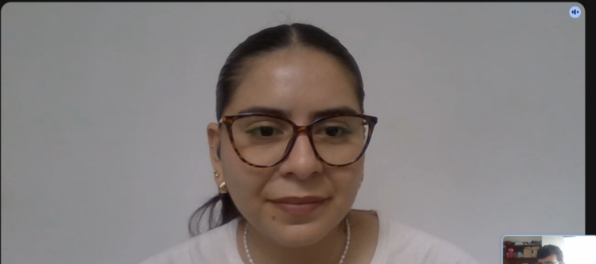

**URL:** [Ver entrevista](https://1drv.ms/v/c/bae01487dfb322d2/IQAAM_Go3yUDT4n1yY5gcZhkAWRun0XjnmObSGcRQKVWXVw?e=JpaED9)

**Inicia:** 00:00  
**Fin:** 07:18

**Resumen:**

Se entrevistó a Ximena Fernanda Castillo Herrera, psicóloga de 30 años especializada en psicoterapia cognitivo-conductual, quien actualmente brinda terapias virtuales. Explicó que utiliza herramientas como Google Calendar, WhatsApp y Gmail para organizar sus citas, comunicarse con las familias y recibir registros de conducta y emociones. Destacó la importancia de trabajar conjuntamente con los padres para conocer lo que ocurre con los niños fuera de las sesiones y adaptar las recomendaciones según sus necesidades.

Asimismo, señaló que, ante situaciones de crisis, mantiene contacto con las familias mediante llamadas o videollamadas y, en algunos casos, realiza visitas presenciales. Manifestó interés en una aplicación que permita a los padres acceder rápidamente a herramientas y estrategias de apoyo según la situación que presente el niño, especialmente cuando el psicólogo no se encuentra disponible. Esta necesidad se relaciona con la propuesta de Kinemo de centralizar recomendaciones y facilitar la coordinación entre familias y profesionales.

---

**Entrevista N°4:**

**Nombre:** Fidia Mercedes

**Apellido:** Diaz Principe

**Edad:** 48 años

**Distrito:** Jesus Maria

**URL:** [Ver entrevista](https://1drv.ms/v/c/bae01487dfb322d2/IQCod4d90d-rSIC_KtIIQLKDARTZk5GCU4g64wltZdlu_uw?e=IqqYrc)

**Resumen:**

La entrevistada es una profesional de psicología especializada en atención infantil y adolescente, orientada al trabajo con familias. Desarrolla sus sesiones principalmente de manera presencial, complementándose con atención virtual cuando es necesario. Utiliza WhatsApp para comunicarse con los padres, Google Calendar para organizar sus citas, Google Meet o Zoom para sesiones virtuales y documentos digitales para registrar información de sus pacientes.

Desde su experiencia, señala que las pautas terapéuticas suelen perder continuidad en el hogar cuando existen varios cuidadores que aplican estrategias diferentes. Para realizar el seguimiento, obtiene información de los padres y solicita registros de las crisis o episodios de desregulación cuando es necesario. También identifica dificultades para mantener el uso constante de materiales visuales como pictogramas y agendas. Considera útil una solución digital que centralice las recomendaciones y permita que todos los cuidadores sigan las mismas indicaciones de manera sencilla y organizada.

#### 2.2.3. Análisis de entrevistas

**Segmento 2: Profesionales de la Salud Mental y Terapeutas Infantiles**

De las tres entrevistas realizadas, el 100% de los entrevistados son psicólogos y utilizan herramientas digitales en su práctica profesional. El 100% utiliza Google Calendar para organizar o gestionar sus citas y WhatsApp como medio de comunicación con las familias. Asimismo, los tres entrevistados utilizan herramientas o documentos digitales para gestionar información relacionada con sus pacientes.

En cuanto a los dispositivos, el 67% (2 de 3) trabaja principalmente con una laptop, mientras que el 67% (2 de 3) utiliza un iPhone para comunicarse y coordinar actividades. Respecto al navegador, el 67% (2 de 3) manifestó utilizar Google Chrome.

Respecto al seguimiento fuera de las sesiones, el 100% considera importante obtener información proporcionada por los padres o las familias para conocer lo que ocurre con el menor. Además, el 67% (2 de 3) menciona específicamente el uso de registros de episodios o conductas como mecanismo de seguimiento. El 100% identifica dificultades relacionadas con la continuidad de las estrategias terapéuticas en el hogar, asociadas principalmente a cambios en las rutinas, falta de continuidad o diferencias entre los cuidadores.

En relación con los materiales de apoyo, el 67% (2 de 3) señala dificultades para mantener materiales visuales o estrategias de apoyo actualizadas y utilizarlas de manera constante. Por otro lado, el 100% muestra una actitud favorable hacia una solución digital de apoyo, siempre que esta facilite el seguimiento y la comunicación con las familias. Entre las características mencionadas se encuentran la sencillez de uso (100%), la seguridad de la información (67%), la personalización según cada paciente (67%) y la posibilidad de facilitar la coordinación entre padres, cuidadores y profesionales (100%).

**Características principales para el arquetipo**

| Características | Resultado |
|---|---|
| Uso de herramientas digitales | 100% |
| Uso de Google Calendar | 100% |
| Uso de WhatsApp | 100% |
| Seguimiento mediante información de los padres | 100% |
| Dificultades con la continuidad en el hogar | 100% |
| Interés en una solución digital | 100% |
| Uso de laptop | 67% |
| Uso de iPhone | 67% |
| Uso de Google Chrome | 67% |
| Uso de registros de episodios | 67% |
| Dificultades con materiales de apoyo | 67% |
| Necesidad de personalización | 67% |
| Importancia de la seguridad | 67% |
| Necesidad de coordinación entre cuidadores | 100% |

### 2.3. Needfinding

El Needfinding es un proceso de investigación centrado en identificar y comprender las necesidades, motivaciones, dificultades y expectativas de los usuarios. Su propósito es reconocer los problemas que experimentan en su contexto cotidiano y recopilar información que permita orientar el diseño de una solución tecnológica centrada en el usuario.
En el proyecto NeuroSync, este proceso se enfoca en dos segmentos objetivo: las familias y cuidadores de niños de 3 a 12 años con condiciones del neurodesarrollo, como TEA, TDAH y síndrome de Down, y los psicólogos o terapeutas infantiles que participan en su acompañamiento.
A partir de la información recopilada durante las entrevistas, se emplean cuatro herramientas de análisis: **User Personas, User Task Matrix, User Journey Mapping y Empathy Mapping**. Estas permiten representar las características de los usuarios, identificar sus principales actividades, analizar las dificultades que enfrentan y comprender sus experiencias, emociones y expectativas.
Los resultados obtenidos servirán como base para identificar oportunidades de mejora y definir los requerimientos funcionales de Kinemo, una plataforma web orientada a facilitar la organización de rutinas, el acceso a guías prácticas y la coordinación entre familias, cuidadores y profesionales autorizados.

### 2.3.1. User Personas

Los User Personas son representaciones ficticias de usuarios que reúnen características, objetivos, motivaciones, necesidades y frustraciones de un segmento específico. Esta herramienta permite comprender a quién está dirigida una solución y facilita la toma de decisiones durante el diseño de la experiencia de usuario.

Para NeuroSync, se desarrollan perfiles representativos de los segmentos objetivo: familias y cuidadores, quienes necesitan organizar el acompañamiento cotidiano del niño y mantener una comunicación coordinada con su red de apoyo; y psicólogos o terapeutas infantiles, quienes requieren compartir pautas de orientación y consultar información relevante sobre el seguimiento de sus pacientes. Estos perfiles permiten identificar las necesidades particulares de cada grupo y orientar el desarrollo de funcionalidades que respondan a sus responsabilidades y objetivos.

A continuación, se presentan los User Personas elaborados para el proyecto.

### User Persona 1: Andrea Ramírez

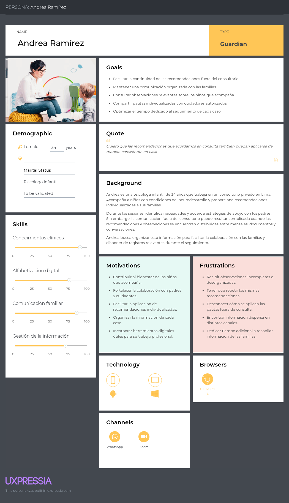

### User Persona 2: María Fernández

### 2.3.2. User Task Matrix

En NeuroSync, esta herramienta permite analizar las actividades de las familias y cuidadores, como organizar rutinas, consultar pautas de acompañamiento, registrar observaciones y compartir información con otros integrantes de la red de cuidado. Asimismo, contempla las tareas de los psicólogos o terapeutas infantiles, como registrar indicaciones clínicas, revisar observaciones y consultar reportes de seguimiento.

La matriz contribuye a identificar las funcionalidades necesarias para cada tipo de usuario y establecer una base para la definición de historias de usuario y requerimientos funcionales.

A continuación, se presenta la User Task Matrix correspondiente a los segmentos objetivo de NeuroSync.

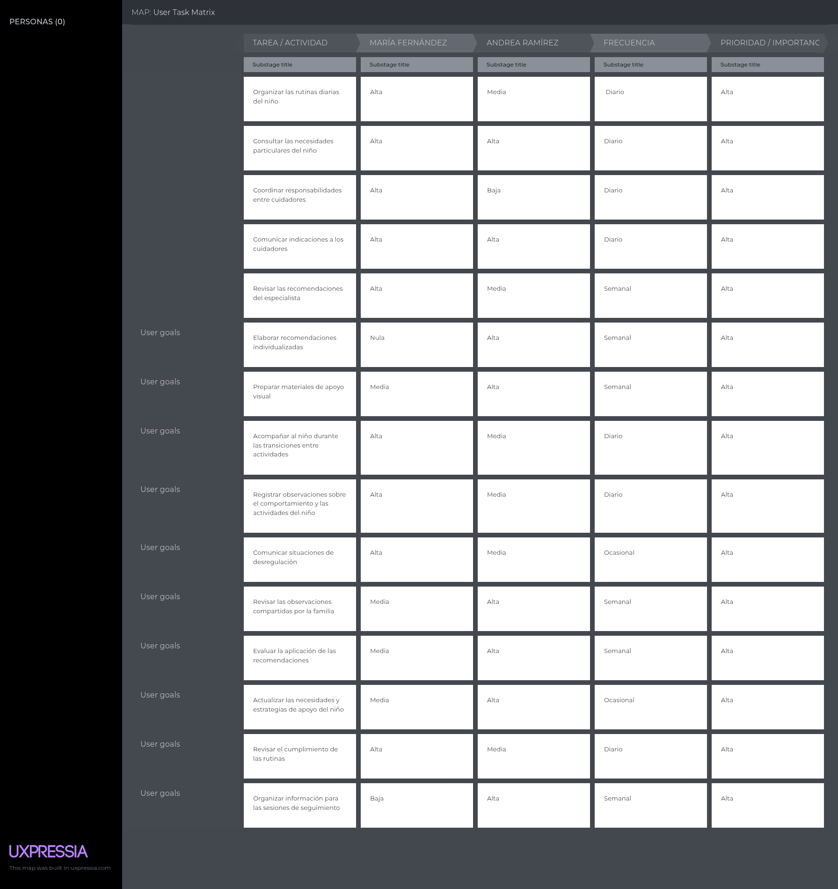

### 2.3.3. User Journey Mapping

En NeuroSync, esta herramienta permite analizar la experiencia de las familias y cuidadores durante la búsqueda de orientación, la organización de rutinas y la coordinación con otros responsables del cuidado del niño. De igual manera, permite comprender el recorrido de los psicólogos o terapeutas infantiles al proporcionar pautas de acompañamiento y realizar el seguimiento de sus pacientes.

La representación de estos recorridos facilita la identificación de puntos de fricción y oportunidades de mejora, proporcionando información para diseñar una experiencia de usuario más clara, accesible y adaptada a las necesidades de cada segmento.

A continuación, se presentan los User Journey Maps elaborados para el proyecto.

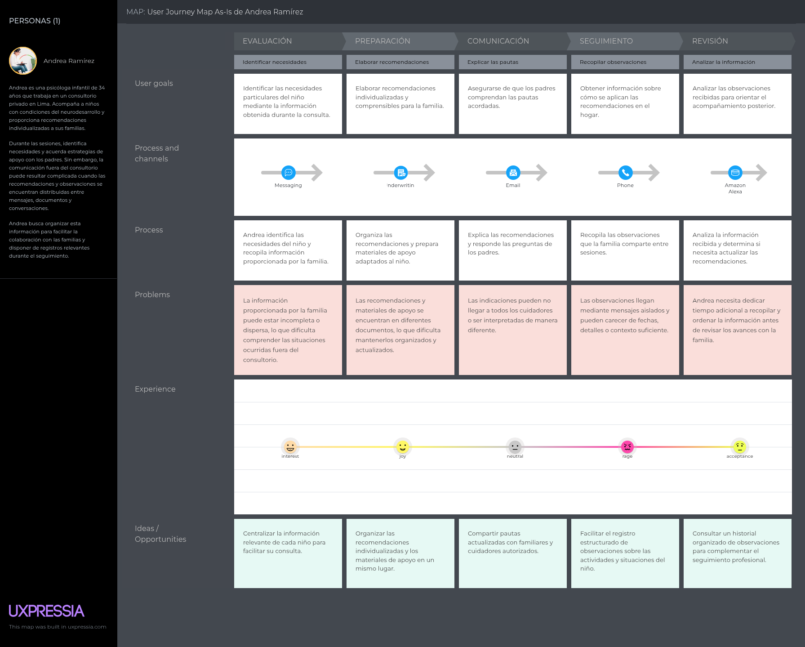

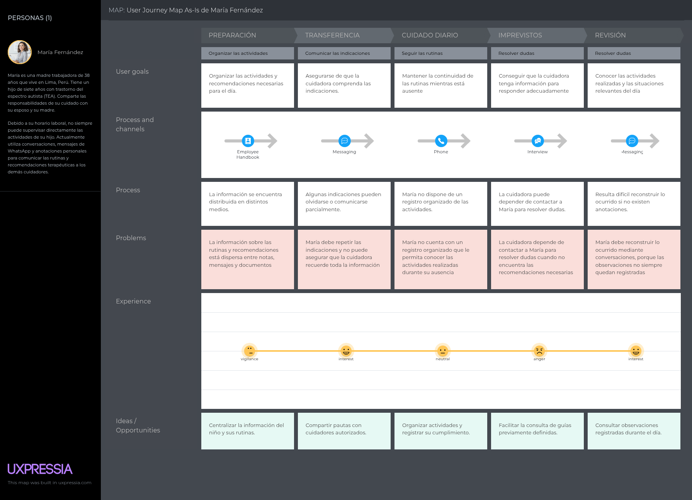

### 2.3.4. Empathy Mapping

En NeuroSync, esta herramienta se utiliza para representar las perspectivas de las familias y cuidadores, quienes deben coordinar diferentes responsabilidades relacionadas con el acompañamiento cotidiano del niño, así como las de los psicólogos o terapeutas infantiles, quienes necesitan proporcionar orientación y mantener un seguimiento organizado de sus pacientes.

Los mapas de empatía permiten reconocer posibles preocupaciones, expectativas y oportunidades de mejora para cada segmento. Esta información contribuye a orientar el diseño de una plataforma que facilite la organización de rutinas, el acceso a pautas de acompañamiento y la coordinación entre los integrantes de la red de cuidado.

A continuación, se presentan los Empathy Maps correspondientes a los perfiles de usuario definidos para NeuroSync.

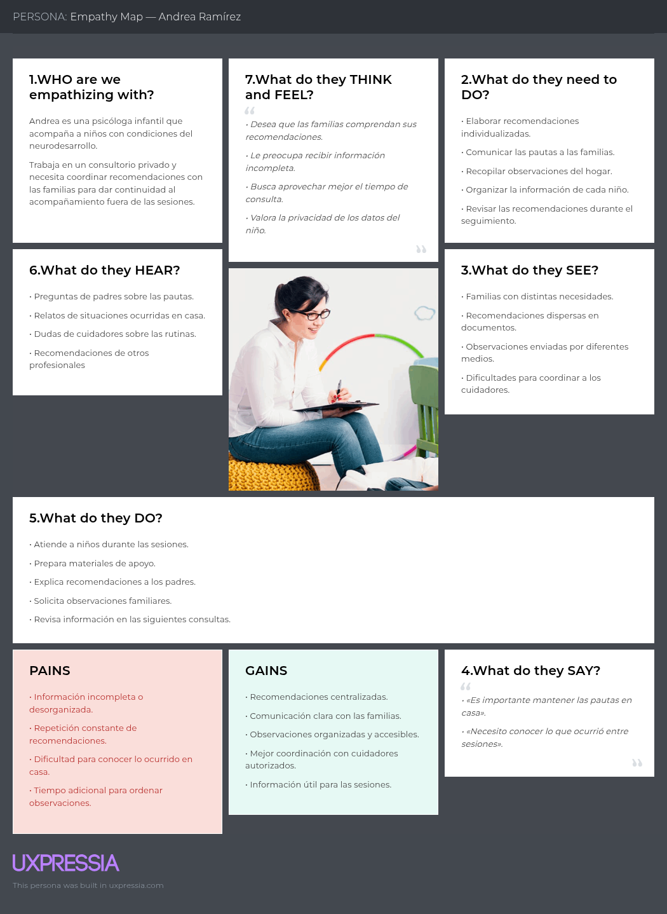

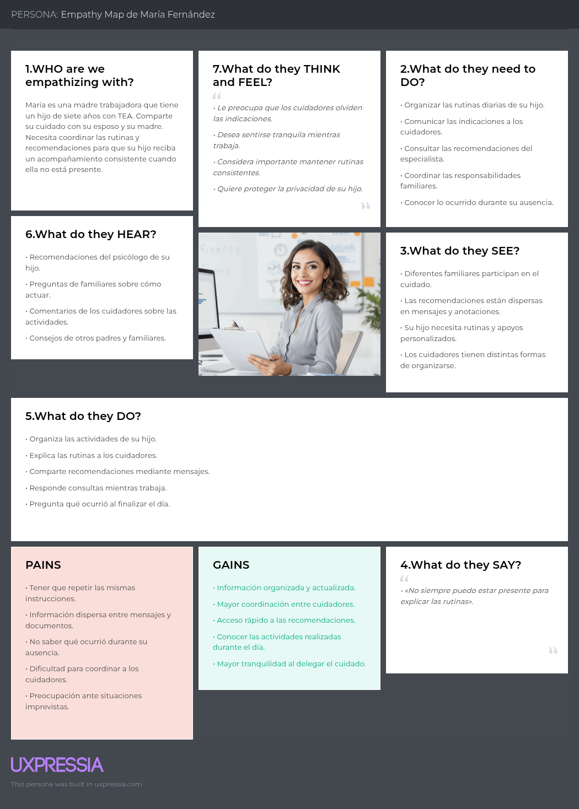

### 2.4. Big Picture Event Storming

El equipo llevó a cabo una sesión colaborativa de Big Picture Event Storming con el objetivo de comprender de manera integral el dominio de negocio de NeuroSync y los principales procesos que soportará la plataforma Kinemo. La dinámica se realizó de forma remota utilizando un board colaborativo en Miro, donde los miembros del equipo, tomando como insumo las necesidades identificadas previamente en las User Stories, fueron colocando notas de color naranja representando los hechos relevantes (Domain Events) que ocurren dentro del negocio, redactados en pasado y sin orden predefinido, siguiendo la técnica de "storm" característica de esta dinámica.

La sesión se organizó en dos pasos principales: primero la recopilación libre de eventos y, posteriormente, el refinamiento de los mismos para distinguir los verdaderos eventos de dominio de acciones de consulta.

**Paso 1 – Recopilación de Domain Events**

Durante esta primera etapa, el equipo se enfocó en generar la mayor cantidad de eventos posibles sin filtrar ni discutir su validez, cubriendo las principales funcionalidades identificadas en el backlog: identidad y acceso, perfil del niño, red de cuidado, rutinas y actividades, orientación clínica, observaciones y crisis, dashboard y reportes, y suscripciones y pagos.

Como resultado de esta recopilación libre se identificaron 42 eventos distribuidos en las ocho áreas funcionales mencionadas, agrupados visualmente en el board mediante clusters horizontales por color de post-it.

**Paso 2 – Refinamiento de Domain Events**

En la segunda etapa, el equipo revisó cada uno de los eventos recopilados para diferenciar los verdaderos Domain Events (cambios de estado relevantes para el negocio) de acciones que en realidad correspondían a consultas (Queries), como visualizar un perfil, visualizar una rutina, consultar una guía o filtrar observaciones.

Estos últimos fueron descartados del listado de eventos y quedaron marcados para ser retomados posteriormente como Queries en el Design-Level Event Storming.

Asimismo, se discutió y acordó que la Landing Page y la API RESTful no constituyen Bounded Contexts independientes, sino una superficie pública de interacción y una interfaz técnica de acceso a las capacidades del dominio, respectivamente.

Como resultado de este refinamiento, los eventos válidos quedaron agrupados en 5 clusters que sentaron la base para la posterior identificación de Bounded Contexts en el Design-Level Event Storming:

1. Identity & Access Management
2. Child Profile & Care Network Management
3. Crisis Alert Management
4. Clinical Guidance & Routine Management
5. Observation & Crisis History Management

**Enlace del Big Picture Event Storming:**

[Ver diagrama en Miro](https://miro.com/app/board/uXjVHkkYYow=/?share_link_id=268152052434)

### 2.5. Ubiquitous Language

El Ubiquitous Language de Kinemo establece un vocabulario común para representar los principales conceptos del dominio de NeuroSync, enfocado en la comunicación, coordinación y seguimiento del cuidado de niños con condiciones del neurodesarrollo.

Los términos definidos a continuación serán utilizados de manera consistente por los integrantes del equipo para describir las necesidades del negocio, las historias de usuario, los procesos identificados mediante Event Storming y el diseño de la solución.

Este vocabulario considera los cinco Bounded Contexts definidos para Kinemo: Identity & Access Management, Child Profile & Care Network Management, Crisis Alert Management, Clinical Guidance & Routine Management y Observation & Crisis History Management.

### Conceptos generales del dominio

**Neurodivergent Child**

Niño de entre 3 y 12 años que forma parte del contexto de atención de Kinemo y presenta una condición del neurodesarrollo como TEA, TDAH o síndrome de Down.

**Parent / Guardian**

Padre o tutor responsable del niño dentro de Kinemo. Puede administrar información del perfil, gestionar integrantes de la red de cuidado y configurar determinados recursos utilizados para el acompañamiento.

**Caregiver**

Persona que participa directamente en el cuidado cotidiano del niño. Puede consultar la información autorizada, seguir rutinas, utilizar guías de apoyo, comunicar episodios de desregulación y registrar observaciones.

**Psychologist**

Profesional autorizado que acompaña al niño desde el ámbito psicológico y puede consultar pacientes vinculados, redactar pautas clínicas, revisar observaciones y proporcionar retroalimentación a la familia.

**Patient**

Niño vinculado a la cuenta de un psicólogo dentro de su relación profesional de atención. El profesional puede consultar los pacientes asociados para acceder a sus pautas y observaciones.

### Identity & Access Management

**User Account**

Cuenta que identifica a una persona registrada en Kinemo y permite asociarla con sus responsabilidades dentro de la plataforma.

**User Role**

Función asignada a un usuario según su participación en el acompañamiento del niño. Permite diferenciar las responsabilidades de padres, cuidadores y profesionales.

**Access Permission**

Autorización que determina qué información o acciones puede consultar o realizar un usuario según su función dentro de Kinemo.

### Child Profile & Care Network Management

**Child Profile**

Conjunto de información del niño que permite a la red de cuidado conocer sus características, necesidades y formas de apoyo. Incluye información como preferencias, reguladores y detonantes.

**Care Network**

Conjunto de personas vinculadas al perfil de un niño que participan en su cuidado. Puede estar conformada por padres, tutores, cuidadores secundarios y profesionales autorizados.

**Care Network Member**

Persona que forma parte de la red de cuidado de un niño y posee determinados permisos para acceder a su información de acuerdo con su participación en el cuidado.

**Care Invitation**

Invitación enviada por un padre o tutor a otra persona para incorporarla a la red de cuidado del niño.

**Care Access**

Permiso otorgado a un integrante de la red de cuidado para acceder a la información del perfil del niño. Este acceso puede ser otorgado o revocado por el responsable correspondiente.

**Trigger**

Detonante identificado en el perfil del niño que puede provocar o contribuir a una situación de desregulación. Su conocimiento permite a los cuidadores anticipar determinadas situaciones y actuar de acuerdo con las pautas establecidas.

**Regulator**

Recurso, estrategia o elemento identificado como útil para favorecer la regulación del niño frente a determinadas situaciones.

### Crisis Alert Management

**Sensory Dysregulation**

Situación en la que el niño presenta dificultades para regularse frente a determinados estímulos o circunstancias y puede requerir estrategias de apoyo adaptadas a sus necesidades.

**Crisis**

Situación de desregulación emocional, conductual o sensorial durante la cual un cuidador puede necesitar consultar pautas individualizadas y coordinar acciones con otros integrantes autorizados de la red de cuidado.

**Crisis Alert**

Notificación digital generada para comunicar un episodio de desregulación a los integrantes autorizados de la red de cuidado del niño.

**Alert Activation**

Acción mediante la cual un cuidador inicia una alerta digital asociada al perfil del niño para informar sobre un episodio de desregulación.

**Alert Recipient**

Integrante autorizado de la red de cuidado que puede recibir una notificación relacionada con una alerta digital.

**Alert Notification**

Aviso generado a partir de una alerta digital para informar a los destinatarios autorizados sobre un episodio reportado.

**Alert Status**

Estado que permite identificar la situación de una alerta digital durante su gestión, desde su activación hasta su cierre.

**Alert Closure**

Acción mediante la cual una alerta digital se da por finalizada, dejando constancia de que ya no requiere permanecer activa.

### Clinical Guidance & Routine Management

**Practical Guide**

Guía de apoyo que contiene instrucciones organizadas para orientar al cuidador frente a una determinada situación o necesidad del niño.

**Clinical Guideline**

Directriz de acompañamiento proporcionada o validada por un psicólogo o profesional autorizado y asociada al niño para que pueda ser consultada por los cuidadores responsables.

**Routine**

Secuencia estructurada de actividades organizada para establecer y mantener la jornada cotidiana del niño.

**Activity**

Acción individual que forma parte de una rutina. Cada actividad puede tener un orden y una duración estimada dentro de la secuencia diaria.

**Visual Support**

Imagen o pictograma personalizado utilizado para representar una actividad y facilitar su comprensión durante la ejecución de una rutina.

**Transition**

Cambio de una actividad hacia la siguiente dentro de una rutina. Kinemo contempla recursos que permiten anticipar este cambio.

**Transition Timer**

Temporizador utilizado durante una rutina para ayudar al niño a anticipar el cambio hacia la siguiente actividad.

**Visual Alert**

Señal utilizada para comunicar al cuidador o al niño la finalización de un temporizador. Se diferencia de Crisis Alert porque no representa una notificación sobre un episodio de desregulación dirigida a la red de cuidado.

### Observation & Crisis History Management

**Observation**

Registro realizado por un cuidador sobre una situación, incidente o hecho relevante ocurrido durante el cuidado cotidiano del niño. La observación queda asociada al niño, al autor y a la fecha correspondiente.

**Incident**

Situación ocurrida durante el día del niño que puede registrarse mediante una observación para dejar constancia de lo sucedido y facilitar su seguimiento.

**Crisis Episode**

Episodio de desregulación emocional, conductual o sensorial que puede ser documentado para conservar información relevante sobre lo ocurrido y facilitar su seguimiento.

**Crisis Severity**

Nivel de intensidad asignado a un episodio de desregulación registrado. Kinemo contempla los niveles leve, moderado y severo para organizar la información y facilitar su posterior consulta.

**Evidence**

Fotografía u otro soporte visual asociado a una observación para aportar mayor contexto sobre la situación registrada.

**Psychologist Comment**

Retroalimentación registrada por un psicólogo autorizado sobre una observación realizada por la familia o los cuidadores.

**Observation History**

Conjunto de observaciones registradas sobre el niño que permite consultar y analizar situaciones ocurridas a lo largo del tiempo.

**Crisis History**

Conjunto de episodios de desregulación registrados que permite consultar antecedentes, observaciones y otra información relevante para el seguimiento del niño.

## Capítulo III: Requirements Specification

### 3.1. User Stories

Las historias de usuario de NeuroSync describen las necesidades que la plataforma busca atender desde la perspectiva de sus usuarios: padres, familiares, cuidadores y psicólogos. Su propósito es orientar el desarrollo de una aplicación web que facilite el acceso a guías prácticas, la organización de rutinas y la comunicación de indicaciones para el acompañamiento cotidiano del niño.

Se organizan en dos grupos: historias de la landing page e historias de la interfaz de la aplicación web. La landing page presenta la propuesta de valor y facilita el acceso al producto; la aplicación reúne las herramientas que utilizará la red de cuidado.

Las siguientes historias constituyen una propuesta inicial que deberá validarse mediante entrevistas con representantes de los segmentos objetivo. Para la implementación del frontend, las interacciones podrán demostrarse con datos de prueba; el almacenamiento persistente, la autenticación y la autorización deberán integrarse posteriormente con el backend.

| Epic / Story ID | Título | Descripción | Criterios de aceptación | Relacionado con (Epic ID) |
|---|---|---|---|---|
| EP01 | Landing Page y Contenido Público | Como visitante, deseo conocer la propuesta de valor y los beneficios de Kinemo para decidir si utilizar la plataforma. | **Escenario 1:** Dado que el visitante accede al sitio público, cuando consulta la información disponible, entonces se presentan la propuesta de valor, los beneficios y los accesos a la aplicación. **Escenario 2:** Dado que la información solicitada no está disponible, cuando el visitante intenta consultarla, entonces se informa la situación sin mostrar información incorrecta. | - |
| EP02 | Gestión de identidades y accesos | Como usuario, deseo administrar mi identidad y acceder de forma segura a Kinemo para proteger la información autorizada. | **Escenario 1:** Dado que el usuario proporciona información válida, cuando solicita registrarse o autenticarse, entonces se valida su identidad y se aplican los permisos correspondientes. **Escenario 2:** Dado que la información proporcionada es inválida, cuando solicita acceder, entonces se rechaza la operación y se informa el resultado. | - |
| EP03 | Gestión del perfil infantil y red de cuidado | Como padre o tutor, deseo administrar el perfil infantil y su red de cuidado para coordinar el acceso autorizado a la información del niño. | **Escenario 1:** Dado que el tutor dispone de permisos, cuando gestiona los datos del niño o su red de cuidado, entonces se guardan los cambios autorizados. **Escenario 2:** Dado que un usuario no dispone de permisos, cuando intenta modificar información, entonces se rechaza la operación. | - |
| EP04 | Gestión de alertas de crisis | Como cuidador autorizado, deseo gestionar alertas de crisis para comunicar oportunamente los episodios a la red de cuidado. | **Escenario 1:** Dado que el cuidador está autorizado, cuando activa una alerta, entonces se registra el episodio y se gestiona su notificación. **Escenario 2:** Dado que el usuario no está autorizado, cuando intenta gestionar una alerta, entonces se rechaza la operación. | - |
| EP05 | Orientación clínica y gestión de rutinas | Como cuidador o profesional autorizado, deseo gestionar pautas y rutinas para proporcionar un acompañamiento cotidiano estructurado. | **Escenario 1:** Dado que el usuario cuenta con autorización, cuando consulta o administra pautas y rutinas, entonces se muestra o actualiza la información permitida. **Escenario 2:** Dado que el usuario carece de permisos, cuando intenta modificar información restringida, entonces se rechaza la operación. | - |
| EP06 | Gestión de observaciones e historial de crisis | Como cuidador o profesional autorizado, deseo registrar y consultar observaciones e incidentes para facilitar el seguimiento del niño. | **Escenario 1:** Dado que el usuario está autorizado, cuando registra o consulta observaciones, entonces se procesa la información asociada al niño. **Escenario 2:** Dado que el usuario no está autorizado, cuando solicita información restringida, entonces se deniega el acceso. | - |
| EP07 | API RESTful e infraestructura técnica | Como Developer, deseo disponer de servicios RESTful para integrar los componentes de Kinemo mediante operaciones seguras y consistentes. | **Escenario 1:** Dado que un cliente realiza una solicitud válida y autorizada, cuando el servicio la procesa, entonces devuelve una respuesta JSON y un código HTTP apropiado. **Escenario 2:** Dado que la solicitud es inválida o no autorizada, cuando se procesa, entonces se devuelve el error correspondiente sin realizar modificaciones indebidas. | - |
| US01 | Visualización de propuesta de valor | Como visitante, deseo conocer el propósito de Kinemo para entender su utilidad para la red de cuidado. | **Escenario 1:** Dado que el visitante accede al sitio público, cuando consulta la información inicial, entonces se presentan la misión y las funcionalidades principales. **Escenario 2:** Dado que el contenido no está disponible, cuando el visitante lo consulta, entonces se informa que no está disponible sin mostrar datos incorrectos. | EP01 |
| US02 | Beneficios por segmento | Como visitante, deseo consultar los beneficios según mi segmento para identificar el valor de Kinemo para mi rol. | **Escenario 1:** Dado que existen beneficios para los segmentos, cuando el visitante consulta uno, entonces se muestran los beneficios correspondientes. **Escenario 2:** Dado que se solicita un segmento no reconocido, cuando se procesa la consulta, entonces se rechaza la selección y se mantienen los segmentos válidos. | EP01 |
| US03 | Preguntas frecuentes | Como visitante, deseo consultar respuestas a preguntas frecuentes para resolver dudas sobre el servicio. | **Escenario 1:** Dado que existen preguntas frecuentes publicadas, cuando el visitante consulta una pregunta, entonces se presenta su respuesta. **Escenario 2:** Dado que no existen preguntas publicadas, cuando se consulta la sección, entonces se informa que no hay preguntas disponibles. | EP01 |
| US04 | Redirección a la aplicación web | Como visitante, deseo acceder al registro o al inicio de sesión para comenzar a utilizar Kinemo. | **Escenario 1:** Dado que el visitante elige registrarse, cuando solicita el acceso, entonces se dirige a la ruta de registro. **Escenario 2:** Dado que el visitante elige iniciar sesión, cuando solicita el acceso, entonces se dirige a la ruta de autenticación. | EP01 |
| US05 | Formulario de registro | Como usuario no registrado, deseo crear una cuenta con un rol válido para acceder a Kinemo. | **Escenario 1:** Dado que el usuario proporciona datos válidos y un correo no registrado, cuando solicita crear la cuenta, entonces se registra con un rol permitido. **Escenario 2:** Dado que el correo ya está registrado, cuando intenta registrarse nuevamente, entonces se rechaza el registro duplicado. | EP02 |
| US06 | Validación de registro | Como usuario no registrado, deseo recibir validación de mis datos para corregir información incorrecta. | **Escenario 1:** Dado que los datos tienen un formato válido, cuando se solicita el registro, entonces se aceptan para su procesamiento. **Escenario 2:** Dado que faltan campos obligatorios o hay valores inválidos, cuando se solicita el registro, entonces se rechaza y se identifican los errores. | EP02 |
| US07 | Inicio de sesión | Como usuario registrado, deseo autenticarme con mis credenciales para acceder a mis funciones autorizadas. | **Escenario 1:** Dado que la cuenta está activa y las credenciales son válidas, cuando solicita autenticarse, entonces se establece una sesión. **Escenario 2:** Dado que las credenciales son incorrectas, cuando intenta autenticarse, entonces se rechaza el acceso. | EP02 |
| US08 | Panel principal de rutinas | Como cuidador autorizado, deseo consultar las actividades del niño para identificar sus tareas pendientes. | **Escenario 1:** Dado que existen actividades programadas y el cuidador tiene acceso, cuando consulta el resumen, entonces se muestran las actividades y sus estados. **Escenario 2:** Dado que no existen actividades para el periodo, cuando consulta el resumen, entonces se devuelve una colección vacía. | EP05 |
| US09 | Perfil clínico del niño | Como cuidador autorizado, deseo consultar las necesidades y preferencias del niño para adaptar el acompañamiento. | **Escenario 1:** Dado que el cuidador tiene permisos sobre el perfil, cuando consulta sus datos, entonces se presentan los datos autorizados, detonantes y reguladores. **Escenario 2:** Dado que carece de permisos, cuando solicita consultar el perfil, entonces se deniega el acceso. | EP03 |
| US10 | Edición del perfil del niño | Como padre o tutor, deseo actualizar los datos del niño para mantener un perfil vigente. | **Escenario 1:** Dado que el tutor tiene permisos y proporciona datos válidos, cuando solicita actualizar el perfil, entonces los cambios quedan guardados. **Escenario 2:** Dado que los datos incumplen las validaciones, cuando intenta actualizar el perfil, entonces se rechazan y se conserva la información anterior. | EP03 |
| US11 | Búsqueda de guías prácticas | Como cuidador autorizado, deseo buscar guías por término o categoría para encontrar orientaciones pertinentes. | **Escenario 1:** Dado que existen guías coincidentes, cuando el cuidador realiza una búsqueda, entonces se muestran las guías correspondientes. **Escenario 2:** Dado que no existen coincidencias, cuando realiza la búsqueda, entonces se informa que no hay resultados. | EP05 |
| US12 | Consulta de guía rápida | Como cuidador autorizado, deseo consultar indicaciones de una guía para seguir pautas acordadas con un profesional. | **Escenario 1:** Dado que existe una guía asociada al niño, cuando un cuidador autorizado la consulta, entonces se presentan las instrucciones en su orden registrado. **Escenario 2:** Dado que la guía no está asociada al niño autorizado, cuando intenta consultarla, entonces se restringe el acceso. | EP05 |
| US13 | Visualización de rutina | Como cuidador autorizado, deseo consultar la secuencia diaria y sus apoyos visuales para anticipar las actividades. | **Escenario 1:** Dado que existe una rutina programada, cuando se consulta la fecha, entonces se muestra la secuencia ordenada con sus apoyos visuales. **Escenario 2:** Dado que no existe una rutina asignada, cuando se consulta la fecha, entonces se informa que no hay actividades. | EP05 |
| US14 | Marcado de actividad completada | Como cuidador autorizado, deseo marcar actividades realizadas para mantener el avance de la rutina. | **Escenario 1:** Dado que una actividad está pendiente, cuando el cuidador la completa, entonces cambia su estado y se conserva la hora de actualización. **Escenario 2:** Dado que ya está completada, cuando intenta completarla nuevamente, entonces no se duplica el registro. | EP05 |
| US15 | Creación de rutina | Como padre, tutor o profesional autorizado, deseo crear una rutina personalizada para organizar el día del niño. | **Escenario 1:** Dado que el usuario está autorizado y proporciona una secuencia válida, cuando guarda la rutina, entonces se crea y se asocia al niño. **Escenario 2:** Dado que faltan actividades obligatorias, cuando intenta guardarla, entonces se rechaza la creación. | EP05 |
| US16 | Temporizador de transición | Como cuidador autorizado, deseo activar un temporizador para una actividad para anticipar cambios de rutina. | **Escenario 1:** Dado que existe una duración positiva configurada, cuando inicia el temporizador, entonces comienza la cuenta regresiva y se emite el aviso configurado. **Escenario 2:** Dado que la duración es inválida, cuando intenta iniciarlo, entonces se impide su ejecución. | EP05 |
| US17 | Registro de observación | Como cuidador autorizado, deseo registrar una observación del niño para facilitar el seguimiento. | **Escenario 1:** Dado que el cuidador tiene acceso y registra información válida, cuando guarda la observación, entonces se almacena con niño, autor y fecha. **Escenario 2:** Dado que falta información obligatoria, cuando intenta registrar la observación, entonces se rechaza la operación. | EP06 |
| US18 | Visualización de red de cuidado | Como padre o tutor, deseo consultar los miembros de la red para conocer sus permisos de acceso. | **Escenario 1:** Dado que el tutor está autorizado, cuando consulta la red, entonces se muestran los integrantes y sus permisos. **Escenario 2:** Dado que un tercero no autorizado intenta consultar la red, cuando solicita sus integrantes, entonces se deniega el acceso. | EP03 |
| US19 | Redacción de pautas clínicas | Como psicólogo autorizado, deseo registrar pautas individualizadas para orientar a los cuidadores. | **Escenario 1:** Dado que el profesional está vinculado al niño y proporciona una pauta válida, cuando la registra, entonces queda disponible para los usuarios autorizados. **Escenario 2:** Dado que un usuario sin rol profesional intenta registrar una pauta, cuando realiza la solicitud, entonces se rechaza por falta de permisos. | EP05 |
| US20 | Recuperación de contraseña | Como usuario registrado, deseo restablecer mi contraseña para recuperar mi acceso. | **Escenario 1:** Dado que existe una cuenta asociada al correo, cuando solicita recuperar su contraseña, entonces se genera un enlace temporal y se envían instrucciones. **Escenario 2:** Dado que el enlace está vencido, cuando intenta utilizarlo, entonces se rechaza y se solicita uno nuevo. | EP02 |
| US21 | Edición de perfil de usuario | Como usuario autenticado, deseo actualizar mis datos de contacto para mantener mi cuenta vigente. | **Escenario 1:** Dado que el usuario proporciona datos válidos para su cuenta, cuando solicita actualizarlos, entonces se guardan los cambios. **Escenario 2:** Dado que intenta modificar una cuenta ajena, cuando solicita la actualización, entonces se rechaza por falta de autorización. | EP02 |
| US22 | Cierre de sesión seguro | Como usuario autenticado, deseo finalizar mi sesión para impedir su reutilización no autorizada. | **Escenario 1:** Dado que existe una sesión activa, cuando el usuario la cierra, entonces queda invalidada. **Escenario 2:** Dado que una sesión fue invalidada, cuando se intenta acceder a recursos protegidos, entonces se rechaza la solicitud. | EP02 |
| US23 | Invitación a red de cuidado | Como padre o tutor, deseo invitar cuidadores o profesionales para ampliar la red de cuidado. | **Escenario 1:** Dado que el tutor tiene permisos y proporciona un destinatario válido, cuando envía una invitación, entonces se registra como pendiente. **Escenario 2:** Dado que existe una invitación pendiente para el mismo destinatario, cuando intenta duplicarla, entonces se evita la duplicación. | EP03 |
| US24 | Aceptación de invitación | Como cuidador o profesional invitado, deseo aceptar una invitación para vincularme al niño autorizado. | **Escenario 1:** Dado que la invitación es válida y vigente, cuando se acepta, entonces el usuario queda vinculado con los permisos asignados. **Escenario 2:** Dado que la invitación está vencida o revocada, cuando intenta aceptarla, entonces se rechaza la vinculación. | EP03 |
| US25 | Revocación de accesos | Como padre o tutor, deseo revocar permisos de un integrante para proteger los datos del niño. | **Escenario 1:** Dado que el tutor administra la red, cuando retira a un integrante, entonces se revocan sus permisos. **Escenario 2:** Dado que un usuario sin permisos intenta revocar accesos, cuando solicita la operación, entonces se deniega. | EP03 |
| US26 | Visualización de pacientes | Como psicólogo autorizado, deseo consultar los niños vinculados a mi cuenta para realizar seguimiento autorizado. | **Escenario 1:** Dado que el profesional tiene vínculos vigentes, cuando consulta sus pacientes, entonces se muestran únicamente los niños autorizados. **Escenario 2:** Dado que no tiene pacientes vinculados, cuando realiza la consulta, entonces se devuelve un listado vacío. | EP03 |
| US27 | Subida de apoyos visuales | Como padre, tutor o profesional autorizado, deseo incorporar imágenes o pictogramas para personalizar las actividades. | **Escenario 1:** Dado que el usuario está autorizado y el archivo cumple las restricciones, cuando lo carga, entonces queda disponible para asociarlo a actividades. **Escenario 2:** Dado que el archivo incumple el formato o tamaño permitido, cuando intenta cargarlo, entonces se rechaza. | EP05 |
| US28 | Duplicación de rutinas | Como padre o tutor, deseo duplicar una rutina existente para reutilizar su estructura. | **Escenario 1:** Dado que el tutor tiene permisos sobre la rutina, cuando solicita duplicarla, entonces se crea una copia independiente. **Escenario 2:** Dado que carece de acceso a la rutina original, cuando intenta duplicarla, entonces se deniega la operación. | EP05 |
| US29 | Eliminación de rutinas | Como padre o tutor, deseo retirar rutinas que ya no se usan para mantener ordenada la planificación. | **Escenario 1:** Dado que el tutor administra una rutina activa, cuando solicita eliminarla, entonces queda inactiva. **Escenario 2:** Dado que la rutina ya está inactiva, cuando intenta eliminarla nuevamente, entonces se mantiene su estado. | EP05 |
| US30 | Marcado de actividad omitida | Como cuidador autorizado, deseo registrar una actividad omitida para reflejar cambios en la ejecución. | **Escenario 1:** Dado que una actividad está pendiente, cuando se marca como omitida, entonces se actualiza su estado. **Escenario 2:** Dado que ya está completada, cuando intenta marcarla como omitida, entonces se impiden estados contradictorios. | EP05 |
| US31 | Configuración de avisos del temporizador | Como cuidador autorizado, deseo elegir avisos visuales o sonoros para adaptarlos a la sensibilidad del niño. | **Escenario 1:** Dado que existen modos configurables, cuando el cuidador selecciona uno válido, entonces se guarda la preferencia. **Escenario 2:** Dado que selecciona un modo inexistente, cuando intenta guardarlo, entonces se rechaza el valor. | EP05 |
| US32 | Categorización de crisis | Como cuidador autorizado, deseo clasificar la intensidad de una crisis registrada para facilitar el análisis del historial. | **Escenario 1:** Dado que el cuidador selecciona una categoría válida, cuando registra el incidente, entonces se guarda la intensidad asociada. **Escenario 2:** Dado que la categoría no está permitida, cuando intenta registrar el incidente, entonces se rechaza el valor. | EP06 |
| US33 | Adjuntar evidencia visual | Como cuidador autorizado, deseo vincular evidencia a una observación para aportar contexto para su seguimiento. | **Escenario 1:** Dado que existe una observación accesible y un archivo válido, cuando se adjunta, entonces queda vinculado a la observación. **Escenario 2:** Dado que el archivo incumple las restricciones, cuando intenta adjuntarse, entonces se rechaza sin modificar la observación. | EP06 |
| US34 | Comentarios del psicólogo | Como psicólogo autorizado, deseo comentar observaciones de cuidadores para ofrecer retroalimentación profesional. | **Escenario 1:** Dado que el psicólogo tiene acceso y proporciona un comentario válido, cuando lo registra, entonces queda asociado al autor y fecha. **Escenario 2:** Dado que un usuario no autorizado intenta comentar, cuando solicita la operación, entonces se deniega. | EP06 |
| US35 | Filtro de observaciones e historial de crisis | Como psicólogo autorizado, deseo filtrar registros por fecha, tipo o intensidad para consultar eventos relevantes. | **Escenario 1:** Dado que existen registros coincidentes, cuando el profesional aplica filtros, entonces se devuelven los registros correspondientes. **Escenario 2:** Dado que no hay coincidencias, cuando se aplica el filtro, entonces se devuelve una colección vacía. | EP06 |
| US36 | Exportación de reporte | Como psicólogo autorizado, deseo exportar observaciones e historial para apoyar el seguimiento profesional. | **Escenario 1:** Dado que el profesional tiene acceso y selecciona un periodo válido, cuando solicita exportar, entonces se genera un reporte PDF con registros autorizados. **Escenario 2:** Dado que intenta exportar información de un niño no vinculado, cuando realiza la solicitud, entonces se deniega la exportación. | EP06 |
| US37 | Endpoint POST Registro de Usuario | Como Developer, deseo implementar el registro REST de cuentas para permitir la creación segura de usuarios. | **Escenario 1:** Dado que se envía POST con datos válidos y correo único, cuando la API procesa la solicitud, entonces responde HTTP 201 Created sin exponer contraseñas. **Escenario 2:** Dado que el correo ya existe, cuando se realiza POST, entonces responde HTTP 409 Conflict. | EP07 |
| US38 | Endpoint POST Autenticación | Como Developer, deseo implementar un endpoint de autenticación para permitir sesiones autenticadas. | **Escenario 1:** Dado que se envían credenciales válidas, cuando la API las verifica, entonces responde HTTP 200 OK con un token válido. **Escenario 2:** Dado que las credenciales son inválidas, cuando la API procesa la solicitud, entonces responde HTTP 401 Unauthorized sin token. | EP07 |
| US39 | Endpoint GET Perfil del Niño | Como Developer, deseo implementar la consulta REST del perfil infantil para exponer datos autorizados. | **Escenario 1:** Dado que el cliente está autorizado, cuando solicita GET del perfil, entonces la API responde HTTP 200 OK con el JSON correspondiente. **Escenario 2:** Dado que el cliente no tiene acceso al niño, cuando solicita el perfil, entonces responde HTTP 403 Forbidden. | EP07 |
| US40 | Endpoint PUT Actualización de Perfil | Como Developer, deseo implementar la actualización REST del niño para mantener datos actualizados. | **Escenario 1:** Dado que el cliente autorizado envía datos válidos, cuando realiza PUT, entonces la API responde HTTP 200 OK con el recurso actualizado. **Escenario 2:** Dado que los campos son inválidos, cuando realiza PUT, entonces responde HTTP 400 Bad Request y conserva la información anterior. | EP07 |
| US41 | Endpoint GET Rutinas | Como Developer, deseo implementar la consulta REST de rutinas para entregar actividades de cada niño. | **Escenario 1:** Dado que el cliente está autorizado, cuando solicita GET de rutinas, entonces responde HTTP 200 OK con una colección JSON. **Escenario 2:** Dado que no tiene permisos sobre el niño, cuando solicita GET, entonces responde HTTP 403 Forbidden. | EP07 |
| US42 | Endpoint POST Crear Rutina | Como Developer, deseo implementar la creación REST de rutinas para registrar planificación personalizada. | **Escenario 1:** Dado que el cliente autorizado envía una rutina válida, cuando realiza POST, entonces la API responde HTTP 201 Created con el identificador. **Escenario 2:** Dado que faltan actividades obligatorias, cuando se procesa POST, entonces responde HTTP 400 Bad Request. | EP07 |
| US43 | Endpoint DELETE Eliminar Rutina | Como Developer, deseo implementar la desactivación REST de rutinas para retirar planificación no vigente. | **Escenario 1:** Dado que el cliente está autorizado y la rutina está activa, cuando realiza DELETE, entonces responde HTTP 204 No Content. **Escenario 2:** Dado que la rutina no existe, cuando realiza DELETE, entonces responde HTTP 404 Not Found. | EP07 |
| US44 | Endpoint POST Observaciones | Como Developer, deseo implementar el registro REST de observaciones para conservar información de seguimiento. | **Escenario 1:** Dado que el cliente autorizado envía una observación válida, cuando realiza POST, entonces la API responde HTTP 201 Created con su identificador. **Escenario 2:** Dado que la observación está incompleta, cuando realiza POST, entonces responde HTTP 400 Bad Request. | EP07 |
| US45 | Endpoint GET Filtro de Observaciones | Como Developer, deseo implementar consultas REST filtradas para recuperar observaciones según criterios. | **Escenario 1:** Dado que el cliente autorizado proporciona filtros válidos, cuando realiza GET, entonces responde HTTP 200 OK con resultados filtrados. **Escenario 2:** Dado que el rango de fechas es inválido, cuando realiza GET, entonces responde HTTP 400 Bad Request. | EP07 |
| US46 | Endpoint POST Pautas Clínicas | Como Developer, deseo implementar el registro REST de pautas clínicas para almacenar recomendaciones profesionales. | **Escenario 1:** Dado que un profesional autorizado envía una pauta válida, cuando realiza POST, entonces la API responde HTTP 201 Created. **Escenario 2:** Dado que el cliente no tiene rol profesional autorizado, cuando realiza POST, entonces responde HTTP 403 Forbidden. | EP07 |
| US47 | Endpoint POST Invitación Red | Como Developer, deseo implementar invitaciones REST a la red de cuidado para permitir vínculos autorizados. | **Escenario 1:** Dado que el tutor autorizado envía un destinatario válido, cuando realiza POST, entonces responde HTTP 201 Created con estado pendiente. **Escenario 2:** Dado que existe una invitación pendiente duplicada, cuando realiza POST, entonces responde HTTP 409 Conflict. | EP07 |
| US48 | Endpoint DELETE Integrante Red | Como Developer, deseo implementar la revocación REST de integrantes para administrar permisos de acceso. | **Escenario 1:** Dado que el tutor autorizado solicita revocar una vinculación, cuando realiza DELETE, entonces responde HTTP 204 No Content. **Escenario 2:** Dado que el solicitante no tiene permisos, cuando realiza DELETE, entonces responde HTTP 403 Forbidden. | EP07 |
| US49 | Integración API de notificaciones de crisis | Como Developer, deseo integrar el envío de alertas con un proveedor externo para notificar a cuidadores autorizados. | **Escenario 1:** Dado que BC03 genera una alerta y el proveedor acepta la solicitud, cuando se envía la notificación, entonces se registra el envío como aceptado sin afirmar su entrega final. **Escenario 2:** Dado que el proveedor devuelve un error, cuando se intenta notificar, entonces se registra el fallo sin marcar la operación como exitosa. | EP07 |
| US50 | Activación de alerta de crisis | Como cuidador autorizado, deseo activar una alerta de crisis para avisar a la red de cuidado. | **Escenario 1:** Dado que el cuidador está autorizado sobre el niño, cuando activa una alerta, entonces se crea un registro activo con niño, autor y fecha. **Escenario 2:** Dado que carece de permisos, cuando intenta activar una alerta, entonces se rechaza su creación. | EP04 |
| US51 | Notificación de crisis | Como padre o cuidador autorizado, deseo recibir alertas del niño para enterarme de una crisis a tiempo. | **Escenario 1:** Dado que se activa una alerta con destinatarios autorizados, cuando se procesan las notificaciones, entonces se solicita notificar solamente a dichas personas. **Escenario 2:** Dado que un integrante perdió su autorización, cuando se genera una alerta, entonces no se incluye como destinatario. | EP04 |
| US52 | Consulta del estado de alerta | Como integrante autorizado de la red de cuidado, deseo conocer el estado de una alerta para coordinar la atención. | **Escenario 1:** Dado que existe una alerta y el usuario tiene permisos, cuando consulta su estado, entonces se devuelve la información y fecha de actualización. **Escenario 2:** Dado que no tiene autorización, cuando consulta la alerta, entonces se deniega el acceso. | EP04 |
| US53 | Finalización de alerta de crisis | Como cuidador autorizado, deseo cerrar una alerta atendida para mantener actualizada su situación. | **Escenario 1:** Dado que existe una alerta activa y el cuidador está autorizado, cuando solicita cerrarla, entonces se actualiza su estado y fecha de cierre. **Escenario 2:** Dado que la alerta ya está cerrada o el usuario no tiene autorización, cuando intenta finalizarla, entonces no se realiza un cierre indebido. | EP04 |

### 3.2 Impact Mapping

El Impact Mapping es una herramienta que permite relacionar los objetivos del negocio con los actores involucrados, los cambios de comportamiento esperados y las funcionalidades necesarias para alcanzarlos.

En NeuroSync, esta herramienta permite identificar cómo las familias y cuidadores, así como los psicólogos o terapeutas infantiles, contribuyen al objetivo de mejorar la organización del acompañamiento y la coordinación de la red de cuidado del niño.

**Impact Mapping de NeuroSync**

### 3.3. Product Backlog

El Product Backlog de NeuroSync reúne las historias de usuario identificadas para el desarrollo de Kinemo, organizadas según su prioridad y valor para el negocio. Cada historia representa una necesidad funcional o técnica asociada con los objetivos de la plataforma y cuenta con una estimación de esfuerzo expresada en Story Points.

La priorización considera principalmente las funcionalidades que permiten mejorar la comunicación y coordinación entre cuidadores durante episodios de desregulación, así como el acceso a pautas individualizadas y el registro de observaciones para facilitar el seguimiento del niño.

Asimismo, se incluyen las historias correspondientes a la Landing Page, la gestión de identidades y accesos, los perfiles infantiles, las rutinas de apoyo y los servicios RESTful necesarios para integrar los componentes de Kinemo.

Las historias relacionadas con alertas digitales, redes de cuidado y pautas individualizadas reciben especial atención debido a su vinculación con el problema central identificado durante el proceso Lean UX.

Las estimaciones de Story Points utilizan la escala 1, 2, 3, 5 y 8, y podrán ajustarse durante la planificación de los sprints según la complejidad y las dependencias identificadas por el equipo.

A continuación, se presenta el Product Backlog actualizado del proyecto.

| # Orden | User Story ID | Título | Descripción | Story Points |
|---|---|---|---|---|
| 1 | US01 | Visualización de propuesta de valor | Como visitante, deseo conocer el propósito de Kinemo para entender su utilidad para la red de cuidado. | 3 |
| 2 | US02 | Beneficios por segmento | Como visitante, deseo consultar los beneficios según mi segmento para identificar el valor de Kinemo para mi rol. | 3 |
| 3 | US04 | Redirección a la aplicación web | Como visitante, deseo acceder al registro o al inicio de sesión para comenzar a utilizar Kinemo. | 2 |
| 4 | US50 | Activación de alerta de crisis | Como cuidador autorizado, deseo activar una alerta de crisis para avisar a la red de cuidado. | 5 |
| 5 | US51 | Notificación de crisis | Como padre o cuidador autorizado, deseo recibir alertas del niño para enterarme oportunamente de una crisis. | 5 |
| 6 | US52 | Consulta del estado de alerta | Como integrante autorizado de la red de cuidado, deseo conocer el estado de una alerta para coordinar la atención. | 3 |
| 7 | US53 | Finalización de alerta de crisis | Como cuidador autorizado, deseo cerrar una alerta atendida para mantener actualizada su situación. | 3 |
| 8 | US09 | Perfil clínico del niño | Como cuidador autorizado, deseo consultar las necesidades y preferencias del niño para adaptar su acompañamiento. | 5 |
| 9 | US12 | Consulta de guía rápida | Como cuidador autorizado, deseo consultar una guía rápida para seguir pautas acordadas con un profesional. | 5 |
| 10 | US19 | Redacción de pautas clínicas | Como psicólogo autorizado, deseo registrar pautas individualizadas para orientar a los cuidadores. | 5 |
| 11 | US23 | Invitación a red de cuidado | Como padre o tutor, deseo invitar cuidadores o profesionales para ampliar la red de cuidado. | 5 |
| 12 | US24 | Aceptación de invitación | Como cuidador invitado, deseo aceptar una invitación para vincularme al perfil del niño. | 3 |
| 13 | US18 | Visualización de red de cuidado | Como padre o tutor, deseo consultar los integrantes de la red para conocer sus permisos de acceso. | 3 |
| 14 | US25 | Revocación de accesos | Como padre o tutor, deseo revocar el acceso de un integrante para proteger la información del niño. | 5 |
| 15 | US17 | Registro de observación | Como cuidador, deseo registrar observaciones del niño para facilitar su seguimiento. | 5 |
| 16 | US35 | Filtro de observaciones | Como profesional, deseo filtrar el historial de observaciones para consultar eventos relevantes. | 3 |
| 17 | US34 | Comentarios del psicólogo | Como psicólogo, deseo comentar observaciones de los cuidadores para ofrecer retroalimentación profesional. | 5 |
| 18 | US32 | Categorización de crisis | Como cuidador, deseo clasificar la intensidad de una crisis registrada para facilitar su análisis. | 3 |
| 19 | US10 | Edición del perfil del niño | Como padre o tutor, deseo actualizar la información del perfil del niño para mantener sus datos vigentes. | 5 |
| 20 | US26 | Visualización de pacientes | Como psicólogo, deseo consultar los pacientes vinculados a mi cuenta para realizar su seguimiento autorizado. | 3 |
| 21 | US11 | Búsqueda de guías prácticas | Como cuidador autorizado, deseo buscar guías por término o categoría para encontrar orientaciones pertinentes. | 3 |
| 22 | US15 | Creación de rutina | Como padre o profesional autorizado, deseo crear una rutina personalizada para organizar el día del niño. | 5 |
| 23 | US13 | Visualización de rutina | Como cuidador, deseo visualizar la rutina diaria y sus apoyos visuales para anticipar las actividades. | 5 |
| 24 | US08 | Panel principal | Como cuidador autorizado, deseo consultar el resumen de rutinas del niño para identificar tareas pendientes. | 5 |
| 25 | US14 | Marcado de actividad completada | Como cuidador, deseo marcar las actividades realizadas para mantener el avance de la rutina. | 3 |
| 26 | US16 | Temporizador de transición | Como cuidador, deseo utilizar un temporizador de transición para anticipar cambios de actividad. | 3 |
| 27 | US27 | Subida de apoyos visuales | Como padre o profesional, deseo incorporar imágenes o pictogramas para personalizar las actividades. | 5 |
| 28 | US33 | Adjuntar evidencia visual | Como cuidador, deseo adjuntar evidencia visual a una observación para aportar contexto a su seguimiento. | 5 |
| 29 | US36 | Exportación de reporte | Como psicólogo, deseo exportar el historial de observaciones para apoyar el seguimiento profesional. | 5 |
| 30 | US03 | Preguntas frecuentes | Como visitante, deseo consultar respuestas a preguntas frecuentes para resolver dudas sobre el servicio. | 2 |
| 31 | US05 | Formulario de registro | Como usuario no registrado, deseo crear una cuenta con un rol válido para acceder a Kinemo. | 5 |
| 32 | US06 | Validación de registro | Como usuario no registrado, deseo recibir validación de mis datos para corregir información incorrecta. | 3 |
| 33 | US07 | Inicio de sesión | Como usuario registrado, deseo iniciar sesión con mis credenciales para acceder a mis funciones autorizadas. | 5 |
| 34 | US22 | Cierre de sesión seguro | Como usuario autenticado, deseo cerrar mi sesión para impedir su reutilización no autorizada. | 2 |
| 35 | US20 | Recuperación de contraseña | Como usuario registrado, deseo restablecer mi contraseña para recuperar el acceso a mi cuenta. | 5 |
| 36 | US21 | Edición de perfil de usuario | Como usuario registrado, deseo actualizar mi información de contacto para mantener mis datos vigentes. | 3 |
| 37 | US28 | Duplicación de rutinas | Como padre o tutor, deseo duplicar una rutina existente para reutilizar su estructura. | 3 |
| 38 | US29 | Eliminación de rutinas | Como padre o tutor, deseo eliminar rutinas que ya no se utilizan para mantener ordenada la planificación. | 3 |
| 39 | US30 | Marcado de actividad omitida | Como cuidador, deseo marcar una actividad como omitida para reflejar cambios en la ejecución de la rutina. | 2 |
| 40 | US31 | Configuración de avisos del temporizador | Como cuidador, deseo configurar avisos visuales o sonoros del temporizador para adaptarlos a las necesidades del niño. | 3 |
| 41 | US49 | Integración API de notificaciones de crisis | Como Developer, deseo integrar las alertas con un proveedor externo para notificar a cuidadores autorizados. | 8 |
| 42 | US39 | Endpoint GET Perfil del Niño | Como Developer, deseo implementar la consulta REST del perfil infantil para exponer datos autorizados. | 5 |
| 43 | US40 | Endpoint PUT Actualización Perfil | Como Developer, deseo implementar la actualización REST del perfil infantil para mantener sus datos vigentes. | 5 |
| 44 | US46 | Endpoint POST Pautas Clínicas | Como Developer, deseo implementar el registro REST de pautas clínicas para almacenar recomendaciones profesionales. | 5 |
| 45 | US47 | Endpoint POST Invitación Red | Como Developer, deseo implementar invitaciones REST a la red de cuidado para permitir vínculos autorizados. | 5 |
| 46 | US48 | Endpoint DELETE Integrante Red | Como Developer, deseo implementar la revocación REST de integrantes para administrar permisos de acceso. | 5 |
| 47 | US44 | Endpoint POST Observaciones | Como Developer, deseo implementar el registro REST de observaciones para conservar información de seguimiento. | 5 |
| 48 | US45 | Endpoint GET Filtro de Observaciones | Como Developer, deseo implementar consultas REST filtradas para recuperar observaciones según criterios. | 5 |
| 49 | US37 | Endpoint POST Registro de Usuario | Como Developer, deseo implementar el registro REST de cuentas para permitir la creación segura de usuarios. | 5 |
| 50 | US38 | Endpoint POST Autenticación | Como Developer, deseo implementar la autenticación REST para permitir sesiones de usuarios autorizados. | 8 |
| 51 | US42 | Endpoint POST Crear Rutina | Como Developer, deseo implementar la creación REST de rutinas para guardar actividades programadas. | 5 |
| 52 | US41 | Endpoint GET Rutinas | Como Developer, deseo implementar la consulta REST de rutinas para recuperar las actividades de cada niño. | 3 |
| 53 | US43 | Endpoint DELETE Eliminar Rutina | Como Developer, deseo implementar la eliminación REST de rutinas para retirar planificación no vigente. | 3 |

## Capítulo IV: Product Design

### 4.1 Style Guidelines

En esta sección se establecen los lineamientos visuales y comunicativos que guiarán el diseño de la plataforma, con el objetivo de garantizar una experiencia consistente, accesible y alineada al dominio terapéutico. Las decisiones de diseño se fundamentan en principios de claridad, accesibilidad y confianza, tomando como referencia buenas prácticas de sistemas de diseño como Material Design.

#### 4.1.1 General Style Guidelines

**Branding:**

Kinemo está enfocado, fundamentalmente, en familias, cuidadores y profesionales que acompañan a niños y niñas de 3 a 12 años con condiciones del neurodesarrollo como TEA, TDAH y síndrome de Down. Por esto mismo, la identidad visual del mismo busca transmitir confianza, cercanía, accesibilidad y acompañamiento.

La identidad de Kinemo intenta representar una herramienta de apoyo de la organización de rutinas y continuidad del cuidado del niño, facilitando la comunicación entre padres, familiares, cuidadores y profesionales. En consecuencia el diseño evita elementos gráficos complejos o sobrecargados y prioriza una interfaz clara, intuitiva y de fácil comprensión y lenguaje.

Con ello se busca generar la sensación de seguridad y tranquilidad, considerando que los
usuarios pueden consultar la plataforma en situaciones de la vida cotidiana, en las cuales requieren acceder rápidamente a información sobre rutinas, estrategias de apoyo o pautas personalizadas para el niño.

**Typography:**

Para la escritura de la tipografía se ha optado por una sin serifa debido a su buena legibilidad en formatos digitales, y su facilidad para ser leída por los diferentes perfiles de usuario de Kinemo. La tipografía jerárquica se organiza de la siguiente forma:

* Títulos: tamaño grande, peso bold, para marcar las secciones de contenido principal.
* Subtítulos: tamaño medio, peso semi-bold.
* Texto general: tamaño estándar, peso regular.
* Botones y etiquetas: tamaño medio, matiz visual. Esta estructura se traduce en una lectura fácil, lo cual resulta especialmente importante para los padres de familia, que necesitan asimilar rápidamente la información, así como para usuarios con distintas capacidades cognitivas.

Con esta estructura, se puede presentar la información de forma clara y permitir practicar una lectura rápida, sobre todo si se trata de guías prácticas, rutinas visuales, recomendaciones que puedan llegar a consultar los cuidadores del niño, durante los momentos de atención diaria a él.

**Colors:**

La paleta de colores de Kinemo incluye colores principales, secundarios, de acento y neutros. El objetivo es tener una interfaz clara, accesible y coherente.

* Morado (Color principal): El morado es el que representa mayor empatía, sensibilidad y apoyo. El morado es el color sin lugar a dudas, apropiado para un entorno relacionado con la atención y el desarrollo de personas con necesidades especiales, pues transmite la proximidad y comprensión necesarias.
* Azul (Color secundario): Refuerza la confianza, la seguridad y el profesionalismo. El azul será clave para que los padres de familia se sientan tranquilos y tengan credibilidad de que los servicios que ofrece la plataforma son verdaderos.
* Amarillo (Color de acento): Brinda energía, optimismo y dinamismo. Se utiliza en elementos interactivos o enfatizados (botones o notificaciones) para llamar la atención proporcionando una señal de alerta pero sin saturación visual.
* Colores neutros (blanco y grises): Se utilizan como base para los fondos y las estructuras así que permiten que la interfaz sea limpia, legible y fácil de navegar.

**Spacing:**

Se aplica un sistema de espaciado basado en una cuadrícula modular (8px) para poder conseguir una uniformidad visual en toda la interfaz. El espaciado correcto entre los elementos permite:

* Mejorar la legibilidad.
* Evitar la saturación visual.
* Facilitar la navegación.

| **Token** | **Valor (px)** | **Valor (DXA/rem)** | **Aplicación**                                  |
|-----------|----------------|---------------------|-------------------------------------------------|
| space-1   | 4px            | 0.25rem             | Separación interna mínima (icono + texto)       |
| space-2   | 8px            | 0.5rem              | Padding interno de chips y badges               |
| space-3   | 12px           | 0.75rem             | Padding de campos de texto (input)              |
| space-4   | 16px           | 1rem                | Padding estándar de tarjetas y botones          |
| space-5   | 20px           | 1.25rem             | Separación entre componentes relacionados       |
| space-6   | 24px           | 1.5rem              | Margen entre secciones de formulario            |
| space-8   | 32px           | 2rem                | Separación entre secciones de contenido         |
| space-10  | 40px           | 2.5rem              | Padding de secciones principales (contenedores) |
| space-12  | 48px           | 3rem                | Espaciado entre bloques de página               |
| space-16  | 64px           | 4rem                | Margen vertical entre secciones de página       |
| space-24  | 96px           | 6rem                | Hero sections y márgenes de pantalla completa   |

Dado que la plataforma incluye una multitud de funcionalidades (calendario, sesiones, marketplace, etc.), los espacios en blanco se convierten en un aspecto clave para conseguir una interfaz ordenada y que el usuario pueda entender.

**Dimensiones a adoptar:**

El tono de comunicación:

| Dimensión                | Posición            | Justificación                                                                  |
|--------------------------|---------------------|--------------------------------------------------------------------------------|
| Divertido / Serio        | Balanceado (50/50)  | Se usa humor con moderación; no trivializa situaciones sensibles de los niños. |
| Formal / Casual          | Semi-formal (40/60) | Tono cercano y accesible para padres, sin perder credibilidad profesional.     |
| Respetuoso / Irreverente | Respetuoso (90/10)  | Siempre empático y sensible a las necesidades especiales.                      |
| Entusiasta / Sereno      | Sereno (30/70)      | Transmite tranquilidad y confianza; evita generar ansiedad en los padres.      |

Lenguaje aplicado: Claro, empático y directo.

Se excluye el empleo del léxico técnico complicado, preponderando mensajes fáciles de entender para los padres de familia. A la vez, se mantiene un tono respetuoso por la sensibilidad que esta problemática conlleva (niños con necesidades especiales).

**Accesibilidad:**

Kinemo se adapta a las distintas capacidades visuales, cognitivas y motrices de los usuarios. Además, dado que la plataforma iba a ser usada por familiares, cuidadores y profesionales, se tuvo en cuenta el diseño de una interfaz sencilla, clara y accesible para el acceso a la información sobre las rutinas, guías y recomendaciones del niño.

Las Web Content Accessibility Guidelines (WCAG) sirvieron de base para el diseño, considerando el nivel AA como mínimo objetivo de accesibilidad. Entre los criterios considerados, cabe destacar:
* Contraste de color: ratio mínimo 4.5:1 para texto normal y 3:1 para texto grande. Todos los colores de la paleta han sido verificados.
* Tamaños táctiles: todos los elementos interactivos tienen un área mínima de 44×44px (WCAG 2.5.5).
* Navegación por teclado: todos los flujos críticos son completamente navegables sin ratón.
* Etiquetas ARIA: todos los componentes interactivos incluyen atributos aria-label, aria-describedby o roles semánticos correctos.
* Texto alternativo: todas las imágenes informativas incluyen atributo alt descriptivo.
* Indicador de foco visible: se muestra un outline claro (#5B2D8E, 3px) al navegar con teclado.
* Compatibilidad multiplataforma: web (Chrome, Firefox, Safari, Edge), iOS y Android.
* Modo de alto contraste: se respetan las preferencias del sistema operativo (prefers-contrast: more).
* Reducción de movimiento: las animaciones se desactivan si el usuario tiene activado prefers-reduced-motion.

#### 4.1.2 Web Style Guidelines

En esta sección se explican e ilustran las decisiones sobre los estándares visuales y de interacción para las interfaces web responsivas de la plataforma. Se definen los componentes, patrones de interacción y especificaciones técnicas para el desarrollo front-end web.

**Breakpoints y Diseño Responsivo:**

La interfaz web adopta un enfoque mobile-first, escalando progresivamente hacia pantallas más grandes. Se definen los siguientes breakpoints:

* xs — < 480px: Móviles pequeños (diseño base).
* sm — 480px – 767px: Móviles grandes y phablets.
* md — 768px – 1023px: Tablets en orientación vertical.
* lg — 1024px – 1279px: Tablets en horizontal y laptops pequeñas.
* xl — 1280px – 1535px: Desktops estándar.
* 2xl — ≥ 1536px: Pantallas grandes y monitores 4K.

**Componentes Base:**

Los componentes de la interfaz web siguen el sistema de componentes de Material Design 3, adaptados a la identidad visual de la plataforma. A continuación se documentan los principales:

Botones:
* Primario (Filled): Fondo #F5A623 texto blanco, border-radius 8px, padding 12px 24px. Hover: #7B4DB0. Active: #4A2070.
* Acento (Filled Tonal): Fondo #F5A623, texto #111827, border-radius 8px. Para CTAs de alta visibilidad.
* Ghost / Text: Sin borde ni fondo. Texto #5B2D8E. Para acciones de baja prioridad.
* Destructivo: Fondo #C62828, texto blanco. Solo para acciones irreversibles (eliminar, cancelar sesión). Todos los botones incluyen: estado disabled (opacidad 38%), indicador de foco visible, estado loading con spinner, y mínimo 44px de altura para accesibilidad táctil.

Inputs y Formularios:
* Campo de texto: border 1px #5B2D8E, border-radius 6px, padding 12px 16px. Focus: border 2px #5B2D8E + box-shadow 0 0 0 3px #EDE5F7.
* Estado de error: border 2px #C62828, mensaje de error en #C62828 debajo del campo.
* Estado de éxito: border 2px #2E7D32 + icono de check en el campo.
* Labels: siempre visibles (no dependen del placeholder). Texto #343A40, Body Medium.
* Helper text: texto secundario debajo del campo, Color #6C757D, Body Small.

Tarjetas (Cards):
* Fondo: #FFFFFF, border-radius 12px, box-shadow 0 2px 8px rgba(0,0,0,0.08).
* Borde opcional: 1px #DEE2E6 para tarjetas en fondos de mismo color.
* Padding interno: 24px (space-6).
* Hover interactivo: box-shadow 0 4px 16px rgba(91,45,142,0.12), transform translateY(-2px), transición 200ms ease.

Navegación:
* Top App Bar (desktop): altura 64px, fondo #FFFFFF, sombra sutil. Logo a la izquierda, navegación principal centrada, acciones de usuario a la derecha.
* Sidebar (dashboard): ancho 260px colapsado a 72px en tablet. Fondo #F8F9FA, íconos + labels. Ítem activo: fondo #EDE5F7, texto #5B2D8E, borde izquierdo 3px #5B2D8E.
* Bottom Navigation (mobile): 4–5 destinos, íconos + labels cortos, ítem activo en #5B2D8E.
* Breadcrumbs: separador /, texto #111827, ítem activo #343A40, Body Medium.

Iconografía:
* Biblioteca base: Material Symbols (Google) en variante Rounded.
* Tamaños: 20px (inline/label), 24px (estándar), 32px (destacado), 48px (hero/vacío).
* Color por defecto: hereda del contexto. En superficies claras: #343A40. En superficies de color: #FFFFFF.
* Íconos de estado: siempre acompañados de texto (no dependen del ícono solo para transmitir información).

### 4.2 Information Architecture

#### 4.2.1 Organization Systems

> _Pendiente — completar en `feature/information-architecture`._

#### 4.2.2 Labeling Systems

> _Pendiente — completar en `feature/information-architecture`._

#### 4.2.3 SEO Tags and Meta Tags

> _Pendiente — completar en `feature/information-architecture`._

#### 4.2.4 Searching Systems

> _Pendiente — completar en `feature/information-architecture`._

#### 4.2.5 Navigation Systems

> _Pendiente — completar en `feature/information-architecture`._

### 4.3 Landing Page UI Design

#### 4.3.1 Landing Page Wireframe

> _Pendiente — completar en `feature/landing-page-ui`._

#### 4.3.2 Landing Page Mock-up

> _Pendiente — completar en `feature/landing-page-ui`._

### 4.4 Web Applications UX/UI Design

#### 4.4.1 Web Applications Wireframes

> _Pendiente — completar en `feature/web-app-ux`._

#### 4.4.2. Web Applications Wireflow Diagrams

El Wireflow Diagram representa la relación entre las principales interfaces de Kinemo y las acciones que permiten pasar de una pantalla a otra. El flujo comienza con los procesos de autenticación y registro y, una vez iniciada la sesión, conduce al Panel principal.

Desde el Dashboard, el usuario puede acceder a las funcionalidades correspondientes a su rol, como Perfil del niño, Guías prácticas, Rutinas, Observaciones y Red de cuidado. En el caso del psicólogo, se habilita adicionalmente el acceso a Pacientes y a la creación de pautas clínicas. El flujo permite visualizar de manera conjunta la interfaz y la navegación esperada dentro del sistema.

#### 4.4.3 Web Applications Mock-ups

> _Pendiente — completar en `feature/web-app-ux`._

#### 4.4.4 Web Applications User Flow Diagrams

> _Pendiente — completar en `feature/web-app-ux`._

### 4.5 Web Applications Prototyping

> _Pendiente — completar en `feature/web-app-prototyping`._

### 4.6 Domain-Driven Software Architecture

#### 4.6.1 Design-Level EventStorming

> _Pendiente — completar en `feature/domain-driven-architecture`._

#### 4.6.2 Software Architecture Context Diagram

> _Pendiente — completar en `feature/domain-driven-architecture`._

#### 4.6.3 Software Architecture Container Diagrams

> _Pendiente — completar en `feature/domain-driven-architecture`._

#### 4.6.4 Software Architecture Component Diagrams

> _Pendiente — completar en `feature/domain-driven-architecture`._

### 4.7 Software Object-Oriented Design

#### 4.7.1. Class Diagrams

### 4.8 Database Design

#### 4.8.1 Database Diagrams

### BC01 — Identity & Access Management

Este diagrama de base de datos aborda los flujos de la siguiente manera:

- **Users:** Almacena las credenciales de acceso de los usuarios, el correo electrónico único, la contraseña cifrada mediante hash y el estado de validación de la cuenta.
- **User_profiles:** Gestiona los datos personales del usuario, manteniendo una relación de uno a uno con `users` para separar la información personal de las credenciales.
- **Password_recoveries:** Soporta el proceso de recuperación de contraseñas mediante tokens, controlando su estado y fecha de expiración.
- **User_sessions:** Registra las sesiones de los usuarios, incluyendo los momentos de inicio y cierre, permitiendo controlar las sesiones activas.

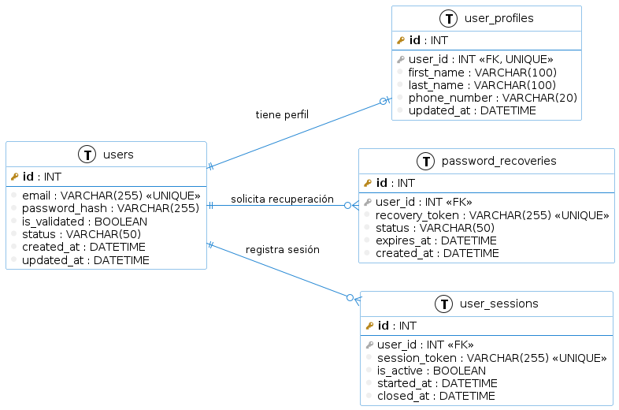

### BC02 — Child Profile & Care Network Management

Este Bounded Context fusiona las responsabilidades de **Child Profile Management** y **Care Network Management**.

- **Children:** Gestiona la información principal del niño, incluyendo sus datos personales y la referencia al padre o tutor responsable.
- **Clinical_profiles:** Almacena las características clínicas y conductuales del niño, como necesidades especiales, detonantes y reguladores.
- **Care_networks:** Representa la red de cuidado asociada al niño, permitiendo identificar a las personas que participan en su acompañamiento.
- **Care_network_invitations:** Administra las invitaciones enviadas a nuevos integrantes de la red, incluyendo el estado, token de validación y fecha de expiración.
- **Care_network_members:** Registra los cuidadores incorporados a cada red de cuidado, sus roles, permisos y estado de participación.
- **Caregiver_authorizations:** Controla las autorizaciones otorgadas a los integrantes para consultar información del niño, permitiendo activar o revocar sus accesos.

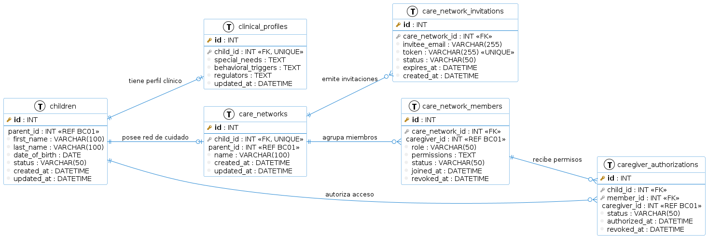

### BC03 — Crisis Alert Management

Este Bounded Context está dedicado exclusivamente a la activación, notificación y seguimiento operativo de alertas de crisis. La administración de la red de cuidado corresponde al BC02.

- **Crisis_alerts:** Registra las alertas activadas por cuidadores autorizados, asociándolas con el niño, el usuario que realizó la activación, su estado y fecha de creación. Permite representar los estados de alerta activa, en atención y finalizada.
- **Alert_notifications:** Gestiona las notificaciones generadas a partir de una alerta. Registra el destinatario autorizado, canal, estado del envío y respuesta del proveedor de notificaciones.
- **Alert_status_transitions:** Almacena los cambios de estado realizados sobre una alerta, identificando el estado anterior, el nuevo estado, el usuario responsable y la fecha de modificación.

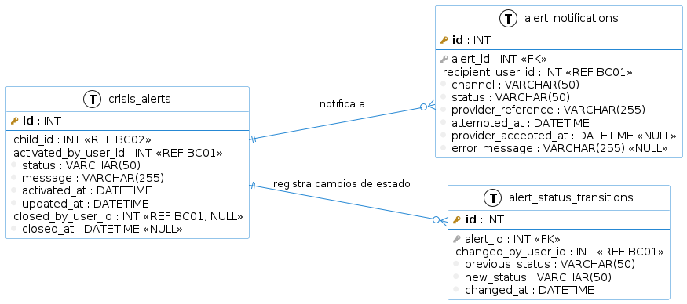

### BC04 — Clinical Guidance & Routine Management

Este Bounded Context fusiona las capacidades de **Routine & Activity Management** y **Clinical Guidance Management**, permitiendo administrar las rutinas del niño y las orientaciones proporcionadas por profesionales autorizados.

- **Routines:** Centraliza la creación, eliminación, duplicación y visualización de las rutinas asociadas al niño. Incluye `original_routine_id` para conservar la trazabilidad de las rutinas duplicadas.
- **Routine_activities:** Administra las actividades que conforman una rutina, gestionando su orden, duración, estado y configuración de alertas y temporizadores de transición.
- **Visual_supports:** Gestiona los apoyos visuales y pictogramas asociados a las actividades, almacenando sus URL y formatos.
- **Patient_assignments:** Registra la vinculación profesional entre un psicólogo y un niño. Permite verificar que exista una asignación activa antes de registrar o modificar pautas clínicas.
- **Clinical_guidelines:** Almacena las indicaciones y recomendaciones clínicas redactadas por los profesionales autorizados, permitiendo su creación, consulta y actualización.
- **Practical_guides:** Administra un repositorio de guías prácticas organizadas por categorías, ofreciendo estrategias de acompañamiento que los cuidadores pueden consultar.

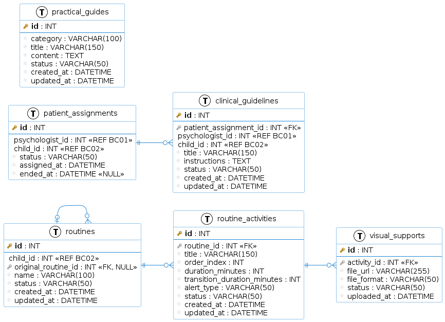

### BC05 — Observation & Crisis History Management

Este Bounded Context se encarga del registro, consulta y seguimiento histórico de observaciones e incidentes de crisis relacionados con el niño.

- **Observations:** Registra las observaciones realizadas por cuidadores autorizados. Contiene la referencia al niño, autor, descripción, fecha y tipo de evento. Permite clasificar las crisis según su intensidad: leve, moderada o severa.
- **Observation_evidences:** Gestiona los archivos adjuntos utilizados como evidencia de una observación, como fotografías u otros apoyos visuales.
- **Psychologist_comments:** Permite a psicólogos autorizados registrar comentarios y retroalimentación sobre las observaciones, facilitando el seguimiento del niño.

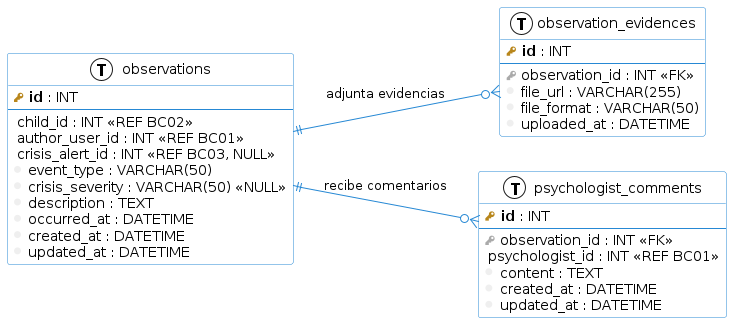

## Capítulo V: Product Implementation, Validation & Deployment

### 5.1 Software Configuration Management

#### 5.1.1 Software Development Environment Configuration

> _Pendiente — completar en `feature/software-configuration-management` (urgente para AV1)._

#### 5.1.2 Source Code Management

> _Pendiente — agregar URLs de los 4 repositorios, explicación de GitFlow, convenciones de branches y Conventional Commits. Completar en `feature/software-configuration-management` (urgente para AV1)._

#### 5.1.3 Source Code Style Guide & Coding Conventions

> _Pendiente — completar en `feature/software-configuration-management`._

#### 5.1.4 Software Deployment Configuration

> _Pendiente — completar en `feature/software-configuration-management`._

### 5.2 Landing Page, Services & Applications Implementation

#### 5.2.1 Sprint 1 (AV1)

##### 5.2.1.1 Sprint Planning 1
> _Pendiente._
##### 5.2.1.2 Aspect Leaders and Collaborators
> _Pendiente._
##### 5.2.1.3 Sprint Backlog 1
> _Pendiente._
##### 5.2.1.4 Development Evidence for Sprint Review
> _Pendiente._
##### 5.2.1.5 Execution Evidence for Sprint Review
> _Pendiente._
##### 5.2.1.6 Services Documentation Evidence for Sprint Review
> _Pendiente._
##### 5.2.1.7 Software Deployment Evidence for Sprint Review
> _Pendiente._
##### 5.2.1.8 Team Collaboration Insights during Sprint
> _Pendiente._

#### 5.2.1 Sprint 1 (AV1)

##### 5.2.2.1.Sprint Planning 2.
##### 5.2.2.2. Aspect Leaders and Collaborators.
##### 5.2.2.3.Sprint Backlog 2.
##### 5.2.2.4.Development Evidence for Sprint Review.
##### 5.2.2.5.Execution Evidence for Sprint Review.
##### 5.2.2.6.Services Documentation Evidence for Sprint Review.
##### 5.2.2.7.Software Deployment Evidence for Sprint Review.
##### 5.2.2.8.Team Collaboration Insights during Sprint.

**BC06 — Observation & Crisis Management**

Durante el Sprint 2 se implementaron y probaron los servicios del bounded context Observation & Crisis Management, utilizando Angular para el frontend y json-server como API REST simulada.

Se realizaron solicitudes HTTP GET y POST para verificar el registro y la consulta de observaciones, los comentarios de psicólogos y los enlaces de evidencias asociados a cada observación.

Las siguientes capturas muestran las pruebas realizadas mediante las herramientas de desarrollo del navegador.

**Evidencia 1. Consulta de evidencias de observación**

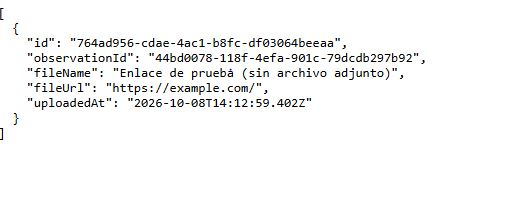

*Figura 1. Consulta de evidencias asociadas a una observación mediante GET /observationEvidences.*

Se muestra la respuesta de la API simulada, incluyendo el identificador de la evidencia, nombre, enlace URL y fecha de registro.

**Evidencia 2. Registro de observaciones mediante HTTP POST**

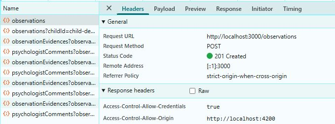

*Figura 2. Solicitud POST /observations.*

La respuesta HTTP 201 Created confirma que json-server creó correctamente una nueva observación.

**Evidencia 3. Datos enviados en la solicitud POST**

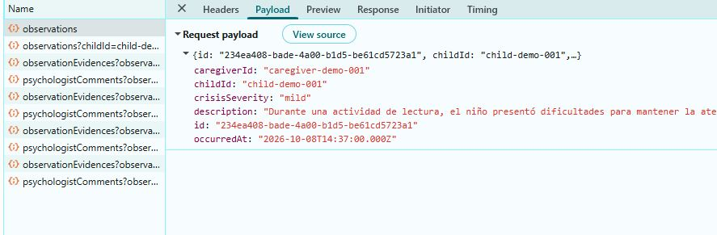

*Figura 3. Cuerpo JSON enviado para registrar una observación.*

La solicitud contiene los identificadores del niño y del cuidador, la descripción, fecha de ocurrencia e intensidad de crisis.

**Evidencia 4. Evidencia adicional del servicio**

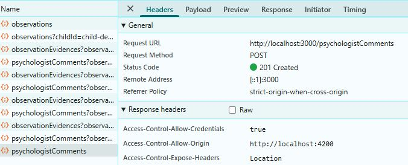

*Figura 4. Evidencia de ejecución de los servicios del BC06.*

**Evidencia 5. Evidencia complementaria**

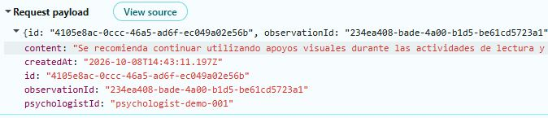

*Figura 5. Evidencia complementaria de las pruebas HTTP del BC06.*

**Evidencia 6. Verificación de servicios**

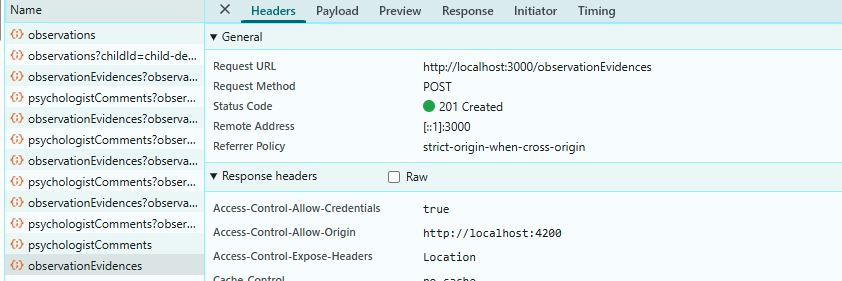

*Figura 6. Verificación de las operaciones del BC06 mediante la API simulada.*

**Resultado de las pruebas**

Las pruebas realizadas permitieron verificar la comunicación HTTP entre Angular y json-server, así como las operaciones de consulta y registro de información correspondientes al BC06.

Estas evidencias corresponden a un entorno local de desarrollo. No representan pruebas de un backend Spring Boot desplegado ni de autenticación real de usuarios.

## Conclusiones

## Bibliografía

#### Angular. (s. f.). Angular documentation. [https://angular.dev/](https://angular.dev/)

#### GitHub. (s. f.). GitHub Docs. [https://docs.github.com/](https://docs.github.com/)

#### GitHub. (s. f.). About GitHub Pages. [https://docs.github.com/en/pages/getting-started-with-github-pages/what-is-github-pages](https://docs.github.com/en/pages/getting-started-with-github-pages/what-is-github-pages)

#### JSON Server. (s. f.). JSON Server [Repositorio de software]. GitHub. [https://github.com/typicode/json-server](https://github.com/typicode/json-server)

#### Mozilla. (s. f.). HTTP request methods. MDN Web Docs. [https://developer.mozilla.org/en-US/docs/Web/HTTP/Reference/Methods](https://developer.mozilla.org/en-US/docs/Web/HTTP/Reference/Methods)

#### Open-SourceHelper. (2026). Frontend-Application [Repositorio de código fuente]. GitHub. [https://github.com/Open-SourceHelper/Frontend-Application](https://github.com/Open-SourceHelper/Frontend-Application)

#### Open-SourceHelper. (2026). Landing-Page [Repositorio de código fuente]. GitHub. [https://github.com/Open-SourceHelper/Landing-Page](https://github.com/Open-SourceHelper/Landing-Page)

#### Open-SourceHelper. (2026). Report [Repositorio de documentación]. GitHub. [https://github.com/Open-SourceHelper/Report](https://github.com/Open-SourceHelper/Report)

## Anexos

### Anexo A. Videos de Exposiciones

| Entrega | Título del video | Enlace |
|---|---|---|
| AV1 | `[Pendiente]` | `[Pendiente]` |

